# simplicio-videos

**A free, self-hosted content conveyor built on a deterministic video engine.** Give it a website; it understands the brand, picks hooks, makes videos with the engine below, waits for your approval, posts through Real Oficial, reads the results and starts the next cycle. A themed 2D factory shows every step. Everything except video generation is a plugin, the default path spends **zero LLM tokens**, and paid AI media is optional per item.

> **Status.** Available today: the deterministic video engine and its CLI (`simplicio-video`). In progress: the conveyor, plugin system, panel and themes, shipping as the **MVP v0.4.0** (one theme, videos working, posting through Real Oficial). Anything below marked *MVP* or *later* is a plan, tracked in [epic #14](https://github.com/simpletibr/simplicio-videos/issues/14) and specified in [`docs/factory/`](docs/factory/README.md).

**Free to use, not open source.** The product is free under a proprietary license and is funded by sponsor placements on the website; the MVP contains no ads and the panel will never run third-party ad scripts ([business model](docs/factory/monetization.md)). The plan for the sponsor placements is a set of rentable spaces inside the factory scenery, priced by the hour per world, country or region from supply and demand ([ad spaces](docs/factory/ads.md)). It is built on open-source tools, each used under its own license ([matrix](docs/factory/monetization.md#tool-license-matrix-checked-2026-10-06-against-each-repository)).

## The conveyor

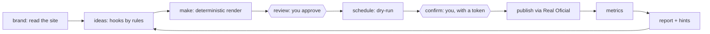

It never ends: after publishing, results come back, a report and hints shape the next ideas, and the loop starts again. Two gates are always yours: **approving a video** and **confirming a post**. Nothing publishes, spends credits or buys anything by itself.

### What a first run looks like (MVP)

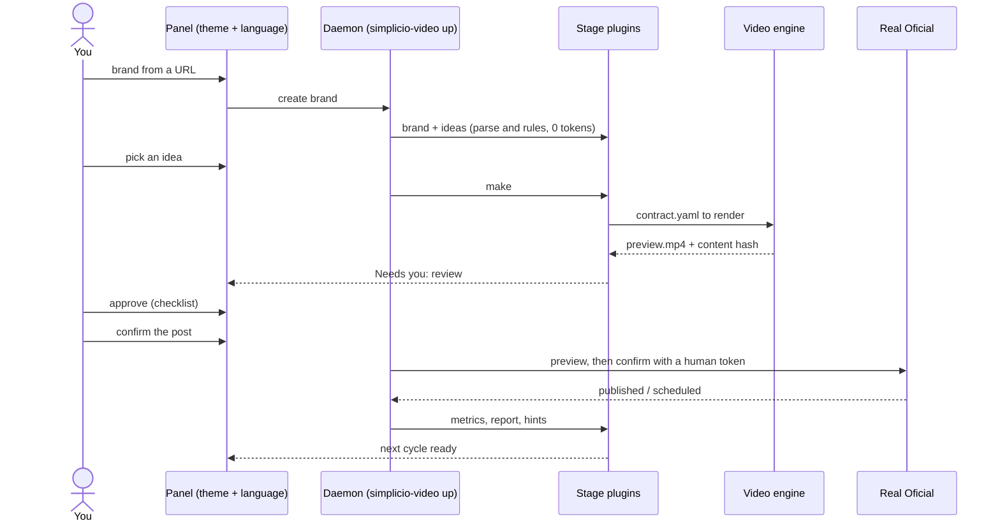

## Token economy

| Where an LLM would be tempting | What we do instead |
|---|---|
| Reading a website | Parse HTML; every fact keeps its source |
| Writing hooks | Templates filled from brand facts, ranked by past results; you or an external agent can add ideas |
| Composing the video | Deterministic `Draft → contract.yaml` over existing templates and motion patterns |
| Render, captions, music, voice | The engine: HyperFrames, ffmpeg, Kokoro, video-use |
| Translating the panel and the characters' bubbles | Message catalogs in 15 languages, free |
| Reports and next ideas | Rules over metrics, with minimum sample sizes |
| Captions, translation, dubbing, covers | Delegated to Real Oficial's own AI |

An LLM is an optional plugin for judgment only, always behind a token budget; a test fails the default loop if it calls a model. External agents (Claude, GPT, Hermes Agent, OpenClaw) can drive the conveyor over MCP with their own tokens, using coarse commands and `loop wait` instead of polling.

### Per item: free by default, paid only if chosen

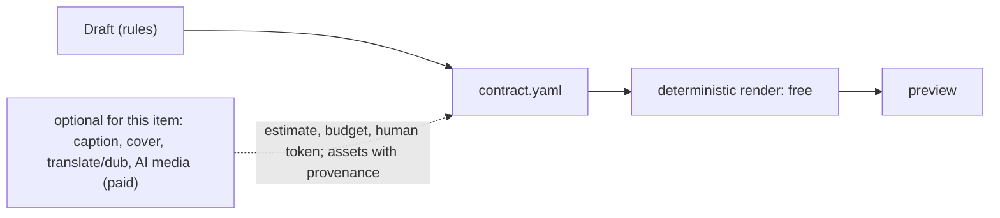

## Plugins: everything but the video engine

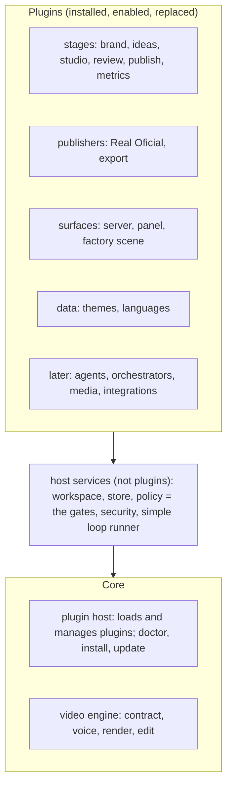

The host services are deliberately **not** plugins: they enforce the human gates, so no plugin can remove them. Plugins declare their permissions in a manifest, are enabled per workspace, and are tested with shared contract suites. Spec: [plugins.md](docs/factory/plugins.md).

```
simplicio-video plugin list | info | install | enable | disable | update | uninstall | doctor
simplicio-video plugin new <kind> <id>     # scaffolds a plugin with a failing contract test first
simplicio-video plugin check <path>        # runs the contract suite for its kind
```

## Themes and languages

A **theme** changes how the factory looks and speaks, never how it behaves: a 3D scene (sky, ground, props), a belt, stations and one character per stage. It is data only (JSON plus SVG or PNG sprites; no code runs), so anyone can make one. The interface keeps one system color, light blue, under every theme. Bubbles are templates per event kind in the language catalogs, so the characters "talk" in every language at zero token cost.

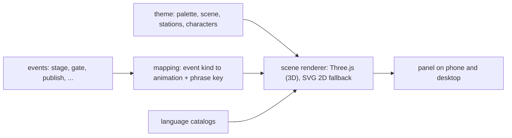

```
themes/<id>/
  theme.json            # scene (sky, ground, props), characters, palette, license
  assets/               # SVG or PNG sprites, original art only
  locales/<lang>.json   # names and bubble phrases for this theme
simplicio-video theme new <id> | validate <dir> | install <path|url> | use <id>
```

| | Plan |
|---|---|
| **MVP** | one theme (`br`, original art) in `pt-BR` and `en`, in 3D with day and night |
| **Languages (proposed 15, one country theme each)** | pt-BR, en-US, es-MX, zh-CN, ru-RU, fr-FR, de-DE, it-IT, ja-JP, ko-KR, hi-IN, ar-SA (right-to-left), tr-TR, id-ID, pl-PL |
| **Genre themes** | original dragons and fantasy realms, a courtyard sitcom, tiny factory mascots, and more |
| **Your own theme** | a folder dropped in your workspace; validated for safe SVG, complete translations and a license |

**We ship only original art.** Protected franchises (Minions, Chaves, Game of Thrones and similar) cannot be committed or distributed here, even as "inspired by"; a private theme is the user's own responsibility. Country themes use positive cultural motifs and get a native review. Details: [themes.md](docs/factory/themes.md).

## What the panel looks like

The factory is a ring of seven houses (a workshop, an idea shop, a factory, a garage, a market, an observatory and a barn, one per stage), far apart, each inside its own painted world, with a round belt in front. You see one house at a time, like a cutaway with no front wall, a robot walking from room to room; arrows or a swipe take you to the next house, and **See the world** lifts you over the whole ring, look-only. Scenery moves, makes sound and answers taps, and each house has rentable ad spaces. The numbers float over it: KPI cards, the station you picked, a stepper that follows one video, the queue, and callouts on the houses that need you. These are shots of a **clickable prototype with sample data** (the product is not built yet). [Open it and read how](docs/factory/prototype/README.md).


| Night | Phone |
|---|---|
| 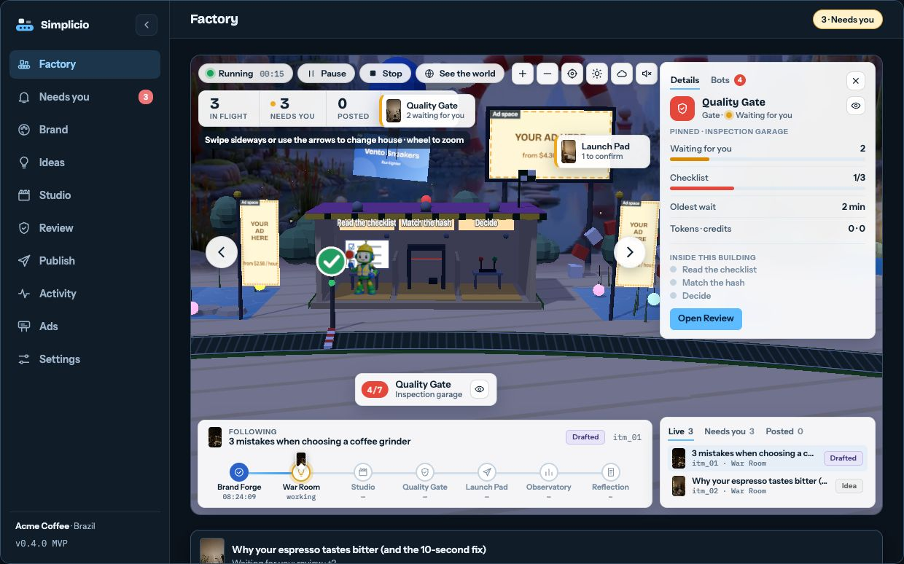 | 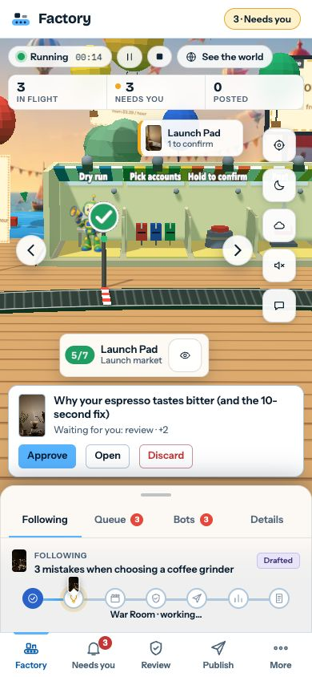 |

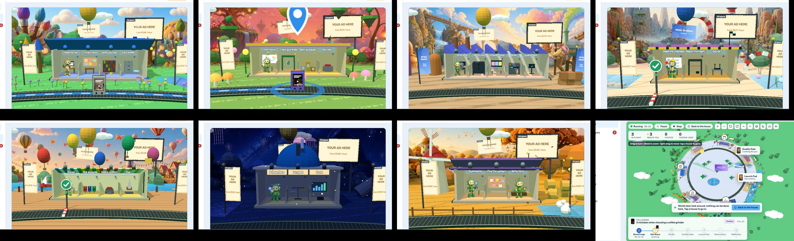

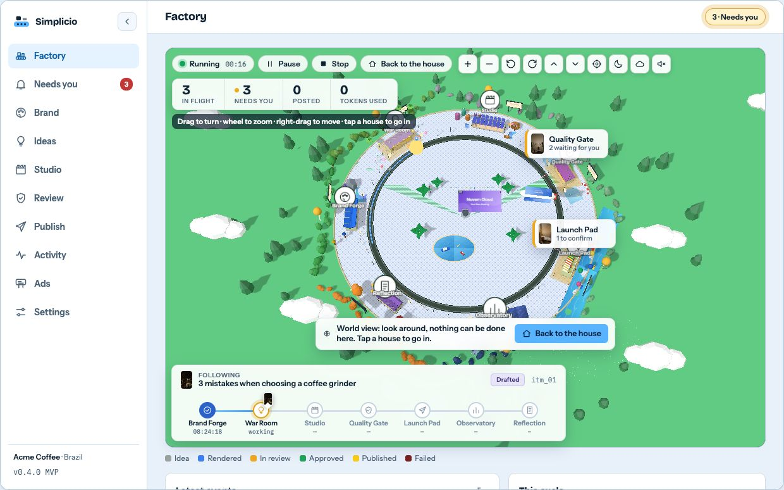

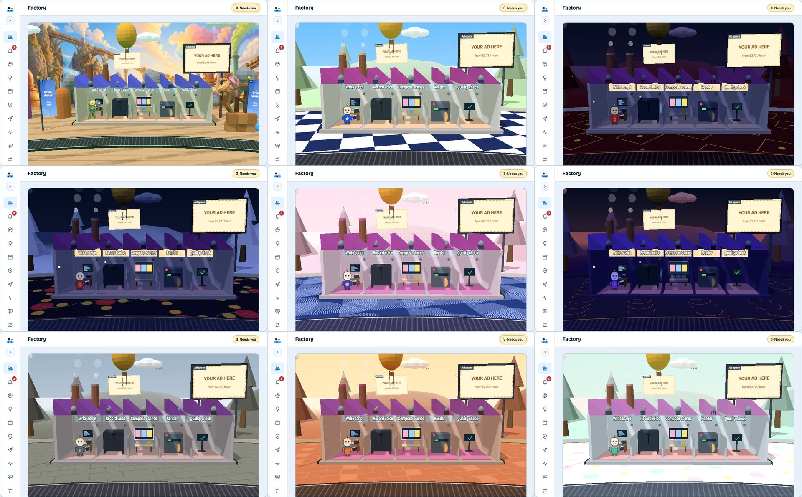

## Commands

Every command has `--help` with a description and examples, and the generated reference (`docs/reference/`, MVP) is built from the same data. *today* = available now, *MVP* = v0.4.0, *later* = after the MVP.

| Group | Commands | When |
|---|---|---|
| Video engine | `init` `validate` `voice` `render` `publish` `run` `list` | today |
| Editing and tools | `edit` `opencut` `montage` `clone` `ugc` | today |
| Providers | `realoficial config`, `mcp` | today |
| Sales operations | `prospect` `venda` | today |
| Health and lifecycle | `doctor` `install` `update` `setup` | MVP |
| Plugins and themes | `plugin …` `theme …` | MVP |
| Workspace | `workspace` `clean` `usage` `policy` | MVP |
| The conveyor | `brand` `ideas` `make` `review` `schedule` `metrics` `loop` `demo` `up` | MVP |
| Depth | `plan` `library` `cast` `compliance` `learn` `eval` `agent` `game` | later |

```bash
simplicio-video doctor          # checks Python, Node, ffmpeg, disk, ports, plugins, workspace; prints the exact fix for each problem
simplicio-video install         # idempotent install of the environment (what install.sh calls)
simplicio-video update          # fetch, show the changelog, fast-forward, reinstall, rebuild the panel, run doctor, print how to roll back
simplicio-video up              # one local daemon: panel, API and loop scheduler on 127.0.0.1 (Tailscale or VPN optional)
simplicio-video loop wait --until gate    # block until you are needed (no polling, no tokens)
```

## Quick start

**Today (video engine):**

```bash
gh repo clone simpletibr/simplicio-videos && cd simplicio-videos
pip install -e .                      # `simplicio-video` command (Python >= 3.10); render needs Node >= 22 + ffmpeg
simplicio-video --help
cd clients/lothus-odontologia/video-01-dia-das-criancas
simplicio-video validate contract.yaml
simplicio-video voice contract.yaml   # provisional local voice (Kokoro) or --provider file|gemini|voxcpm|openvoice|voicestudio
simplicio-video render contract.yaml  # out/lothus-dia-criancas.mp4 + render.manifest.json
```

**v0.4.0 (MVP), planned:**

```bash
git clone <repo> && cd simplicio-videos && ./install.sh
simplicio-video doctor && simplicio-video setup
simplicio-video up                    # open the panel, choose the theme and language
simplicio-video demo                  # offline walkthrough with a fictional brand, no keys
```

## Apps we build on

Optional tools are never vendored: you install them, we invoke them. Licenses were checked against each repository on 2026-10-06.

### Video

| App | License | Role | Command | Doc |
|---|---|---|---|---|
| [HyperFrames](https://github.com/heygen-com/hyperframes) | Apache-2.0 | Deterministic HTML/GSAP → MP4 render (core) | `render` | [motion](motion/README.md) |
| [video-use](https://github.com/browser-use/video-use) | MIT | EDL editing of any MP4 | `edit setup\|transcribe\|pack\|render\|verify` | [tools/video-use](tools/video-use/README.md) |
| [OpenCut](https://github.com/OpenCut-app/OpenCut) | MIT | Editor for manual finishing | `opencut clone\|dev\|where` | [recursos](docs/recursos.md) |
| [OpenMontage](https://github.com/calesthio/OpenMontage) | **AGPL-3.0** | Agentic production pipelines, run as a separate program from the user's own checkout | `montage …` | [recursos](docs/recursos.md) |
| [Hypit AI](https://github.com/hypit-ai/hypit) | modified Apache-2.0 (no commercial redistribution, no multi-tenant use) | Clone viral videos; the user's own install only | `clone …` | [recursos](docs/recursos.md) |

### Audio

| App | License | Role | Provider | Doc |
|---|---|---|---|---|
| Gemini TTS | cloud API | Default narration | `gemini` or `file` | [gemini](voices/gemini.md) |
| Kokoro | Apache-2.0 model, MIT `kokoro-onnx` | Free local draft voice (pt-BR ok) | `local` | [local](voices/local.md) |
| [VoxCPM2](https://github.com/OpenBMB/VoxCPM) | Apache-2.0 | Voice design or cloning (30 languages, 48 kHz) | `voxcpm` | [voxcpm](voices/voxcpm.md) |
| [OpenVoice V2](https://github.com/myshell-ai/OpenVoice) | MIT | Voice cloning on a Kokoro base | `openvoice` | [openvoice](voices/openvoice.md) |
| [VoiceStudio](https://github.com/debpalash/VoiceStudio) | **AGPL-3.0** | Cloned voice profiles over its local API; HTTP only | `voicestudio` | [voicestudio](voices/voicestudio.md) |

All voice providers share one pipeline: raw take kept per provider → silence trim → contract ffmpeg chain → 48 kHz mono → `timing.lock.json`. A take longer than its slot is an error; audio is **never time-stretched**. Cloned voices need the speaker's written authorization ([voices](voices/README.md)).

## Integrations

Real Oficial is the default provider (publishing, scheduling, analytics; captions optional) and the only integration in the MVP. The rest are plugins planned after it, each starting with a spike; facts were checked on 2026-10-06. Full catalog and findings: [integrations.md](docs/factory/integrations.md).

| Category | Services | Plan |
|---|---|---|
| Publishing, scheduling, analytics, media | **Real Oficial** (MCP, OAuth) | MVP; media later |
| Social and ads | Meta, Google (YouTube, GA4, Ads), TikTok | M4 (platforms gate public posting behind audits; Real Oficial holds them) |
| Payments | Stripe, PayPal, AbacatePay | M4 (REST and webhooks) |
| Checkout | CartPanda, Kirvano | M4 (after capturing a live payload) |
| CRM | HubSpot | M4 |
| Attribution | RedTrack (Utmify skipped for v1) | M4 |
| Analytics and market intelligence | Microsoft Clarity, Google Analytics, Semrush, Similarweb | M4 |
| VSL player | Vturb | M4 |
| Agent runtimes (external clients over MCP) | Hermes Agent, OpenClaw | M4 recipes |
| Paid AI media (optional per item) | TopView, Higgsfield, Real Oficial media | M3/M4 |

## Roadmap

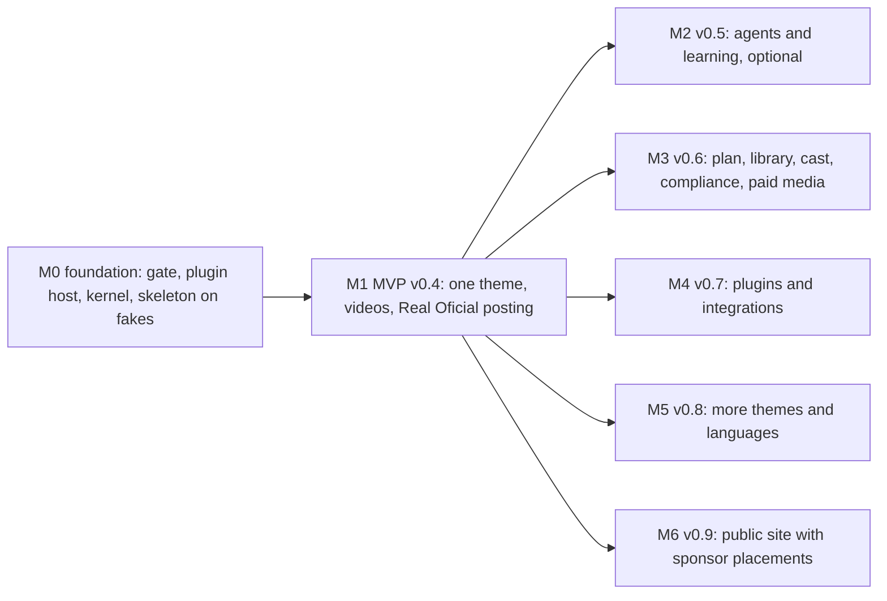

Every release has every shipped stage working end to end, the loop test green with each stage real, `doctor` green on a fresh clone, and an honest list of known limits. Plan, order and open decisions: [roadmap](docs/factory/roadmap.md), [design review](docs/factory/design-review.md).

## How we build it

Test first (contract suites, flow tests, an end-to-end loop test that runs on fakes from day one), one directory per issue so many can run in parallel, a local gate (`make check`, no GitHub Actions) and a serialized landing script, independent review before merge. Start at [parallel-work.md](docs/factory/parallel-work.md) and [`AGENTS.md`](AGENTS.md).

## Repository map

```
simplicio-videos/
├── src/simplicio_video/    # core: video engine, registry, plugin host, core commands
├── src/simplicio_factory/  # (MVP) SDK, host services, first-party plugins
├── themes/  locales/       # (MVP) data-only plugins
├── web/                    # (MVP) panel, factory scene, i18n
├── schema/ schemas/        # engine contract and factory JSON Schemas
├── templates/ motion/ voices/ tools/ ugc/ intake/ colab/ skills/
├── docs/factory/           # the specification (start here)
├── docs/                   # ADRs, pipeline, setup, research; index in docs/README.md
├── clients/                # example videos only
├── plugin.json             # how this package presents itself to Simplicio Runtime (generated from the registry)
└── AGENTS.md / CLAUDE.md   # rules and flows for agents
```

`plugin.json` is the manifest for **Simplicio Runtime**; the plugins described above extend `simplicio-video` itself.

## Example videos

Rendered examples only; client facts are not kept in the repo.

| Example | Folder | What |
|---|---|---|
| Repair shop / games, 9:16 Reels, 20 s | [video-01](clients/wjr-informatica-games/video-01/) · [preview](clients/wjr-informatica-games/video-01/preview/) | pt-BR narration (Gemini TTS) + own music and SFX; reference for template `assistencia-tecnica-games` |
| Cutdown 11.5 s of the above | [video-02-videouse](clients/wjr-informatica-games/video-02-videouse/) · [preview](clients/wjr-informatica-games/video-02-videouse/preview/) | built with [video-use](docs/video-use-integracao.md) (EDL + HyperFrames overlay) |
| Dentistry, 9:16 post, 15 s | [video-01-dia-das-criancas](clients/lothus-odontologia/video-01-dia-das-criancas/) · [preview](clients/lothus-odontologia/video-01-dia-das-criancas/preview/) | reference for template `saude-odontologia` |

## Catalogs and documentation

| What | Where |
|---|---|
| Factory specification | [docs/factory/](docs/factory/README.md): [roadmap](docs/factory/roadmap.md), [plugins](docs/factory/plugins.md), [contracts](docs/factory/contracts.md), [themes](docs/factory/themes.md), [integrations](docs/factory/integrations.md), [business model](docs/factory/monetization.md), [risks and policies](docs/factory/risks-and-policies.md), [ownership](docs/factory/ownership.yaml) |
| Motion patterns (46) | [motion/README.md](motion/README.md) |
| Sector templates (2 ready, 6 skeleton) | [templates/README.md](templates/README.md) |
| Voices | [voices/README.md](voices/README.md) |
| Intake | [intake/README.md](intake/README.md) |
| Real Oficial MCP map | [docs/realoficial.md](docs/realoficial.md) |
| Older decisions (Portuguese) | [ADR-0001](docs/decisoes/ADR-0001-visao-plugin.md) … [ADR-0004](docs/decisoes/ADR-0004-ugc-generativo.md); index in [docs/README.md](docs/README.md) |

Tests today: `PYTHONPATH=src python -m pytest`. Library previews: `bash motion/scripts/preview.sh && node motion/scripts/catalog.mjs`.

> Language policy: new documentation, CLI help and code comments are English. Older docs under `docs/`, `intake/`, `templates/` and client folders are still Portuguese and are translated as they are touched.

## License

Proprietary, free to use. All rights reserved; a full EULA is part of [#70](https://github.com/simpletibr/simplicio-videos/issues/70). Third-party tools keep their own licenses ([matrix](docs/factory/monetization.md#tool-license-matrix-checked-2026-10-06-against-each-repository)).
