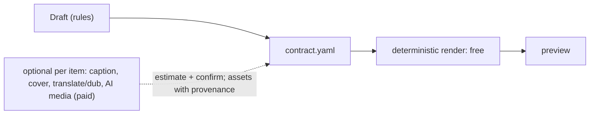
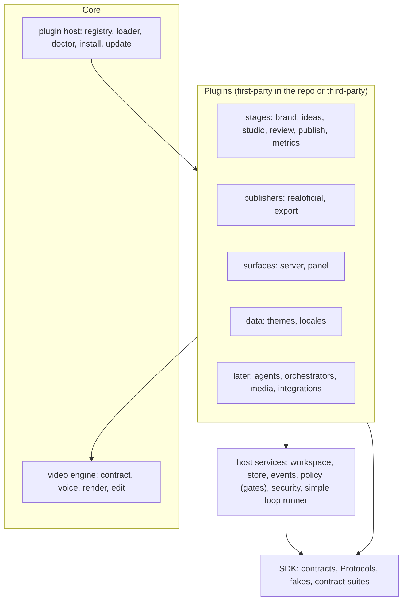
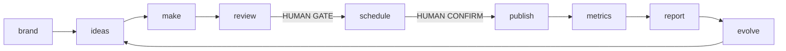

# Factory: the content conveyor (architecture)

Status: **specification**. Nothing here is implemented yet; each issue in [parallel-work.md](parallel-work.md) implements one part against these contracts. If code and spec disagree, fix the spec in the same PR.

Reading order: [roadmap.md](roadmap.md) (what ships when) → [monetization.md](monetization.md) (free, proprietary, sponsored) → [design-review.md](design-review.md) (why) → this file → [plugins.md](plugins.md) → [contracts.md](contracts.md) → [themes.md](themes.md) → [integrations.md](integrations.md) → [risks-and-policies.md](risks-and-policies.md) → [parallel-work.md](parallel-work.md) → your issue.

## What we are building

A self-hosted, local-first **conveyor** that turns a website into a never-ending content loop: understand the brand, pick hooks, make videos with the deterministic engine we already have, get a human to approve, schedule and post through Real Oficial, measure, and start the next cycle with what was learned. A panel shows the conveyor as a themed 2D factory with one character per stage. One developer clones the repo, installs, runs one daemon, and everything stays on their machine.

**Everything is a plugin except the core, and the core is video generation** ([plugins.md](plugins.md)).

## Non-goals

- Not a SaaS: single tenant, single host, no billing, no multi-user accounts. The product is **free to use and not open source**; revenue is advertising on the site ([monetization.md](monetization.md)). We build on open-source tools, we do not publish ours.
- No new way of generating videos: the engine is enough. Paid generators are optional steps of one item.
- No account warming or managed accounts, no scraping of social platforms for trends, no browser automation of posting.
- No autonomy beyond the policy; the default never publishes by itself.
- No vendor lock-in: any LLM (when one is used at all), any MCP/OpenAPI/function-calling client, any publisher behind a Protocol.

## Principles

1. **Spend the fewest tokens possible** ([token economy](#token-economy)): the default path uses zero LLM tokens.
2. **Deterministic core.** Decisions are frozen in files (contract, draft, EDL); rendering is pure ffmpeg/HyperFrames. Same input, same bytes.
3. **Everything is a plugin**, except the video engine and the host that loads plugins and enforces the human gates.
4. **Human gates are enforced by the server**, not by an agent's good behavior.
5. **Walking skeleton and test first.** The loop runs end to end on fakes from day one; each real stage replaces a stub without breaking the flow test.
6. **One-way layers**, enforced by an architecture test.
7. **Always green.** `main` only moves through the local gate (`make check`); no GitHub Actions (org policy). Every release has every shipped stage working.
8. **Small and boring.** Mature libraries, stdlib where enough (SQLite, polling), no brokers, no migrations before 1.0, no abstraction before its first user.
9. **Honest about the world.** Nothing here claims platform rules or provider capabilities from memory; rules are dated data with sources.

## Token economy

| Where an LLM would be tempting | What we do instead |
|---|---|
| Reading a website | Parse HTML (OpenGraph, JSON-LD, meta, CSS); facts are extracted, each with its source |
| Generating hooks and scripts | Hook templates filled from brand facts and ranked by past results; a person or an external agent can add ideas |
| Composing the video | `Draft → contract.yaml` is deterministic composition over existing templates and motion patterns |
| Rendering, trimming, captions, music | The engine: HyperFrames, ffmpeg, Kokoro, video-use |
| Translating the UI and the "agents talking" bubbles | Locale catalogs and bubble templates per event kind, in 15 languages, at zero cost |
| Reports and next-cycle hints | Rules over metrics (top hooks, outliers with minimum sample sizes) |
| Captions, translations, dubbing, covers | Delegated to Real Oficial, which runs its own AI (its cost is credits, not our tokens) |
| Routing, polling, formatting | Plain code |

Rules:

1. An LLM is a plugin (`llm`, `agent-runtime`) used only for judgment that rules cannot do (fresh hooks, critique). It is never used for parsing, formatting, routing, translating UI text or polling.
2. When a model is called: the smallest sufficient one (local first), a prompt built from `brand.facts` (not pages), structured output against a schema, one retry, cache by input hash, many items per call, **no multi-agent debates unless a person asks**.
3. Every call passes through the budget governor with token and USD caps; usage is recorded per stage and per item (`simplicio-video usage`).
4. **Tests enforce it:** a `NoLLM` guard makes the default loop fail if any model is called; LLM-enabled stages have a token budget asserted against recorded cassettes.
5. External agents (Claude, GPT, Hermes Agent, OpenClaw, ...) driving us over MCP spend *their* tokens, so our tools are **coarse** (one call runs a stage), return ids and paths rather than blobs, offer `loop wait` instead of polling, and support `--json --fields` and an events digest.

### Per-item production route

Each content item picks how it is produced. **Deterministic is the default and costs nothing.** Optional steps are chosen per item; anything paid needs an estimate, a budget reservation and a confirm token.



AI outputs enter the contract as assets with provenance and a hash, so the render stays deterministic.

## Architecture



| Layer | Package(s) | May import | Notes |
|---|---|---|---|
| L0 core | `simplicio_video` (engine, `registry`, `plugins`, `commands`) | stdlib, pyyaml, jsonschema | Installs and renders with no factory and no plugin |
| L1 SDK | `simplicio_factory.contracts`, `.testkit` | pydantic | Pure: no I/O, no network. Models, Protocols, fakes, contract suites |
| L2 host services | `.workspace`, `.store`, `.policy`, `.security`, `.runner` | L1 | Not removable: they enforce the gates |
| L3 plugins | `simplicio_factory.plugins.<id>`, third-party packages | L1, L2 interfaces, L0 public API | Never import another plugin; look services up through the host |
| L4 web | `web/` (TypeScript) | the server's OpenAPI and event stream | Types generated from the JSON Schemas |

`tests/factory/test_architecture.py` (AST based) fails the gate on a violation, including: a plugin importing another plugin, or an LLM, agent, orchestration or tracing framework imported outside its own plugin.

## The loop



| Stage (code) | Station (panel) | Character | In the MVP | Gate |
|---|---|---|---|---|
| brand | Brand Forge | Brander | yes | confirm profile on first run |
| ideas | War Room | Ideator | yes, rules | no |
| make | Studio | Director | yes | no |
| review | Quality Gate | Gatekeeper | yes | **human** (below autonomy L3) |
| schedule / publish | Launch Pad | Poster | yes | **human confirm token** |
| metrics | Observatory | Analyst | yes | no |
| report / evolve | Reflection Chamber, Evolution Lab | Reflector, Evolver | yes, rules | no |
| market, cast, plan, library, compliance, learn | Radar Tower, Casting Booth, ... | Scout, Caster, ... | later | per plugin |

Item states and transitions: [contracts.md](contracts.md#contentitem-state-machine). A stage whose plugin is absent is reported as `stage.skipped` and the loop continues.

## Process model

`simplicio-video up` (the `server` plugin) starts **one daemon**: HTTP server + job worker + loop scheduler. A lock file in the workspace refuses a second daemon. CLI commands and `simplicio-video mcp` (stdio) are short-lived clients acting on the workspace through the same Python functions; long work is enqueued as a job and run by the daemon, or inline with `--inline` when no daemon is running. Nothing needs a network except the sites a person asks us to read and the providers they configure.

## Where things live

```
src/simplicio_video/           # L0: engine, registry, plugin host, core commands
src/simplicio_factory/         # L1-L3: SDK, host services, plugins/<id>/
themes/<id>/  locales/<lang>/  # data-only plugins
web/{shared,app,scene,i18n}/   # L4 npm workspaces
schemas/                       # JSON Schemas (plugin manifest, factory documents), generated or checked in
docs/factory/                  # this specification (normative)
docs/host/<name>.md            # docs of core and host tracks
docs/plugins/<id>.md           # docs of each plugin
docs/decisoes/ADR-00NN-*.md    # decisions (English from ADR-0005 on)
docs/reference/                # generated: CLI, MCP tools, schemas, events, config
mk/*.mk                        # one Makefile fragment per track
<workspace>/                   # runtime data, outside the repo (see contracts.md)
```

## Decisions

| Topic | Decision | Why | Revisit when |
|---|---|---|---|
| Plugin boundary | Core = video engine + plugin host. Host services (store, policy, security, runner) are not plugins | They enforce the gates; a plugin must not be able to remove them | never for gates |
| Packaging | Engine and host registry in `simplicio_video`; SDK, host services and first-party plugins in `simplicio_factory`; heavy dependencies in extras | The engine must install and render with no factory | The factory needs its own release cadence |
| License | Proprietary, free to use. Dependencies must permit proprietary distribution; AGPL tools stay external services | Owner decision, see monetization.md | — |
| State | Artifacts are files in the workspace; coordination is one SQLite database in WAL mode | Files alone cannot give atomic multi-writer coordination; SQLite is stdlib and zero-ops | More than one host writes a workspace |
| Event bus | No broker: events are rows; consumers poll `EventLog.read/wait` | Simplest thing that works for one host | Multi-host |
| Sync Protocols | Synchronous; the server runs them in a threadpool | Engine and CLI are sync | Profiling shows a bottleneck |
| LLM | None in the MVP. Protocol exists; an `llm` plugin (LiteLLM) comes later | Token economy: rules first | A stage proves it needs judgment |
| Orchestration | MVP: a simple sequential runner in the host. Later: LangGraph as an `orchestrator` plugin behind the same `LoopRunner` Protocol | Strangler: the flow test stays green when the runner changes | Spike results |
| Agents | Later, as `agent-runtime` plugins (CrewAI; Hermes Agent and OpenClaw as external clients). Kill criteria in design-review.md | Optional and token-budgeted | Spike results |
| Publishing | `Publisher` Protocol. Default Real Oficial. Always-available `ExportPublisher`. Postiz optional (AGPL: HTTP only) | Works with zero providers; honest about the upload gap | Real Oficial ships upload |
| UI | Preact + TypeScript + Vite SPA; functional pages first; the factory is a 2D **SVG** scene driven by events, behind a renderer interface; Three.js renderer later | A 2D belt with 2D characters does not need WebGL; the interface keeps Three.js a drop-in | Isometric or 3D scenery wanted |
| Themes and locales | Data-only plugins; bubbles are catalog templates | Zero token cost, anyone can make one | — |
| Python | Engine and factory ≥ 3.10; extras for agent frameworks may need 3.10–3.13; install and gate target 3.12 | CrewAI currently requires `<3.14`; this machine runs 3.14 | CrewAI supports 3.14 |
| Gate | No GitHub Actions: `make check` offline + pre-push hook + serialized `scripts/land.sh` | `main` stays green without paid CI | — |
| Compatibility | Pre-1.0: break freely, no migrations; the workspace refuses a schema mismatch with a clear message | Simplest | 1.0 |
| Extension | Every model has `ext` (namespaced) so plugins attach data without a contract change | Removes the main cross-issue blocker | A field proves universal |
