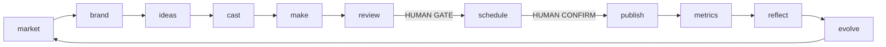

# Factory: the content loop (architecture)

Status: **specification**. Nothing here is implemented yet. Each track in [parallel-work.md](parallel-work.md) implements one part against these contracts. If code and spec disagree, fix the spec in the same PR.

Reading order: [design-review.md](design-review.md) (why) → this file (what) → [contracts.md](contracts.md) (exact shapes) → [risks-and-policies.md](risks-and-policies.md) (rules that are not optional) → [parallel-work.md](parallel-work.md) (how we build it) → your issue.

## What we are building

A self-hosted, local-first engine that turns a website into a **never-ending content loop**: understand the brand, find angles, make videos with the deterministic engine, get a human to approve, schedule, measure, reflect, and start again with what was learned. Agents do the work and report progress; a human approves anything irreversible; a panel (list views first, a gamified Three.js factory on top) shows every step.

One developer clones the repo, installs, runs one daemon, and everything stays on their machine. Real Oficial (MCP) is the default backend for publishing and AI media; everything else is optional.

## Non-goals

- Not a SaaS: single tenant, single host, no billing, no multi-user accounts.
- No account warming or managed accounts (platform terms), no scraping of social platforms for trends, no browser automation of posting.
- No autonomy beyond what the policy allows; the default never publishes by itself.
- No vendor lock-in: any LLM, any MCP/OpenAPI/function-calling client, any publisher behind a Protocol.

## Principles

1. **Deterministic core.** The LLM decides; files freeze the decision (contract, EDL, draft); rendering is pure ffmpeg/HyperFrames. Same input, same bytes.
2. **Human gates are enforced by the server**, not by an agent's good behavior (see [risks-and-policies.md](risks-and-policies.md)).
3. **Walking skeleton first.** The offline demo loop (fake LLM, fake publisher) comes before polish; every part is testable alone with fakes.
4. **One-way layers.** Dependencies point down; an architecture test enforces it.
5. **Always green.** `main` only moves through the local gate (`make check`); no GitHub Actions (org policy).
6. **Small and boring.** Mature libraries, stdlib where enough (SQLite, polling), no brokers, no migrations before 1.0.
7. **Honest about the world.** Nothing here claims platform rules or provider capabilities from memory; rules are dated data with sources.

## Architecture

```mermaid
flowchart TB
  web["web/ - SPA + lazy 3D factory"] --> server
  server["server - REST, SSE, MCP/HTTP, A2A mounts"] --> graph
  server --> stages
  graph["graph - LangGraph"] --> stages
  graph --> agents
  agents["agents - CrewAI adapter, roles, prompts"] --> core
  stages["stages - brand, library, cast, studio, plan, review, publish, insights, learn, compliance, media"] --> core
  core["core - workspace, store, policy, security"] --> kernel
  kernel["kernel - contracts, protocols, testkit"]
  stages --> engine["simplicio_video - deterministic engine (unchanged API)"]
```

| Layer | Package(s) under `src/` | May import | Notes |
|---|---|---|---|
| L0 engine | `simplicio_video` | stdlib, pyyaml, jsonschema | Installs and renders with no factory and no agent stack |
| L1 kernel | `simplicio_factory.contracts`, `.testkit`, `.app` (dataclass) | pydantic | Pure: no I/O, no network. Protocols + in-memory fakes |
| L2 core | `.workspace`, `.store`, `.policy`, `.security`, `.llm` | L1 | Real implementations of the Protocols |
| L3 stages | `.brand`, `.library`, `.cast`, `.studio`, `.plan`, `.review`, `.publish`, `.insights`, `.learn`, `.compliance`, `.integrations.*`, `.game`, `.evals` | L1, L2 interfaces, L0 public API | Never import a concrete store/bus; take Protocols |
| L4 runtimes | `.agents`, `.a2a_adapter`, `.graph`, `.obs` | L1–L3 | **Only** place that imports crewai, langgraph, a2a-sdk, langfuse |
| L5 surfaces | `.server`, `.mcp_http`, `.notify`, `.commands` | L1–L4 public `api` modules | Thin: no domain logic |
| L6 web | `web/` (TypeScript) | the server's OpenAPI and event stream only | Generated types from the JSON Schemas |

`tests/factory/test_architecture.py` (AST based) fails the gate on any violation.

## The loop



| Stage (code) | Station (UI) | Agent role | Human gate |
|---|---|---|---|
| market | Radar Tower | Scout | no |
| brand | Brand Forge | Brander | confirm profile on first run |
| ideas | War Room | Ideator crew (Creative, Skeptic, Trend-hunter) | no |
| cast | Casting Booth | Caster | consent document for real people / cloned voices |
| make | Studio | Director | no |
| review | Quality Gate | Critic (advises only) | **yes** (below autonomy L3) |
| schedule | Launch Pad | Poster (preview only) | **yes** (confirm token) |
| publish | belt exit | system (Publisher) | — |
| metrics | Observatory | Analyst | no |
| reflect | Reflection Chamber | Reflector | activating a lesson needs approval |
| evolve | Evolution Lab | Evolver | prompt/policy changes need approval |

Item states and transitions: [contracts.md](contracts.md#contentitem-state-machine).

## Process model

`simplicio-video up` starts **one daemon**: HTTP server + job worker + loop scheduler. A lock file in the workspace refuses a second daemon. CLI commands and `simplicio-video mcp` (stdio) are short-lived clients acting on the workspace through the same Python functions; long work is enqueued as a job and run by the daemon, or inline with `--inline` when no daemon is running. Nothing needs a network except the LLM, Real Oficial and the sites a user asks us to read.

## Where things live

```
src/simplicio_video/           # L0 engine (existing) + registry.py, commands/ (thin wrappers)
src/simplicio_factory/         # L1-L5 (new); one directory per track, see ownership.yaml
web/{shared,app,factory3d}/    # L6 npm workspaces
schemas/factory/               # JSON Schemas generated from the models (checked in)
docs/factory/                  # this specification (normative)
docs/tracks/<track>.md         # one doc per track: quickstart, reference, troubleshooting
docs/decisoes/ADR-00NN-*.md    # decisions (English from ADR-0005 on)
docs/reference/                # generated: CLI, MCP tools, schemas, events, config
mk/*.mk                        # one Makefile fragment per track (included by Makefile)
scripts/                       # gate, landing, generators
<workspace>/                   # runtime data, outside the repo (see contracts.md)
```

## Decisions

| Topic | Decision | Why | Revisit when |
|---|---|---|---|
| Packaging | New package `simplicio_factory` in the same distribution; heavy dependencies in extras | The engine must install and render with no agent framework | The factory needs its own release cadence |
| State | Artifacts are files in the workspace (diffable, human-readable); coordination is one SQLite database in WAL mode (events, jobs, ledger, tokens, budgets) | Files alone cannot give atomic multi-writer coordination; SQLite is stdlib and zero-ops | More than one host writes a workspace |
| Event bus | No broker. Events are rows; consumers poll `EventLog.read/wait`; the SSE endpoint loops on it | Simplest thing that works for one host | Multi-host |
| Sync Protocols | Protocols are synchronous; the server runs them in a threadpool | Engine and CLI are sync; no async infection | Profiling shows a bottleneck |
| Agent stack | LangGraph (control flow), CrewAI (role agents), A2A (messages), Langfuse (traces). Each behind our Protocols, imported from L4 only, each starting with a time-boxed spike and explicit kill criteria ([design-review.md](design-review.md#kill-criteria)) | Three young frameworks stacked is the biggest dependency risk; adapters keep the core stable and swappable | A spike fails, footprint too large, API churn |
| LLM access | One `LLM` Protocol; default implementation through LiteLLM (hosted and local models) | Any LLM, no lock-in | — |
| Publishing | `Publisher` Protocol. Default Real Oficial MCP. Always-available `ExportPublisher` (writes a ready-to-upload bundle). Postiz optional (AGPL: HTTP only) | Works with zero providers; honest about the Real Oficial MP4 upload gap | Real Oficial ships upload |
| UI | Preact + TypeScript + Vite SPA with functional list views first; Three.js factory as a lazily loaded route over the same API and event stream | Critical information must never live only in a 3D scene; 2D fallback and tests are cheap | — |
| Python | Engine and factory ≥ 3.10; the `agents` extra needs 3.10–3.13 (CrewAI pin). Install and gate target 3.12 | CrewAI currently requires `<3.14`; this repo's dev machine runs 3.14 | CrewAI supports 3.14 |
| Gate | No GitHub Actions: `make check` offline + pre-push hook + serialized `scripts/land.sh` | `main` stays green without paid CI | — |
| Compatibility | Pre-1.0: break freely, no migrations. The workspace carries a schema version and refuses a mismatch with a clear message | Simplest; matches repo policy | 1.0 |
| Extension | Every model has `ext` (namespaced by track) so tracks can attach data without a contract change | Removes the main cross-track blocker | A field proves universal: promote it |
