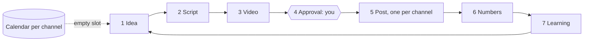

# Blueprint: the marketing loop, from idea to post

Status: proposal, 2026-10-07. This replaces the earlier draft of this file, which started from the agency sales work. Facts about today were checked against the repository, GitHub and the live Real Oficial tool descriptions on 2026-10-07. Everything else is a proposal, and example numbers are marked as examples. The first part is for you. The appendix at the end is for the builders, and you can skip it.

## In one minute

- **What it is.** A marketing loop that never stops: idea, script, video, your approval, post, numbers, lesson, next idea. It runs for each project (your brand, a client, a product line) and for each of that project's channels (its Instagram, TikTok, YouTube and so on).
- **You only approve.** One swipe per video and one Face ID per week's posting plan. The machine does the rest, and nothing goes out without you.
- **Almost no running cost.** No AI writing cost by default: ideas, scripts and captions come from templates and rules. The only paid part is the voice. You can use the free local voice, or the livelier Gemini voice at about half a US cent per video, which you will probably want.
- **Today only the video maker exists.** Posting to Instagram, TikTok and YouTube stays manual until Real Oficial accepts our video file (#19). Until then the loop prepares each post and reminds you at the right time.
- **First goal.** Your own brand, from an idea to an approved video you can post.

## The loop



The calendar drives the loop. Each channel has posting slots, for example Monday, Wednesday and Friday at 18:00. When a slot 3 days ahead (example) is still empty, the loop starts making something for it.

| Step | What happens | Who | Cost |
|---|---|---|---|
| 1. Idea | Idea templates are filled with the project's real facts. Upcoming dates for the project's country and sector (Dia das Mães, Black Friday, Natal) are another source of ideas. Ideas are ranked by what worked before. You or your own AI agent can add ideas too. | Machine (you may add) | Free |
| 2. Script | The idea becomes spoken lines, screen text and scenes in a format made for a series, such as a tips list, myth vs fact, or a question to the audience. A channel never gets the same format or the same kind of hook twice in a row. A guard rejects any price, number or phone that is not in the project's facts. | Machine (you may edit) | Free |
| 3. Video | The engine records the voice and makes the video. It takes about 80 s for a 16 to 20 s video (measured). | Machine | Voice only: free, or about half a US cent with Gemini |
| 4. Approval | You watch the video, tick a short checklist and check each channel's caption and post options. Then you approve, ask for changes or discard. | **You** | Free |
| 5. Post | You confirm the week's plan once. At each time, the post goes out through Real Oficial, or you get a ready-to-post bundle and a reminder. Then the app asks "Posted?": one tap, and you paste the post's link. The real time is recorded. | Machine after your confirm; you while posting is manual | Free |
| 6. Numbers | At 24 h, 72 h and 7 days you get a reminder to type 4 numbers (views, likes, comments, shares) or upload the platform's spreadsheet export. This becomes automatic once posts go through Real Oficial or a direct connection. Only posts with a link count. | You at first, the machine later | Free |
| 7. Learning | Rules compare hooks, times and lengths per channel. Once there is enough data, they say what worked. A weekly report sums it up. | Machine | Free |
| 8. Next idea | The lessons change the idea ranking and the best times. The next empty slot starts the loop again. | Machine | Free |

A test will check that the default path spends no AI writing cost.

**When things don't go to plan**

- **Deadlines.** You approve by 24 hours before the slot. If you miss that, the slot is skipped, because nothing posts without you. You get one reminder before the deadline and one note after. A slot with no approved video stays empty.
- **Pause.** You can pause a channel or a whole project for a date range, for example a vacation.
- **Failures.** If a video fails to render, it gets one automatic retry, then the bell. If a post fails, you get the bell and Real Oficial's retry. If it still fails, you get a ready-to-post bundle for the same slot.
- **Account needs reconnecting.** The channel is marked, and its posts wait until you reconnect it in the Real Oficial app.
- **Daily post cap or Real Oficial credits used up.** The post waits, and the bell asks you for a new time.

## Projects and channels

### A project

A project is one brand or business whose marketing the loop runs. It holds:

- **Identity.** Name, site, language, timezone (Brasília time by default), the voice and tone, and the visual kit: the real logo and where it came from, the colors and the video formats.
- **Facts.** Offers, prices, address, phone and claims, each with its source. Scripts may use only these.
- **Goals.** For example "3 posts a week on each channel". Goals set the default posting rhythm, and the weekly report checks them.
- **Who approves and who posts.** Approves: you, or you and then the client. Posts: you, or the client. When the client posts, the bundle goes to a shared folder for that project and the reminder goes to the client's contact.

### A channel

A channel is one project on one platform, for example the project's Instagram connected in Real Oficial. It holds:

- **Rhythm and caption style.** For example Monday, Wednesday and Friday. Each channel has its own caption length, hashtags, emoji or none, call to action and language.
- **Best times.** Set by hand, or from Real Oficial's best-time report (paid plan). Until you have your own posts there, that report uses data from the whole platform. Later the times come from your own numbers. Times are converted to the project's timezone.
- **Post options.** On TikTok, you choose privacy and interactions (comments, duet, stitch) once per channel. They show on the weekly confirm, and you can change them per post. On YouTube: title, visibility, made for kids and playlist. The "AI-generated" label is on by default, because the voice is synthetic. A client project can also mark a paid partnership.
- **Posting path and health.** Real Oficial, a direct connection later, or a ready-to-post bundle, which always works. The channel also shows whether its account is connected and its daily post cap.

| Platform | Posting today | Later | Video shape |
|---|---|---|---|
| Instagram Reels, TikTok, YouTube Shorts | Bundle and reminder | Real Oficial (#19) or a direct connection (#59) | Vertical (9:16), made today |
| Facebook, LinkedIn | Bundle and reminder | Real Oficial lists posting only for the three above. Facebook may get a direct connection (#59). | Vertical now; other shapes not before Phase 6 |

### From one idea to many posts

```
Idea: "3 mistakes that make people skip your video"   (project: your own brand)
  └─ One vertical video, approved once
       ├─ Instagram post:  caption A (long, 5 hashtags), cover, Wed 18:00
       ├─ TikTok post:     caption B (short, 3 hashtags), cover, Wed 19:30
       └─ YouTube post:    title and caption C, cover, Thu 12:00
```

- **One video, several posts.** All three platforms take the same vertical video. The caption, cover, time and post options change per channel.
- **Covers.** In the bundle, each channel can have its own cover. Through Real Oficial, a video has one cover for all channels, and it must be a Real Oficial thumbnail. Whether a frame from our own video can be the cover there depends on Real Oficial's answer about uploads (#19).

### What it looks like in practice (example numbers)

| Project | Channels | Rhythm | Who posts |
|---|---|---|---|
| Your own brand | Instagram, TikTok, YouTube | 3 videos a week, each on all 3 | You: bundle now, Real Oficial later |
| A client clinic | Instagram, Facebook | 2 videos a week | The client, from a shared folder |
| A product line | TikTok | 5 videos a week | You: bundle now, Real Oficial later |

- **Totals.** 3 projects, 6 channels, 10 videos and 18 posts a week. Your approvals: about 10 swipes and 3 Face IDs.
- **While posting is manual.** 18 uploads by hand a week: 14 by you and 4 by the client. The time per upload is not measured yet. For each post, numbers are typed at 24 h, 72 h and 7 days, or come from one spreadsheet export per platform.
- **Machine time.** About 14 minutes of video-making a week. This is an estimate based on about 80 s per video (measured).

## What exists today and what is missing

| Step | Today | Missing |
|---|---|---|
| Projects and channels | Nothing | Project and channel records, with many projects from the start |
| Calendar | Nothing | A program that keeps running, a calendar and work that runs at set times |
| Idea | Only fixed sales lines per business sector | Idea templates filled with your facts, and upcoming dates (#52) |
| Script | Half manual: a script with blanks someone fills | Idea to script, with series formats and a brand promo format (#16) |
| Video | Works: about 80 s per video, vertical only. The 6 ready formats are 16 to 20 s sales ads for business sectors, and none fits your brand. | Series formats; other shapes later |
| Approval | Machine checks and a watermarked preview | An approval queue on your phone (#18) |
| Post | Upload to Google Drive only; Real Oficial blocked (#19) | Bundle, reminder and "Posted?" link; Real Oficial later |
| Numbers | Nothing | Reminders to type numbers or upload the spreadsheet export (#22) |
| Learning | Nothing | Verdicts per hook, time and length, and a weekly report |
| Bell | Nothing | Without a bell, the loop would wait silently for your approval. With it, you get a Telegram message (later a phone notification) whenever something needs you. |

The plan itself exists only on paper. The specification (PR #51) is still open, and none of the 56 open issues is done.

## Three ways to see it

All three views show the same information, and the same decision card opens in each of them.

- **Classic:** calendar and lists. The fastest. The default on the phone.
- **Hybrid:** Classic with a thin strip of the seven houses on top. The default on the desktop.
- **Game:** the approved cutaway houses, one per loop step. It is for the overview, a second screen and showing people.

```
PHONE (Classic)
+------------------------------+
| Today   [All projects v] (o) |
| Needs you (4)                |
| > 2 videos to approve [Swipe]|
| > Confirm next week   [Hold] |
| > Posted? paste link (1)     |
| ! TikTok: reconnect          |
| Wed IG 18:00  [ ] empty      |
| Today Calendar Ideas  More   |
+------------------------------+
(o) = system health   [ ] = empty slot   ! = needs attention
[Swipe] = approve by swiping   [Hold] = hold and Face ID to confirm
```

Every decision opens the same card. It shows the video, the checklist, and each channel's caption, cover, time and post options. From there you approve, ask for changes or discard.

## Signature features

- **Fill the week.** One tap fills next week's empty slots with the best ideas and makes the videos overnight, so you can review them in one sitting.
- **While you were away.** Three lines, or an 8-second replay in Game, of what happened overnight. If the morning digest does not arrive, the machine is down.
- **Weather as health.** Sun means all is well, clouds mean warnings and rain means failures. Snow means paused, dust means a budget or credits ran out, and fog means the machine cannot be reached.
- **Hooks that worked.** Plain verdicts with the number of posts behind them. Until there is enough data, it says so honestly, for example "3 more posts until a verdict".
- **Monthly recap video per project.** "Your month", made from the real numbers.
- **Honest meter.** It shows that no AI writing cost was spent, plus the cents spent on voice and the minutes of video-making.

## Money and going public

- The product stays free.
- Revenue: a Real Oficial partnership (a commission on credits people buy), flat monthly sponsorships, and later a paid hosted version.
- Before it goes public, client data must be cleaned up and a lawyer must confirm the license. Details are in the appendix.

## Order of work

Each phase ends with something you can do. v0.4.0, the first full release as decided, is tagged at the end of Phase 5.

**Phase 0: Ground.** Merge the spec (#51) with this blueprint. Add the local safety check (#31). Add the basic records, with many projects and channels from the start and tests written first (#32, #33). Run a demo with fake accounts (#47).
*At the end you can* watch the whole loop run for a demo project with two fake accounts, from idea to post to numbers to lesson, and read every step.

**Phase 1: One project, from idea to approved video.** The background program and its storage (#41, #35). Project setup from a site plus a form (#15). Ideas from templates and upcoming dates (#52). Two or three series formats plus a brand promo format (#16). The approval queue (#18). Classic pages in pt-BR and English (#23, #34, #55). Limits and a pause switch (#36). Phone login, with Face ID tested on your iPhone first; if it fails, you confirm with a hold plus a PIN (#37). Nightly backup.
*At the end you can* set up your own brand, get ranked ideas, turn one into a video, approve it on your phone and download a ready-to-post bundle (video, caption and cover).

**Phase 2: Channels, calendar and posting.**
- Channels with rhythm, best times, caption styles and post options.
- The calendar per project and channel (#17, moved earlier), with a project switcher and an all-projects calendar.
- "Fill the week", one post per channel, and the weekly confirm with Face ID.
- Bundles with a reminder and the "Posted?" link, and Real Oficial posting when possible (#19, #49).
- The Telegram bell and morning digest (#24), the rules for deadlines and failures, and the Hybrid strip.

*At the end you can* connect your channels, add a client project, watch next week fill itself, approve the week in one sitting and get every post out on time with its link recorded.

**Phase 3: Numbers and learning.** Number reminders and spreadsheet import. Real Oficial's numbers for posts made through it (#22). Verdicts per hook, time and length, the weekly report and better idea ranking. The house view in Game on the desktop (#28). You see which hooks and times work on each channel. The first verdicts come after about 3 to 6 weeks (estimate).

**Phase 4: Rules per project.** Budgets, limits, quiet hours and a Real Oficial account for each project, plus a link where a client approves their own videos. You run your brand and your clients side by side.

**Phase 5: The living factory (v0.4.0).** The full Game on the desktop and on phones that are fast enough. The overnight replay, weather as health and optional sound. The Brazil theme (#53, #54), the monthly recap video and the release checks (#48, #50). You can leave the factory on a screen and decide from any view.

**Phase 6: Public.** The license with a lawyer (#70) and a clean public copy of the code. The installer and docs (#43, #44, #46), the site (#68) and sponsorships (#69). Other video shapes (square, horizontal) come no earlier than this phase. Anyone can install the demo loop and run it with no AI cost.

## Out of scope for now

- **Your sales tools** (`prospect`, `venda`, Pix charges, Drive delivery). They stay as they are, including the Dia das Crianças campaign on 12/10. A separate fix for them will get its own GitHub issue.
- **The B-roll look as the default.** It needs AI to write a plan for every video. It can come later as an option that uses your own AI agent.
- **Ads in the panel, other themes and other languages.** The panel stays ad-free, and each language needs a native reviewer.
- **Posting without your approval, automatic replies or DMs, copying data from platforms, and robots that post through a browser.**
- **Paid AI images and clips.** Optional per video later, always with the price shown first and your confirm.

## Decisions for you

1. **Which project goes first?**
   **Recommendation:** your own brand (@wesleysimplicio). The data is real, there is no client risk, and every post shows the product working. None of the six ready formats fits your brand today, so Phase 1 adds series formats and a brand promo format.
2. **Which channels go first?**
   **Recommendation:** Instagram Reels, TikTok and YouTube Shorts. All three take the vertical video the engine already makes, and they are the three Real Oficial can post to. Real Oficial's plan may limit Instagram and TikTok posting, so ask about it in the same message (Next steps #3).
3. **How do posts go out while Real Oficial cannot take our video file?**
   The options are:
   - (a) a ready-to-post bundle and a reminder for each channel;
   - (b) waiting for Real Oficial;
   - (c) building one direct platform connection now;
   - (d) uploading each video once in the Real Oficial app and letting the loop schedule every channel from there.

   **Recommendation:** (a) now, plus a 30-minute test of (d) this week. Upload one finished video in the Real Oficial app and check whether the loop can see it and schedule it. If it can, switch to (d). That means one upload per video instead of one per channel, and Real Oficial's numbers and best times start working. Build a direct connection only if Real Oficial says no by the end of Phase 3.
4. **How much may the machine do alone?**
   **Recommendation:** you approve every video. You confirm each week's plan once with Face ID, tested on your iPhone first; if it fails, you confirm with a hold plus a PIN. After that the machine posts at the planned times. Fully automatic posting stays off.
5. **Where does the background program run?** Scheduled posts and number reminders need a machine that is always on.
   **Recommendation:** the always-on Linux machine you already use for videos, after a short check that it stays on, restarts by itself and has disk space. Your Mac and phone connect to it through your private network. One machine, no syncing.

## Next five steps

1. **(You)** Answer the five decisions above.
2. **(Agent)** Replace `docs/factory/blueprint.md` with this document on the spec branch. In the spec, rename Brand to Project and add Channel, the post per channel and the calendar. Open a separate issue for the sales-tool delivery fix. Then you review and merge #51.
3. **(You)** Send Real Oficial one message with four asks:
   - a way to upload our video file;
   - an app key for unattended posting;
   - a referral or commission arrangement (#19);
   - whether your plan limits Instagram and TikTok posting.

   Then run the 30-minute app-upload test from decision 3, and the agent checks the result.
4. **(Agent)** Build the local safety check (#31) and the basic records (#32, #33) for projects, channels, ideas, videos, posts, numbers, lessons and decisions. Tests come first, and there are no GitHub Actions.
5. **(Agent)** Build the demo run (#47): a demo project with two fake accounts going through the whole loop. It is recorded so the first screens and tests can replay it.

---

## Appendix: for the builders (you can skip this)

### A. Today, with sources

- **Engine.** `simplicio-video` v0.3.0 turns a script file (`contract.yaml`) into an MP4. It validates the script, records the voice, compiles, renders with HyperFrames, then masters the sound to -14 LUFS (loudness set for social apps). It calls no AI model. 213 tests are collected. A run without the render tests gives 207 passed and 3 failed, all from one hardcoded path in `montage.py`.
- **9:16 only.** All 12 templates are 9:16, and the plates in `engine/build.mjs` are fixed at 1080×1920. Six templates are ready and six are skeletons, `saas-tech` among them. The ready ones are 16 to 20 s sector ads with fixed scenes. For example, `institucional-odontologia` runs hook, message, sector, then "Conheça {empresa.nome}". #16 builds one new template, `brand-promo`.
- **Ideas and scripts.** The only text source is fixed lines per sector in `templates/*/setores.json`, used by `prospect`. `init` writes a skeleton with TODO lines, and `prospect` fills 4 sales templates.
- **Approval.** No approval state, queue or screen. Only machine checks and a watermarked preview.
- **Posting.** No daemon, job queue or calendar. `publish` uploads to Google Drive. The `realoficial` command only prints a config.
- **Real Oficial (#19, live tool descriptions).**
  - Posting tools accept only clips that live inside Real Oficial. `ro_import_video` takes only videos made in Real Oficial, and `ro_estimate_clips` takes only YouTube or Twitch links. `docs/realoficial.md` gives the workaround: upload the MP4 in the Real Oficial app.
  - Login is OAuth only (a browser login, no app keys). Every post is a preview, then a confirm that is valid for a few minutes. Scheduling goes up to 30 days ahead. The daily credit cap resets at 21:00 Brasília time.
  - Accounts are connected only in its app. Each has a rolling 24-hour post cap (`daily_post_limit`) and a `needs_reconnect` flag. TikTok privacy must be chosen by the user, never by an agent. The AI-generated label (YouTube, TikTok) is off by default there.
  - `ro_set_clip_cover` accepts only a Real Oficial AI thumbnail, and the cover applies to every future post of that clip.
  - `ro_get_social_analytics` covers only posts published through Real Oficial and needs a paid plan. It gives `best_time` in UTC from the user's own history, or from the whole platform when that history is short.
  - Publishing is listed for TikTok, Instagram Reels and YouTube Shorts. Instagram and TikTok posting is "limited time" depending on the plan.
- **Numbers and learning.** No code yet. The spec (#22) ranks template families only after 3 posts each and flags outliers only after 8 posts. This plan extends the ranking to hook families, times and lengths per channel.
- **The spec.** It lives in `docs/factory/` on branch `docs/factory-spec`, as PR #51: open, mergeable, not reviewed. No factory code exists (no `Makefile`, `web/` or `src/simplicio_factory`). There are 56 open issues under epic #14. An automated run gave up on 50 of them, with no branches and no PRs. The NoLLM test exists only in the spec, not in code.
- **The spec has no channel.** A publication has accounts and a time, but nothing decides the time. There is one Real Oficial login per install. The calendar is #17 (M3).
- **The prototype.** One generated file with fake data: `build.py` joins 13 JS files, the CSS and the HTML. It is good for ideas, not for code. Commit `f8c0911` fixed both dock shortcuts: the dock's Approve now opens Review, and its hold is disabled when upload is off. One flaw remains: hold-to-publish always confirms the first post in the queue. Its themes are written as code, but they must be data.

### B. The three views in detail

```
DESKTOP (Classic, Calendar)
+------------------------------------------------------------------+
| [All projects v]  (o) clear   Needs you 3   Classic|Hybrid|Game   |
+---------+--------------------------------------------------------+
| Today   |        Mon        Tue        Wed        Thu        Fri  |
| Calendar| IG  18:00 ok      -       18:00 [ ]     -       18:00 ok|
| Ideas   | TT  19:00 ok   19:00 ok      -       19:00 [ ]     -    |
| Insights| YT     -      12:00 ok      -          -      12:00 [ ]|
| Projects| [ ] = empty slot. "Fill" picks the best-ranked idea.    |
+---------+--------------------------------------------------------+

HYBRID (strip above Classic)
+----------------------------------------------------------------------+
| Workshop  Ideas   Factory   Garage   Market   Observatory  Barn  (sun)|
|    ok      12     [##-] 2    (!) 2    5 this wk   3 new     wk 41     |
+-----------+----------------------------------------------------------+
| Today     | Approve (2)                                     A  N  D  |
+-----------+----------------------------------------------------------+

GAME (one house at a time)
+--------------------------------------------------------------------+
| (o) 14:02  Needs you 2   < Inspection garage 4/7 >  Classic|Hyb|Game|
|   [Checklist o]  [Captions o]  [Decide (!) robot]   room lamps      |
| +-- Decision card (same as Classic) ------------------------------+ |
| | [9:16] [x][x][ ]  IG / TT / YT captions   (A)(N)(D)  [hold]     | |
| +----------------------------------------------------------------+ |
+--------------------------------------------------------------------+
(o) = system health   (!) = needs you   [##-] = video in progress
A N D = approve, ask for changes, discard   [x] = checklist item ticked
```

| House | Loop step | What it shows |
|---|---|---|
| Workshop | Project and channels | The project kit and the health of connections |
| Idea shop | Idea | Ideas waiting, ranked, and empty slots to fill |
| Video factory | Script and video | Rooms: write script, record voice, compose, render, check |
| Inspection garage | Approval | Videos waiting for you, with the bell |
| Launch market | Post | Today's posts leaving at their times |
| Observatory | Numbers | Numbers arriving at 24 h, 72 h and 7 days |
| Learning barn | Learning | This week's verdicts, sent back to the idea shop |

- The approved delights stay: moving water, plants and lights, tappable props, the robot and the bots. Anything that blinks, or can be tapped to do something, must show real state.
- The server checks every decision again, so a bug in one view cannot skip a step. A test fails if any action exists in Game but not in Classic.

### C. Behind the scenes

- **One background program (a daemon: a program that keeps running).** `simplicio-video up` serves the panel, runs jobs and wakes on schedule. A lock file stops a second copy from starting. The command line and the AI-agent connection both talk to it.
- **One database is the truth.**
  - Everything that changes lives in one SQLite database (a database in a single file): projects, channels, ideas, videos, posts, numbers, lessons and pending decisions.
  - Many projects are supported from Phase 0.
  - Files hold only finished content: scripts, voice takes, videos and covers.
  - Why: the spec split state between files and the database, and a crash between the two writes would leave the loop confused.
- **Jobs with a time.** Every job can have a "run at" time. Calendar slots, deadlines and number reminders become jobs. A job missed while the machine was off runs once when it wakes, and that is logged.
- **The engine runs apart.** Each render runs as its own process in that video's own folder. The engine stops itself on errors and writes next to its script file, so running it inside the program could crash the program or mix up files.
- **Decision points ("gates") are saved.**
  - Gates cover approving a video, confirming a week, spending money, connecting an account and changing a rule.
  - Gates survive restarts and carry a deadline.
  - You decide with a passkey (Face ID or fingerprint, no password), tied to the exact content you saw.
  - AI agents can suggest. They can never approve, post or spend.
- **Posting paths behind one interface.**
  - The bundle always works.
  - Real Oficial is added when it can take our file, or through app uploads if the option (d) test passes.
  - Direct platform connections (APIs) come later (#59).
  - Each post carries a unique key, so it never goes out twice.
  - Real Oficial's preview expires in minutes, so a late confirm asks for a new preview.
  - A post counts as done only once it has its link.
- **Number sources behind one interface.** Typed numbers and spreadsheet imports first, then Real Oficial analytics for posts made through it, then direct APIs.
- **Events.** Everything that happens goes into a numbered event log. The panel loads the current state, then follows new events live. The same events and text templates drive the three views, the activity feed, the bell and the digest.
- **Notifications.**
  - Telegram first, because it works on any phone. Phone push once the panel is installed as an app.
  - At most one message per decision, grouped, and silent in quiet hours (23:00 to 07:00 by default).
  - Reminders for a client's posts go to the client's contact.
- **Safety that is always on.**
  - A STOP file (a file that pauses everything) is checked before any outside action.
  - Dry-run (prepare without doing) is the default.
  - Daily caps apply. The spec's defaults are 0 AI tokens, 40 renders and 3 posts per platform per day.
  - Quiet hours follow each project's timezone.
- **Phone access.** The panel listens only on the machine itself. It is published on your private network (Tailscale) over HTTPS (an encrypted address), which the phone app, push and Face ID need.
- **Backup.** A nightly encrypted copy goes to the Drive you already use, through rclone crypt (an encrypted copy tool). 14 copies are kept, and a tested restore command exists. Passwords and keys are never in backups.
- **Updates.** Only tagged releases are installed, with a backup first, and never while renders are queued. The schema (the shape of the stored records) only gains fields. A breaking change goes through export and import, not migration code.
- **AI agents (MCP, the standard way agents call tools).** Agents get a few coarse tools: list ideas, add an idea, submit a script, check status, and "wait until something needs me". Waiting costs nothing. Agents spend their own tokens, never ours.

### D. Data model

| Record | What it is | Key fields |
|---|---|---|
| **Project** | A brand or business | name, site, language, timezone, voice, visual kit, facts (each with a source), offers, goals, who approves (you / you then client), who posts (you / client), client contact, shared folder, autonomy, budget, pauses |
| **Channel** | One project on one platform | project, platform, account reference, posting path, shapes, rhythm, best times, caption style, post options (TikTok privacy, interactions, paid partnership; YouTube title, visibility, made for kids, playlist; AI label), daily cap, health, pauses |
| **Idea** | A hook and angle to try | project, hook, angle, hook family, format, date it is tied to, facts used, score, source (rules, you or agent), status |
| **Item** | The video made from one idea | idea, script, format, state, version hash, renders, quality checks, cost |
| **Variant** | The video for one channel | item, channel, caption, cover, slot, post options |
| **Schedule** | A rule that creates work on time | owner (channel or project), rule (for example "Mon, Wed, Fri 18:00"), timezone, lead time, approval deadline, next run, what to do if missed |
| **Post** | One variant sent or exported | variant, posting path, planned time, real time, link, status, outside id, unique key, error |
| **Metric** | Numbers for a post at one moment | post, window (24 h, 72 h, 7 d), views, likes, comments, shares, saves, source (typed, spreadsheet, Real Oficial, API) |
| **Learning** | What the numbers taught | project, channel, kind (hook family, time, length), verdict, sample size, evidence |
| **Gate** | A point where the machine waits for you | kind (approve, schedule, spend, connect, rule change), subject, version hash, deadline, status, who decided, on which device, when |

Supporting records: Job, Event, Device and Session, and Usage (render seconds, voice characters, credits and tokens).

An item moves through these states: idea, scripted, rendered, waiting for you, approved, scheduled, posted, measured. Side states are "needs changes", "failed", "skipped" and "discarded". Only one function changes a state, and every change writes an event.

### E. On screen

- **Stack.** Preact, TypeScript and Vite (web tools), the decision in force (`docs/factory/README.md`). Types are generated from the server's API so the two never drift.
- **Pages.**
  - **Today.**
  - **Calendar:** per project and channel, plus all projects.
  - **Ideas.**
  - **Video detail:** player, script, versions, the posts per channel and a timeline.
  - **Approvals:** the swipe stack.
  - **Posts:** with "Posted?".
  - **Insights.**
  - **Projects and channels.**
  - **Settings:** health, budgets, backup and devices.
- **Links.** Every object has its own web address, so a notification opens the exact video or decision. The view is a device setting, not part of the address.
- **Phone.** The panel installs as a PWA (a web app you add to the home screen). It has bottom tabs, the swipe stack, the prototype's pull-up sheet and Face ID on hold-to-confirm. With no connection it shows the last state, read-only.
- **Languages.** pt-BR and English, seeded from the prototype's 641-key catalog, with correct dates, times, money and timezones for each place.
- **The scene behind one interface.**
  - A 2D strip for Hybrid, which is also the fallback.
  - A 3D house view for Game.
  - A still image for weak phones.
  - Themes are data files, and only the Brazil theme is moved now. Its painted art stays "experimental" until the image terms are read.
- **Take the prototype's ideas, not its code.** Keep the needs-you count, the checklist tied to the video version, hold-to-confirm, the bottom sheet, the camera framing and the event text catalog. Do not carry dock-level approve or publish shortcuts in any form. The prototype is rewritten, not ported.
- **Accessibility.** Classic is the complete path and meets WCAG 2.2 AA (the web accessibility standard). The 3D canvas is hidden from screen readers and has a keyboard navigator. The phone's "reduce motion" setting stops 3D motion too.
- **Speed budgets.**
  - The house view must stay within 400 draw calls and 25k triangles (GPU work per frame, #28). A Mac measured 391 and 20,393.
  - The world view measured 3,248 draw calls on a Mac, so it comes to desktop first.
  - Phones need at least 30 fps (frames per second) with 200 items, or they fall back to 2D.
  - No phone has been measured yet.
- **Tests run locally, with no GitHub Actions.** They cover the state logic on recorded event logs, the three views at phone and desktop sizes, "same actions in every view" and "nothing approves without the checklist".

### F. Money and going public (detail)

- **License.** A lawyer confirms it. Option one is FSL: anyone may use the code but not sell it as a competing hosted service, and each version becomes Apache-2.0 after two years. Option two is AGPL: real open source, where anyone may host it but must share their changes.
- **Revenue.**
  - A Real Oficial partnership: a commission on credits bought through the app. This is the same conversation as #19, and Real Oficial's account tools already show a referral program.
  - Flat monthly sponsorships on the site, the theme gallery and the docs.
  - Site ads only as a complement, from a network that does not track, after about 50k pageviews a month.
  - A paid hosted version later.
  - The local panel has no ads, and `ads.md` stays a document.
- **Before going public.**
  - **Client data.** It is still in git history: commit `c35ff25` only removed it from the current files. Three client preview MP4s are tracked, and tests use client scripts.
  - **AI art.** The terms for the GPT Image 2 art have not been read.
  - **GSAP (an animation library).** 37 template and motion files load GSAP 3.14.2 from a CDN (a public download server). The copy vendored on the B-roll branch says "All rights reserved" under GreenSock's standard license, so the lawyer reads it.
  - **License labels.** `pyproject.toml` still says "Proprietary", and the title of #70 still says "free proprietary license".
- **The public repo** is a new one with fresh history, built from an allowlist (a list of the files allowed out). The private repo is not flipped to public.

### G. Out of scope (detail)

- The `venda entregar` B-roll delivery bug moves to its own issue. It re-renders `contract.yaml` instead of delivering `final/final.mp4`.
- Multi-agent frameworks (LangGraph, CrewAI, A2A), the hosted version and programmatic ads.
- Moving the prototype code: it is rewritten against its ideas.
- Kaggle and Colab render backends, and `ugc`, `clone`, `montage`, `edit` and `opencut` in the panel: they stay CLI features.
- The other 8 prototype themes and 13 more languages.
- Later: English content templates (today the content path assumes pt-BR), and moving the preview watermark from a hardcoded name into project settings.