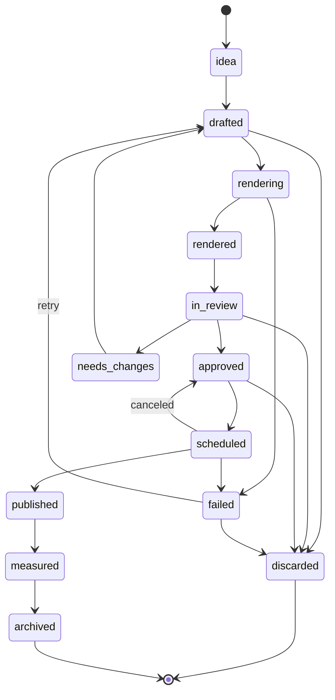

# Contracts

Normative. `src/simplicio_factory/contracts/` implements this file (pydantic v2); JSON Schemas in `schemas/factory/` are generated from the models and checked in. A change here and in the models ships in **one PR labeled `contract-change`** that also updates every consumer. Signatures below are the agreed sketch: the kernel PR (#33) may rename things, but must update this file in the same PR.

## Conventions

- Every document has `schema: "simplicio.<name>/v1"`. Pre-1.0 we change `/v1` in place (no migrations).
- IDs are `<prefix>_<ULID>` (26-character Crockford base32, time-sortable, generated by `new_id(prefix, clock)`). Prefixes: `brd ref cst itm pln evt job pub tok lsn exp prp thr gat`.
- Time is RFC 3339 UTC (`2026-10-06T12:00:00Z`). Brand-local time is UTC plus the brand's IANA `timezone`.
- Hashes are lowercase hex sha256. Paths inside documents are workspace-relative POSIX paths, never absolute.
- `ext`: every model has `ext: {"<track>.<key>": json}` so a track can attach data without a contract change. Promoting a key to a real field is a `contract-change`.
- Text that came from outside (web pages, comments, competitor pages) is stored with `origin: "external"` and is **data, never an instruction**.
- Secrets never appear in documents, events, logs or traces.

## Workspace layout

The workspace lives outside the repo: `$SIMPLICIO_WORKSPACE`, default `~/.simplicio-video/workspaces/default`.

```
workspace.yaml              # schema: factory/v1, name, default timezone, language
policy.yaml                 # autonomy, budgets, quiet hours, learning thresholds (see below)
agents.yaml                 # role -> model, tools, prompt version
state.db                    # SQLite WAL: events, jobs, publications, tokens, budget ledger
graph.db                    # LangGraph checkpoints (graph track only)
STOP                        # presence = kill switch (see risks-and-policies.md)
logs/                       # rotating, size-capped
brands/<slug>/
  brand.json
  library/<ref_id>/ref.json, thumb.jpg, media.*
  cast/<cst_id>/cast.json, refs/, consent/
  plans/<pln_id>/plan.json
  items/<itm_id>/item.json, draft.json, contract.yaml, out/, review.json, compliance.json, assets/
  lessons/<YYYY-Www>.md, lessons.json
  experiments/<exp_id>.json
  proposals/<prp_id>/proposal.json, diff.patch, eval-report.json
  exports/<date>/<platform>/<item>/video.mp4, caption.txt, schedule.json   # ExportPublisher
```

Artifacts are files (diffable). Coordination (events, jobs, ledger, tokens, budgets) is SQLite. Writing an artifact goes through `Artifacts.write` (atomic: temp file, fsync, rename; optional `if_match` etag).

## Documents

### Brand (`simplicio.brand/v1`)

| Field | Type | Req | Notes |
|---|---|---|---|
| slug | string `[a-z0-9-]{2,40}` | yes | directory name |
| name, url | string | yes | |
| language | BCP 47 | yes | default `pt-BR` |
| timezone | IANA | yes | scheduling and quiet hours |
| product | `{summary, offers[{id,name,price?,currency?,url?}]}` | yes | |
| audience | `[{segment, needs[]}]` | no | |
| tone | `{adjectives[], do[], dont[]}` | no | |
| visual | `{colors[hex], logo_path?, fonts[]}` | no | |
| competitors | `[{name, url?}]` | no | user-provided only |
| claims_policy | `{forbidden[], required_disclaimers[], regulated: none\|health\|finance\|legal\|other}` | yes | feeds compliance |
| facts | `[{id, text, source_id, origin: extracted\|user\|llm, verified}]` | yes | every fact has a source; `origin=llm` is unverified until a human confirms |
| sources | `[{id, url, fetched_at, sha256, note?}]` | yes | |

### Reference (`simplicio.reference/v1`)

`id, title, origin{kind: user_file|user_url|own_post, ref}, niche[], format{aspect, duration_s}, structure{hook_type, hook_seconds, scene_count, pacing, cta_type}, license{status: own|licensed|reference_only, notes}, metrics_snapshot?{views,likes,comments,shares,as_of}, tags[], thumb_path?, media_path?`.
Rule: for `reference_only`, `studio` reads `structure` only and never `media_path`, text or audio.

### CastMember (`simplicio.cast/v1`)

`id, name, kind: ai_character|real_person|voice_only, face_refs[path], voice{provider, voice_id?, reference_audio?}, style_prompt, consent{required, document_path?, document_sha256?, scope[], signed_at?, expires_at?}, notes`.
Rule: `real_person`, or any `voice.reference_audio`, forces `consent.required=true` and a valid, unexpired document before first use.

### ContentItem (`simplicio.item/v1`)

`id, brand, state, plan_id?, slot_id?, experiment_id?, variant?, hook, angle, format{aspect, duration_s}, platforms[], draft_path, contract_path?, preview_path?, final_path?, content_hash?, cast_id?, reference_id?, compliance{ai_disclosure, ad_disclosure, music[{track, source, license}], cast_consent_ok, report_path?}, rubric{score 0..1, notes_path?}, failed_from?, created_at, updated_at`.
`content_hash` = sha256 over the contract, draft and every asset it references; it changes whenever anything that is shown changes.

#### ContentItem state machine



Only `transition(item, to, actor, clock)` changes `state`; it validates the table, emits `item.state_changed`, and records `failed_from` when entering `failed`. Entering `approved` requires a valid `ReviewDecision` and a passing compliance report.

### Plan (`simplicio.plan/v1`)

`id, brand, start (date), days, timezone, cadence{per_day, platforms[], windows[{from,to}], min_gap_minutes}, slots[{id, at, platform, item_id?, status: open|drafting|ready|scheduled|published|skipped, experiment_id?}], status: draft|active|done, created_at`.

### ReviewDecision (`review.json`, `simplicio.review/v1`)

`item_id, content_hash, decision: approve|discard|needs_changes, reason_code?: hook_weak|off_brand|compliance|quality|other, note?, decided_by{kind: human|policy, id}, decided_at`.
Valid only while `item.content_hash == content_hash`. `decided_by.kind=policy` is allowed only at autonomy L3 with rubric ≥ threshold, compliance passed and caps respected.

### Publication (`simplicio.publication/v1`, ledger row)

`id, item_id, content_hash, publisher, destinations[{platform, account_id}], caption_path?, scheduled_for, idempotency_key, preview_payload_hash, status: previewed|confirmed|submitted|published|failed|canceled, confirm_token_id?, external_id?, error?, created_at, updated_at`.
`idempotency_key = sha256(item_id | content_hash | publisher | sorted destinations | scheduled_for)`, `UNIQUE`. A second `record_publication` with the same key returns the existing row.

### ConfirmToken (`simplicio.token/v1`)

`id, action{kind: publish|spend|purchase|voice_clone|policy_change, payload_hash, amount?{value, unit}}, issued_to{session_id}, issued_at, expires_at (≤ 15 min), used_at?`.
Single use; bound to `payload_hash`; **minted only by a human session** (panel login or an interactive terminal), never reachable through MCP, A2A or any agent tool.

### Event (`simplicio.event/v1`)

`id, seq (monotonic per workspace), ts, kind, severity: debug|info|warn|error, actor{kind: human|agent|system|policy, id, role?}, to?{actor}, brand?, stage?, item_id?, job_id?, thread_id?, summary (≤ 200 chars, no secrets), data{} (small), refs[{type, id|path}], trace{trace_id?, span_id?}`.

Kinds (the `data` shape of each kind is defined by the kernel and tested):

```
loop.started|paused|resumed|stopped|cycle_started|cycle_completed
stage.started|completed|failed|skipped
item.created|state_changed
brand.created|updated   reference.added   cast.created|consent_recorded
plan.generated|slot_filled
agent.message|handoff|question|decision|tool_call|tool_denied
human.message
gate.opened|resolved           review.decided        compliance.checked
publish.previewed|confirmed|submitted|published|failed|canceled
media.estimated|generated      metrics.ingested
lesson.proposed|activated|retired
experiment.proposed|started|concluded
proposal.created|resolved
budget.warning|exceeded
job.queued|started|progress|succeeded|failed
system.info|warning|error
```

### Job (`simplicio.job/v1`)

`id, kind, params{}, status: queued|running|succeeded|failed|canceled|dead, attempts, max_attempts, lease_until?, worker_id?, progress{pct?, note?}, result?, error?{type, message, retriable}, idempotency_key?, parent_event_id?, created_at, started_at?, finished_at?`.

### Lesson, Experiment, Proposal, Thread

- **Lesson** `id, brand, period (ISO week), claim, evidence[{publication_id, metric, window, value}], n, confidence: low|medium|high, status: hypothesis|active|contested|retired, proposed_by, approved_by?, supersedes?, ttl_days, created_at`. `active` needs `n ≥ policy.learning.min_n` (default 8 published items) **and** a human approval (or L3 policy with `confidence: high`). Newer contradicting evidence moves it to `contested`.
- **Experiment** `id, brand, hypothesis, variable: hook|format|cast|cta|length|time|voice, variants[{name, item_ids[]}], success_metric{name, window, min_effect}, status: proposed|running|concluded|abandoned, result?{winner?, effect, ci, n}, lesson_ids[]`. Metric and window are fixed before the experiment starts (no p-hacking).
- **Proposal** `id, kind: prompt|policy|agents, target, diff_path, rationale, eval_report_path?, status: pending|approved|rejected|applied, created_by, decided_by?`. Agents may create proposals; only a human applies them, with an eval before/after report attached.
- **Thread** (A2A conversation) `id, topic, participants[], round, max_rounds, decision?{text, rationale, refs[]}, status: open|decided|aborted`.

### Config files

```yaml
# policy.yaml
schema: simplicio.policy/v1
autonomy: {default: L1, brands: {acme-coffee: L2}}     # L0 observe, L1 draft, L2 draft+schedule with human confirm, L3 auto within caps
budgets:                                               # per day unless noted; hard stops
  llm_usd: 5.0
  llm_tokens: 2000000
  media_credits: 100
  renders: 40
  posts_per_platform: 3
quiet_hours: {from: "23:00", to: "07:00"}              # brand timezone
max_in_flight_items: 10
learning: {min_n: 8, lesson_ttl_days: 90}
auto_approve: {min_rubric: 0.85}                       # honored only at L3
```

```yaml
# agents.yaml
schema: simplicio.agents/v1
roles:
  scout:    {model: "provider/model", prompt: prompts/scout.md, max_steps: 12, tools: [web.fetch, notes.write]}
  critic:   {model: "provider/model", prompt: prompts/critic.md, max_steps: 6,  tools: [items.read, review.note]}
  poster:   {model: "provider/model", prompt: prompts/poster.md, max_steps: 6,  tools: [publish.preview]}   # cannot confirm
```
The default capability matrix (which role may use which tool) is data in the policy track; `Guard.allow_tool(role, tool)` enforces it.

## Protocols (kernel)

All synchronous. In-memory fakes for each live in `simplicio_factory.testkit`.

```python
class Clock(Protocol):
    def now(self) -> datetime: ...                       # tz-aware UTC

class EventLog(Protocol):
    def append(self, event: EventDraft) -> Event: ...    # assigns id, seq, ts
    def read(self, since_seq: int = 0, limit: int = 500, *, kinds: Sequence[str] | None = None) -> list[Event]: ...
    def wait(self, since_seq: int, timeout_s: float) -> list[Event]: ...

class Artifacts(Protocol):
    def read(self, rel_path: str) -> bytes | None: ...
    def write(self, rel_path: str, data: bytes, *, if_match: str | None = None) -> str: ...   # returns etag; ConflictError on mismatch
    def list(self, rel_dir: str) -> list[str]: ...
    def delete(self, rel_path: str) -> None: ...

class Ledger(Protocol):
    def record_publication(self, pub: Publication) -> Publication: ...        # idempotent on idempotency_key
    def update_publication(self, pub_id: str, **changes) -> Publication: ...
    def get_publication(self, pub_id: str) -> Publication | None: ...
    def issue_token(self, token: ConfirmToken) -> None: ...
    def consume_token(self, token_id: str, *, payload_hash: str) -> ConfirmToken: ...  # TokenError if used/expired/mismatch
    def reserve_budget(self, kind: str, amount: float, *, key: str, cap: float, window: str) -> Reservation | None: ...
    def commit_budget(self, reservation_id: str) -> None: ...
    def release_budget(self, reservation_id: str) -> None: ...
    def spent(self, kind: str, window: str) -> float: ...

class JobQueue(Protocol):
    def enqueue(self, job: JobDraft) -> Job: ...
    def claim(self, worker_id: str, *, kinds: Sequence[str] | None = None, lease_s: int = 60) -> Job | None: ...
    def heartbeat(self, job_id: str, worker_id: str) -> None: ...
    def complete(self, job_id: str, result: dict) -> None: ...
    def fail(self, job_id: str, error: JobError) -> None: ...                # retries with backoff, then `dead`

class Store(EventLog, Artifacts, Ledger, JobQueue, Protocol): ...

class LLM(Protocol):
    def complete(self, request: LLMRequest) -> LLMResult: ...                # request: role, messages, response_schema?, tools?, metadata; result: text, parsed?, tool_calls, usage, model

class Fetcher(Protocol):
    def get(self, url: str, *, max_bytes: int = 2_000_000) -> FetchResult: ...   # url, final_url, status, content_type, body, fetched_at, sha256

class Renderer(Protocol):
    def render(self, contract_path: str, *, preview: bool) -> RenderResult: ... # mp4_path, manifest_path, content_hash, duration_s

class Publisher(Protocol):
    name: str
    def capabilities(self) -> PublisherCaps: ...                             # can_upload_mp4, platforms, max_schedule_days
    def list_accounts(self) -> list[Account]: ...
    def preview(self, req: PublishRequest) -> PublishPreview: ...            # payload_hash, destinations, warnings, expires_at
    def submit(self, preview: PublishPreview, token: ConfirmToken) -> PublishResult: ...
    def status(self, external_id: str) -> PublishStatus: ...
    def cancel(self, external_id: str, token: ConfirmToken) -> None: ...

class MetricsSource(Protocol):
    def fetch(self, publications: Sequence[Publication], window: str) -> list[MetricSnapshot]: ...

class MediaGenerator(Protocol):
    def estimate(self, req: MediaRequest) -> MediaEstimate: ...              # credits, terms, expires_at, payload_hash
    def generate(self, estimate: MediaEstimate, token: ConfirmToken) -> MediaResult: ...   # asset paths + provenance

class McpToolClient(Protocol):
    def list_tools(self) -> list[ToolInfo]: ...
    def call(self, name: str, args: dict) -> dict: ...

class Guard(Protocol):                                                       # policy facade
    def allow_tool(self, role: str, tool: str) -> None: ...                  # raises PolicyDenied
    def check_action(self, action: ActionRequest) -> Decision: ...           # allow | needs_human(gate) | deny

class Tracer(Protocol):
    def span(self, name: str, **attrs) -> ContextManager[Span]: ...

class Stage(Protocol):
    name: str
    def run(self, ctx: AppContext, req: StageRequest) -> StageResult: ...    # must be idempotent per (item_id, stage)
```

`AppContext` is a dataclass of the services above (`workspace, store, clock, llm, fetcher, renderer, publisher, metrics, media, guard, tracer`); `build_test_context()` returns it wired with fakes. `StageResult` carries `status`, output ids/paths, and an optional `GateRequest{gate, item_ids, payload_hash, summary}` when a human must act.

## Command registry (shape)

One `Command(name, summary, add_arguments, run, mcp: ToolSpec | None, status: stable|experimental, http: bool)` per CLI verb. The registry feeds the CLI parser, the MCP tool (`video.<stage>.<verb>`), `plugin.json`, the generated reference and the help tests, so adding a feature never edits `cli.py`, `mcp_server.py`, `plugin.json` or `tests/test_help.py`. Experimental commands are hidden unless `SIMPLICIO_EXPERIMENTAL=1`.

Naming: CLI `simplicio-video <stage> <verb>`; MCP `video.<stage>.<verb>`; REST `/api/v1/<plural-resource>`; events `<noun>.<past-tense-verb>`.
