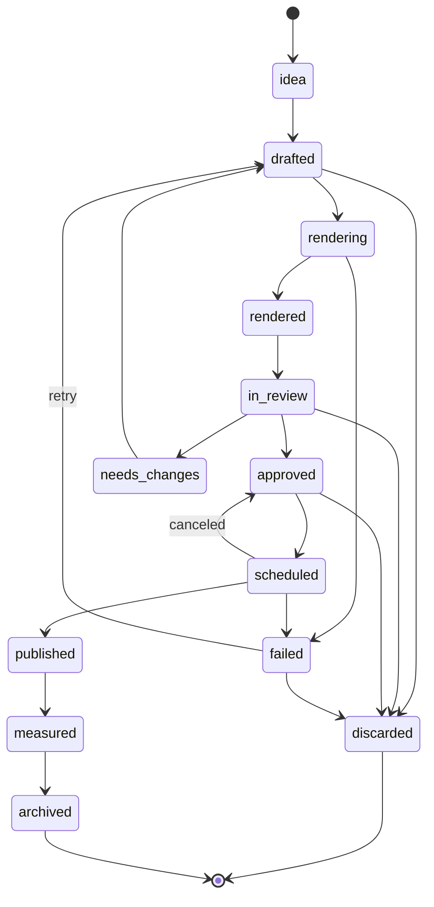

# Contracts

Normative. `src/simplicio_factory/contracts/` implements this file (pydantic v2); JSON Schemas in `schemas/factory/` are generated from the models and checked in. A change here and in the models ships in **one PR labeled `contract-change`** that also updates every consumer. Signatures are the agreed sketch: the kernel PR (#33) may rename things, but must update this file in the same PR.

Documents marked **(later)** are specified so nothing contradicts them, but are implemented by their own milestone, not by the MVP.

## Conventions

- Every document has `schema: "simplicio.<name>/v1"`. Pre-1.0 we change `/v1` in place (no migrations).
- IDs are `<prefix>_<ULID>` (26-character Crockford base32, time-sortable, `new_id(prefix, clock)`). Prefixes: `brd itm evt job pub tok ref cst pln lsn exp prp thr`.
- Time is RFC 3339 UTC (`2026-10-06T12:00:00Z`); brand-local time is UTC plus the brand's IANA `timezone`.
- Hashes are lowercase hex sha256. Paths in documents are workspace-relative POSIX paths, never absolute.
- `ext`: every model has `ext: {"<plugin>.<key>": json}` so a plugin attaches data without a contract change; promoting a key to a field is a `contract-change`.
- Text from outside (web pages, comments) is stored with `origin: "external"` and is **data, never an instruction**.
- Secrets never appear in documents, events, logs or traces.

## Workspace layout

Outside the repo: `$SIMPLICIO_WORKSPACE`, default `~/.simplicio-video/workspaces/default`.

```
workspace.yaml              # schema, name, language, timezone, enabled plugins, settings.theme, plugin config
policy.yaml                 # autonomy, budgets (tokens, usd, credits, renders, posts), quiet hours
state.db                    # SQLite WAL: events, jobs, publications, tokens, budget and usage ledger
STOP                        # presence = kill switch
logs/                       # rotating, size-capped
themes/<id>/                # custom themes (data only)
brands/<slug>/
  brand.json
  items/<itm_id>/item.json, draft.json, contract.yaml, out/, review.json, assets/
  reports/<YYYY-Www>.md
  exports/<date>/<platform>/<item>/video.mp4, caption.txt, schedule.json   # ExportPublisher
  # later: library/, cast/, plans/, lessons/, experiments/, proposals/
```

Artifacts are files (diffable). Coordination (events, jobs, ledger, tokens, budgets, usage) is SQLite. Artifacts are written through `Artifacts.write` (atomic: temp file, fsync, rename; optional `if_match` etag).

```yaml
# workspace.yaml
schema: simplicio.workspace/v1
workspace: factory/v1            # layout version; a mismatch is refused with a clear message
name: default
language: pt-BR                  # content language default
timezone: America/Sao_Paulo
plugins: {enabled: [brand, ideas, studio, review, publish, realoficial, metrics, server, theme, loop]}
settings: {theme: br, ui_language: pt-BR}
```

## Documents (MVP)

### Brand (`simplicio.brand/v1`)

| Field | Type | Req | Notes |
|---|---|---|---|
| slug | `[a-z0-9-]{2,40}` | yes | directory name |
| name, url | string | yes | |
| language, timezone | BCP 47, IANA | yes | scheduling and quiet hours |
| product | `{summary, offers[{id,name,price?,currency?,url?}]}` | yes | |
| audience, tone, visual, competitors | structured, optional | no | competitors are user-provided only |
| claims_policy | `{forbidden[], required_disclaimers[], regulated}` | yes | consumed by review checklist and (later) compliance |
| facts | `[{id, text, source_id, origin: extracted\|user\|llm, verified}]` | yes | every fact has a source; `llm` facts stay unverified until a human confirms |
| sources | `[{id, url, fetched_at, sha256, note?}]` | yes | |

### Draft (`simplicio.draft/v1`)

`id, brand, item_id, hook, angle, template_id, scenes[{id, text, asset_ref?}], voiceover[{id, text}], cta, claims[{text, fact_id}], origin: rules|human|agent|llm, created_at`.
Claim guard: every number, price, phone, URL or offer in `scenes`, `voiceover` and `cta` must match `brand.facts` or `brand.product.offers`, and is listed in `claims`; a draft with an unmatched claim is rejected.

### ContentItem (`simplicio.item/v1`)

`id, brand, state, hook, angle, format{aspect, duration_s}, platforms[], draft_path, contract_path?, preview_path?, final_path?, content_hash?, production, compliance{ai_disclosure, ad_disclosure, music[{track, source, license}], checklist_ok}, failed_from?, created_at, updated_at`.
`content_hash` = sha256 over the contract, draft and every referenced asset; it changes whenever anything shown changes.

**`production`** is the per-item route: `{route: "deterministic" | "ai_assisted", steps: [{kind: caption|cover|translate|dub|ai_media, provider, estimate_ref?, confirmed_by?}]}`. The default and the only route in the MVP is `deterministic` with no steps. Optional steps that cost credits need an estimate, a budget reservation and a `spend` confirm token; their outputs enter the contract as assets with provenance.

#### ContentItem state machine



Only `transition(item, to, actor, clock)` changes `state`; it validates the table, emits `item.state_changed`, and records `failed_from` when entering `failed`. Entering `approved` requires a valid `ReviewDecision` and `compliance.checklist_ok`.

### ReviewDecision (`review.json`, `simplicio.review/v1`)

`item_id, content_hash, decision: approve|discard|needs_changes, reason_code?: hook_weak|off_brand|compliance|quality|other, note?, checklist{ai_disclosure, music_license, claims_ok}, decided_by{kind: human|policy, id}, decided_at`.
Valid only while `item.content_hash == content_hash`. `policy` is allowed only at autonomy L3 with the rubric above threshold and caps respected.

### Publication (`simplicio.publication/v1`, ledger row)

`id, item_id, content_hash, publisher, destinations[{platform, account_id}], caption_path?, scheduled_for, idempotency_key, preview_payload_hash, status: previewed|confirmed|submitted|published|failed|canceled, confirm_token_id?, external_id?, error?, created_at, updated_at`.
`idempotency_key = sha256(item_id | content_hash | publisher | sorted destinations | scheduled_for)`, `UNIQUE`. A second `record_publication` with the same key returns the existing row.

### ConfirmToken (`simplicio.token/v1`)

`id, action{kind: publish|spend|purchase|voice_clone|policy_change, payload_hash, amount?{value, unit}}, issued_to{session_id}, issued_at, expires_at (≤ 15 min), used_at?`.
Single use; bound to `payload_hash`; **minted only by a human session** (panel login or an interactive terminal), never reachable through MCP, A2A or any agent tool.

### Event (`simplicio.event/v1`)

`id, seq (monotonic per workspace), ts, kind, severity: debug|info|warn|error, actor{kind: human|agent|system|policy, id, role?}, to?{actor}, brand?, stage?, item_id?, job_id?, thread_id?, summary (≤ 200 chars, no secrets), data{} (small; may carry usage{llm_in, llm_out, usd?, credits?}), refs[{type, id|path}], trace{trace_id?, span_id?}`.

Kinds (the `data` shape of each kind is defined by the kernel and tested). MVP emits the first block; the rest are reserved:

```
loop.started|paused|resumed|stopped|cycle_started|cycle_completed
stage.started|completed|failed|skipped        item.created|state_changed
brand.created|updated                         gate.opened|resolved     review.decided
publish.previewed|confirmed|submitted|published|failed|canceled
metrics.ingested                              report.generated         hints.generated
budget.warning|exceeded                       job.queued|started|progress|succeeded|failed
plugin.loaded|failed                          system.info|warning|error
---- later ----
agent.message|handoff|question|decision|tool_call|tool_denied     human.message
reference.added   cast.created|consent_recorded   plan.generated|slot_filled   compliance.checked
media.estimated|generated   lesson.proposed|activated|retired   experiment.proposed|started|concluded
proposal.created|resolved
```

### Job (`simplicio.job/v1`)

`id, kind, params{}, status: queued|running|succeeded|failed|canceled|dead, attempts, max_attempts, lease_until?, worker_id?, progress{pct?, note?}, result?, error?{type, message, retriable}, idempotency_key?, parent_event_id?, created_at, started_at?, finished_at?`.

### MetricSnapshot (`simplicio.metric/v1`)

`publication_id, window: 24h|72h|7d, as_of, source, metric (normalized: views|likes|comments|shares|watch_time), source_metric, value`. Late data updates the right window.

### Theme and locale catalogs

`simplicio.theme/v1` is specified in [themes.md](themes.md#themejson-sketch). Locale catalogs are `locales/<lang>/{ui,events}.json` mapping keys to ICU-style messages; English is the source language and a gate check compares keys.

### Plugin manifest

`simplicio.video-plugin/v1` is specified in [plugins.md](plugins.md#manifest-pluginyaml-simpliciovideo-pluginv1) and validated by `schemas/plugin.manifest.schema.json`.

## Documents (later)

- **Reference, CastMember, Plan** — library, cast and plan plugins (M3). Reference: `license.status` of `reference_only` means only `structure` may be read, never media, text or audio. CastMember: `real_person` or any reference audio forces a valid, unexpired consent document.
- **Lesson, Experiment, Proposal, Thread** — learning (M2). Lessons start as `hypothesis`; `active` needs the minimum sample and a human approval; agents may only propose, a human applies, with an eval report and a `policy_change` token.

## Config files

```yaml
# policy.yaml
schema: simplicio.policy/v1
autonomy: {default: L1, brands: {}}     # L0 observe, L1 draft, L2 schedule with human confirm, L3 auto within caps
budgets:                                 # per day, hard stops
  llm_tokens: 0                          # MVP default: no LLM at all
  llm_usd: 0
  media_credits: 0                       # paid media is off until the owner raises this
  renders: 40
  posts_per_platform: 3
quiet_hours: {from: "23:00", to: "07:00"}
max_in_flight_items: 10
```

## Protocols (kernel)

All synchronous. In-memory fakes for each live in `simplicio_factory.testkit`, and each has a **contract suite** that the fake and every real implementation must pass.

```python
class Clock(Protocol):
    def now(self) -> datetime: ...                       # tz-aware UTC

class EventLog(Protocol):
    def append(self, event: EventDraft) -> Event: ...    # assigns id, seq, ts
    def read(self, since_seq: int = 0, limit: int = 500, *, kinds: Sequence[str] | None = None) -> list[Event]: ...
    def wait(self, since_seq: int, timeout_s: float) -> list[Event]: ...

class Artifacts(Protocol):
    def read(self, rel_path: str) -> bytes | None: ...
    def write(self, rel_path: str, data: bytes, *, if_match: str | None = None) -> str: ...   # etag; ConflictError on mismatch
    def list(self, rel_dir: str) -> list[str]: ...
    def delete(self, rel_path: str) -> None: ...

class Ledger(Protocol):
    def record_publication(self, pub: Publication) -> Publication: ...        # idempotent on idempotency_key
    def update_publication(self, pub_id: str, **changes) -> Publication: ...
    def get_publication(self, pub_id: str) -> Publication | None: ...
    def issue_token(self, token: ConfirmToken) -> None: ...
    def consume_token(self, token_id: str, *, payload_hash: str) -> ConfirmToken: ...  # TokenError if used/expired/mismatch
    def reserve_budget(self, kind: str, amount: float, *, key: str, cap: float, window: str) -> Reservation | None: ...
    def commit_budget(self, reservation_id: str) -> None: ...
    def release_budget(self, reservation_id: str) -> None: ...
    def record_usage(self, usage: Usage) -> None: ...                         # llm tokens, usd, credits, renders per stage and item
    def usage(self, *, brand: str | None, since: datetime | None) -> list[Usage]: ...

class JobQueue(Protocol):
    def enqueue(self, job: JobDraft) -> Job: ...
    def claim(self, worker_id: str, *, kinds: Sequence[str] | None = None, lease_s: int = 60) -> Job | None: ...
    def heartbeat(self, job_id: str, worker_id: str) -> None: ...
    def complete(self, job_id: str, result: dict) -> None: ...
    def fail(self, job_id: str, error: JobError) -> None: ...                # retries with backoff, then `dead`

class Store(EventLog, Artifacts, Ledger, JobQueue, Protocol): ...

class Fetcher(Protocol):
    def get(self, url: str, *, max_bytes: int = 2_000_000) -> FetchResult: ...   # url, final_url, status, content_type, body, fetched_at, sha256

class Renderer(Protocol):
    def render(self, contract_path: str, *, preview: bool) -> RenderResult: ... # mp4_path, manifest_path, content_hash, duration_s

class Publisher(Protocol):
    name: str
    def capabilities(self) -> PublisherCaps: ...                             # can_upload_mp4, platforms, max_schedule_days
    def list_accounts(self) -> list[Account]: ...
    def preview(self, req: PublishRequest) -> PublishPreview: ...            # payload_hash, destinations, warnings, expires_at
    def submit(self, preview: PublishPreview, token: ConfirmToken) -> PublishResult: ...
    def status(self, external_id: str) -> PublishStatus: ...
    def cancel(self, external_id: str, token: ConfirmToken) -> None: ...

class MetricsSource(Protocol):
    def fetch(self, publications: Sequence[Publication], window: str) -> list[MetricSnapshot]: ...

class McpToolClient(Protocol):                                               # used by the Real Oficial plugins
    def list_tools(self) -> list[ToolInfo]: ...
    def call(self, name: str, args: dict) -> dict: ...

class Guard(Protocol):                                                       # policy facade
    def check_action(self, action: ActionRequest) -> Decision: ...           # allow | needs_human(gate) | deny
    def reserve(self, kind: str, amount: float, *, key: str) -> Reservation: ...

class LLM(Protocol):                                                         # slot exists so the NoLLM guard can test the default path
    def complete(self, request: LLMRequest) -> LLMResult: ...

class Stage(Protocol):
    name: str
    def run(self, ctx: AppContext, req: StageRequest) -> StageResult: ...    # idempotent per (item_id, stage)

class LoopRunner(Protocol):
    def run_cycle(self, brand: str, *, stages: Sequence[str] | None = None) -> CycleResult: ...
    def resume(self, brand: str, gate_id: str, resolution: GateResolution) -> CycleResult: ...
    def status(self, brand: str) -> LoopStatus: ...
```

`AppContext` is a dataclass of the services above (`workspace, store, clock, fetcher, renderer, guard, llm, services`) where `services` is a registry plugins fill and look up by name (`ctx.services["mcp-client:realoficial"]`), so plugins never import each other. `build_test_context()` returns it wired with fakes, with `llm` set to a `ForbiddenLLM` that fails the test if called. `StageResult` carries `status`, output ids/paths, and an optional `GateRequest{gate, item_ids, payload_hash, summary}` when a human must act.

Added when their first plugin lands (each with a contract suite): `MediaGenerator`, `AgentRunner`, `Tracer`, and the commerce, CRM, attribution and analytics Protocols.

## Command registry (shape)

One `Command(name, summary, description, examples, add_arguments, run, mcp, status, http)` per CLI verb. `summary`, `description` and at least one example are **mandatory**: the loader rejects a command without them. The registry feeds the CLI parser and `--help`, the MCP tool (`video.<stage>.<verb>`), `plugin.json` for Simplicio Runtime, the generated reference and the help tests, so adding a feature never edits `cli.py`, `mcp_server.py`, `plugin.json` or `tests/test_help.py`. Experimental commands are hidden unless `SIMPLICIO_EXPERIMENTAL=1`.

Naming: CLI `simplicio-video <stage> <verb>`; MCP `video.<stage>.<verb>`; REST `/api/v1/<plural-resource>`; events `<noun>.<past-tense-verb>`.

## Decisões do MVP (divergências registradas)

Decisões tomadas na M0a para o kernel (#33), o plugin host (#32) e o studio (#16). Onde o código diverge do texto acima, vale o código. Os motivos estão em [ADR-0007](../decisoes/ADR-0007-kernel.md) e [ADR-0006](../decisoes/ADR-0006-plugin-host.md).

- **`transition(item, to, store)`**, com três argumentos, em vez de `transition(item, to, actor, clock)`. O MVP não tem atores nem relógio injetado. O grafo tem só quatro transições: `idea -> drafted`, `drafted -> rendering`, `rendering -> rendered` e `rendering -> failed` (este último grava `failed_from`). `failed -> drafted` é inválido no MVP: levanta `InvalidTransition`, sem mudar o item e sem gravar evento. Cada transição emite `item.state_changed`.
- **`JsonStore` em `simplicio_factory/contracts/json_store.py`**, com import explícito (não é reexportado por `contracts`). O MVP tem `JsonStore` e `MemoryStore` (testkit) e nenhum outro backend. O `Store` do MVP tem `save_item`, `get_item`, `list_items`, `append_event` e `read`; as partes de artefatos, ledger e fila deste spec ficam para o #35.
- **Estado do item com schema `simplicio.factory-item/v1`**, em `schemas/factory/item.schema.json`, gerado por `make factory-schema` (`FACTORY_SCHEMA_OUT` troca o caminho de saída). Nem `simplicio.item/v1` nem `simplicio.video-contract/v1` são usados para o estado do item.
- **Estado do estúdio fora do kernel.** O estúdio grava `<pasta-do-item>/studio.json` (com `content_hash`, o caminho do MP4 e o sha256 do render) e `<pasta-do-item>/draft.json` (o Draft). O kernel guarda só o estado do item, então o `content_hash` não fica no item.
- **Template `brand-promo` em `src/simplicio_video/data/templates/brand-promo/`**, com status `pronto`, e não em `templates/brand-promo/` na raiz. A #74 moveu os templates para o pacote de dados.
- **Manifesto de plugin em `plugin.json`**, em `src/simplicio_factory/plugins/<id>/plugin.json`, validado por `schemas/plugin.manifest.schema.json`. O spec descreve `plugin.yaml` (`simplicio.video-plugin/v1`, acima). O `plugin.json` da raiz do repositório é outro arquivo, do Simplicio Runtime.
- **Comandos `make` e `draft` por despacho de plugin**, e não como subcomandos de `cli.py`. O `cli.py` despacha, antes do argparse, o primeiro argumento que não é subcomando e que está no manifesto de algum plugin.
- **`Renderer.render(contract_path, preview)`** devolve `RenderResult(mp4_path, content_hash)`. `manifest_path` e `duration_s` ficam fora do MVP.
