# Working in parallel (agreement for humans and agents)

Goal: many issues in flight at once, `main` always green, every release with every shipped stage working. That holds because every issue has (1) a fixed contract, (2) fakes and contract suites to develop against, (3) paths it alone may touch, (4) a loop end-to-end test that stays green, and (5) one local gate every PR must pass.

## Plan: MVP first, the rest as backlog

```mermaid
flowchart LR
  subgraph W0a["M0a foundation (4 issues, parallel)"]
    F1["#31 gate + TDD check"]; F2["#32 registry + plugin host"]; F3["#33 kernel + contract suites"]; F4["#34 web scaffold"]
  end
  subgraph W0b["M0b skeleton"]
    SK["#47 simple runner + stub stages + e2e flow test on fakes"]
  end
  subgraph MVP["M1 MVP: 21 issues, all parallel, each replaces a stub without breaking the e2e test"]
    CORE["host: #35 store #36 policy #37 security"]
    PL["plugins: #15 brand #52 ideas #16 studio #18 review #19 publish+realoficial #22 metrics"]
    SF["surface: #41 server #23 panel #28 factory scene #53 theme engine #54 theme br #55 i18n"]
    PF["platform: #43 install/update/doctor #44 docs #46 licenses"]
  end
  subgraph REL["M1 close"]
    E2E["#48 UI e2e"]; LIVE["#49 Real Oficial live check (human)"]; R["#50 v0.4.0"]
  end
  W0a --> W0b --> MVP --> REL
```

| Milestone | Issues | Starts when |
|---|---|---|
| **M0 Foundation** | #31, #32, #33, #34 (parallel), then #47 | now (after the spec PR #51 is merged) |
| **M1 MVP v0.4.0** | host #35 #36 #37 · plugins #15 #52 #16 #18 #19 #22 · surface #41 #23 #28 #53 #54 #55 · platform #43 #44 #46 · close #48 #49 #50 | M0 is merged |
| M2 Agents and learning (v0.5) | #25 #26 #27 #30 #29 #45 #24 | MVP released |
| M3 Content depth (v0.6) | #17 #20 #21 #39 #40 #38 #42 | MVP released |
| M4 Plugins and integrations (v0.7) | #59–#67 | MVP released |
| M5 Themes and languages (v0.8) | #56 #57 #58 | MVP released |

Backlog issues are intentionally short: they are elaborated just in time, and `scripts/check_ownership.py` refuses an issue whose `ownership.yaml` entry is still `backlog`. Suggested concurrency: up to 10 issues at a time from the current milestone; landing is serialized.

## Test first

Every issue starts with tests, as separate commits in this order:

1. **Contract tests**: the contract suite of the plugin kind (`StageContract`, `PublisherContract`, ...), schema and fixture tests. `plugin new <kind> <id>` generates the red starter.
2. **Flow tests**: the stage's flow test, and the loop end-to-end test with this stage real.
3. **Implementation** until green, then docs.

`scripts/check_tdd.py` enforces it: the first commit of the branch touches only tests, fixtures and docs, and every change under `src/` comes with a change under `tests/` (the `tdd-exempt` label plus a stated reason waives it, for example for docs-only PRs).

Test kinds:

| Kind | What it proves | Where |
|---|---|---|
| Contract suites | A fake and every real implementation behave the same way (`Store`, `Publisher`, `MetricsSource`, `Stage`, `Theme`, `Locale`, `Plugin`) | SDK `testkit.contract_suites`, subclassed per plugin |
| Schema/fixture tests | Documents validate; invalid ones are rejected | `tests/factory/contracts/` |
| Flow tests | A stage turns inputs into outputs and events as specified | `tests/factory/plugins/<id>/` |
| **Loop e2e matrix** | The whole loop works with each real stage swapped in while the rest are stubs, and with every available stage real | `tests/e2e/` (#47); a stage is discovered, never registered in a shared list |
| **NoLLM test** | The default loop never calls a model (`ForbiddenLLM` fails the test) | `tests/e2e/` |
| Token-budget tests | An LLM-enabled stage stays under its documented token budget against cassettes (later milestones) | per plugin |
| UI tests | Panel and scene at 375 px and 1440 px; WebGL-off and reduced-motion fallbacks | `web/*`, `tests/e2e_ui/` (#48) |

## Ownership

[`ownership.yaml`](ownership.yaml) maps every issue to the paths it alone may change; `scripts/check_ownership.py <issue>` fails a PR that touches anything else. Mechanisms that remove conflicts:

| Hotspot | Rule |
|---|---|
| `cli.py`, `mcp_server.py`, `plugin.json`, `tests/test_help.py` | Frozen after #32. A plugin declares its commands in its manifest; `plugin.json` and the references are **generated** (`make regen`) |
| `Makefile` | Owned by #31. Tracks add `mk/<track>.mk` (`CHECKS += ...`, `REGEN += ...`); the Makefile includes `mk/*.mk` |
| `pyproject.toml` | #33 declares every extras group on its own line separated by comments; an issue edits only its own group |
| `README.md`, `AGENTS.md`, `docs/README.md` | Owned by #44. Others write `docs/plugins/<id>.md` or `docs/host/<name>.md` with front matter (`title`, `summary`, `commands`, `issue`, `last_verified`) that #44 indexes |
| Generated files (`plugin.json`, `schemas/**`, `docs/reference/**`, `web/shared/src/generated/**`, `web/package-lock.json`) | Never edit by hand. On a conflict: take either side, run `make regen`, commit |
| ADR numbers | Pre-assigned in `ownership.yaml` |
| Contracts | Need a field? Use `ext["<plugin>.<key>"]`. A real change is a small `contract-change` PR with every consumer updated |
| `__init__.py` of declared packages | Created empty by #33; issues only add modules |
| Plugins | One directory each (`plugins/<id>/`); a plugin never imports another plugin, it asks the host (`ctx.services`) |
| Extra fakes | Next to your code (`plugins/<id>/testing.py` or `tests/factory/plugins/<id>/fakes.py`); the shared `testkit` belongs to #33 |

## Start here (every agent, every issue)

1. Read [README.md](README.md), [roadmap.md](roadmap.md), [plugins.md](plugins.md), [contracts.md](contracts.md), [risks-and-policies.md](risks-and-policies.md) and your issue. If an acceptance criterion is untestable, comment before coding.
2. `git worktree add ../sv-<issue> -b feat/<issue>-<slug> origin/main`, then `make setup`.
3. **Write the failing contract and flow tests first and commit them alone.**
4. Touch only your owned paths. Need something elsewhere? Comment on the owner's issue or open a tiny `contract-change`/fix PR.
5. Implement until `make check` is green (offline, under a minute). Never call real providers; sockets are blocked in unit tests; the default path must use zero LLM tokens.
6. Docs: your `docs/plugins/<id>.md` or `docs/host/<name>.md` (quickstart, reference, troubleshooting, `last_verified`), every command with summary, description and examples, an ADR if you made a decision; run `make regen`.
7. Open the PR from the template with evidence per acceptance criterion and the red-first commit link.
8. Independent review: a second agent or person runs `/code-review` on the diff; blockers fixed; the reviewer adds the `reviewed` label.
9. `scripts/land.sh <pr>` (serialized): rebase on `origin/main`, gate, TDD check, ownership check, `reviewed` label, squash-merge.
10. Never run real publish, spend or purchase in tests or demos. Real calls happen only in #49, by a human, one at a time.

## The gate and landing without CI

`make check` = ruff on new code and changed files, unit + contract + e2e tests with sockets disabled, architecture test, NoLLM test, manifest/schemas/reference freshness, docs links, ownership, TDD order. Target: under 60 seconds, zero network. `make check-full` adds `render`, `integration` and `ui` tests. `make check-web` runs the web workspaces.

No GitHub Actions (org policy). `scripts/land.sh <pr>` holds a lock so only one PR lands at a time (a local merge queue), rebases on `origin/main`, runs the gate and checks, then squash-merges and deletes the branch. A pre-push hook (`make hooks`) runs the gate too. If `main` ever goes red, revert first, investigate second.

## Definition of Ready (issue) and Done (PR)

Ready: owned paths listed; contracts it uses exist; every acceptance criterion is a command or a test; fakes and contract suites exist.

Done: red-first commit; gate green; loop e2e green; each acceptance criterion has evidence in the PR; no file outside the owned set; **every command has help with examples**; docs and generated references updated; events emitted are in the catalog; zero tokens on the default path; secrets and PII checked (redaction); independent review; `Closes #N`.

## Contract changes

Pre-1.0 we break freely, but in one PR: update `contracts.md`, the models, the generated schemas and TS types, the fixtures and every consumer, with the `contract-change` label and a note on each affected open issue. Prefer `ext` keys until a field proves universal.

## Experimental plugins and commands

`status: experimental` hides a plugin or command unless `SIMPLICIO_EXPERIMENTAL=1`. It flips to `stable` only when its acceptance criteria pass, so partial work never confuses users and never breaks a release.

## Safety rules for agents working in this repo

- Do not run real publish, spend, purchase or voice-clone actions; use fakes.
- Do not put client data, secrets or personal data in the repo, fixtures or logs; the demo brand is the fictional "Acme Coffee".
- Do not fetch arbitrary URLs from tests; use fixtures.
- Do not edit another issue's files to "just make it work"; ask the owner.
- Do not commit art, names or characters from protected franchises, even in a theme.
- English only for docs, help text, comments and commit messages.
