# Working in parallel (agreement for humans and agents)

Goal: dozens of issues in flight at once, `main` always green, nothing half-done visible to users. This works because every track has (1) a fixed contract, (2) fakes to develop against, (3) paths it alone may touch, and (4) one local gate every PR must pass.

## Waves

```mermaid
flowchart LR
  subgraph W0["Wave 0 - foundation (merge first, parallel among themselves)"]
    F1["#31 gate"]; F2["#32 registry"]; F3["#33 kernel"]; F4["#34 web scaffold"]
  end
  subgraph W1["Wave 1 - 27 tracks, all parallel, depend only on wave 0"]
    CORE["core #35 #36 #37"]; STAGES["stages #15 #16 #17 #18 #19 #20 #21 #22 #29 #38 #39 #40"]
    RUN["runtimes #25 #26 #27 #30"]; SURF["surfaces #23 #24 #28 #41 #42"]; PLAT["platform #43 #44 #45 #46"]
  end
  subgraph W2["Wave 2 - integration"]
    I1["#47 skeleton loop + demo"]; I2["#48 UI end to end"]; I3["#49 Real Oficial live checklist"]
  end
  W0 --> W1 --> W2 --> R["#50 release v0.4"]
```

Pre-flight (before wave 0): merge the docs-only PRs #12 and #13 and this specification PR.

| Wave | Issues | Starts when | Milestone |
|---|---|---|---|
| 0 | #31 gate, #32 registry, #33 kernel, #34 web scaffold | now | M0 Foundation |
| 1 | core #35 #36 #37 · stages #15 #16 #17 #18 #19 #20 #21 #22 #29 #38 #39 #40 · runtimes #25 #26 #27 #30 · surfaces #23 #24 #28 #41 #42 · platform #43 #44 #45 #46 | all of wave 0 is merged | M1 Parts |
| 2 | #47 #48 #49 | the wave 1 issues each one lists are merged | M2 Integrated |
| 3 | #50 | wave 2 merged | M3 Release v0.4 |

Wave 0 is the only serialized part and it is deliberately small and itself parallel (four disjoint issues). Nothing in wave 1 waits on another wave 1 issue: stages and runtimes code against Protocols and fakes from the kernel; surfaces code against generated types and recorded fixtures.

Suggested concurrency: start with up to 10 issues at a time (any 10 of a wave), keep landing serialized through `scripts/land.sh`.

## Ownership

[`ownership.yaml`](ownership.yaml) maps every issue to the paths it alone may change. `scripts/check_ownership.py <issue>` fails a PR that touches anything else. Shared mechanisms that remove conflicts:

| Hotspot | Rule |
|---|---|
| `cli.py`, `mcp_server.py`, `plugin.json`, `tests/test_help.py` | Frozen after #32. Add `src/simplicio_factory/commands/<track>.py` with a `Command`; `plugin.json` and references are **generated** (`make regen`) |
| `Makefile` | Owned by #31. Tracks add `mk/<track>.mk` (`CHECKS += my-check`, `REGEN += my-gen`); the Makefile includes `mk/*.mk` |
| `pyproject.toml` | #33 declares every extras group on its own line separated by comments; a track edits only its own group |
| `README.md`, `AGENTS.md`, `docs/README.md` | Owned by #44. Tracks never edit them; they write `docs/tracks/<track>.md` with front matter (`title`, `summary`, `commands`, `issue`) that #44 indexes |
| Generated files (`plugin.json`, `schemas/factory/*`, `docs/reference/*`, `web/shared/src/generated/*`) | Never edit by hand. On a conflict: take either side, run `make regen`, commit |
| ADR numbers | Pre-assigned in `ownership.yaml` so they never collide |
| Contracts | Need a field? Use `ext["<track>.<key>"]`. A real change is a small `contract-change` PR first, with every consumer updated in it |
| `__init__.py` of declared packages | Created empty by #33; tracks only add modules |
| Extra fakes | Put them next to your code (`<track>/testing.py` or `tests/factory/<track>/fakes.py`); the shared `testkit` belongs to #33 |

## Start here (every agent, every issue)

1. Read [README.md](README.md), [contracts.md](contracts.md), [risks-and-policies.md](risks-and-policies.md) and your issue. If an acceptance criterion is untestable, comment on the issue before coding.
2. `git worktree add ../sv-<issue> -b feat/<issue>-<slug> origin/main`, then `make setup` (venv, extras you need, hooks).
3. Write the track doc stub and the failing tests first; develop against the kernel fakes.
4. Touch only your owned paths. Need something elsewhere? Comment on the owner's issue or open a tiny `contract-change`/fix PR.
5. `make check` until green (offline, under a minute). Never call real providers; sockets are blocked in unit tests.
6. Update docs: `docs/tracks/<track>.md` (quickstart, reference, troubleshooting, `Last verified`), the ADR if you made a decision, and run `make regen`.
7. Open the PR from the template, paste the evidence for each acceptance criterion, and label `parallel-ok` issues' PRs normally.
8. Request an independent review (a second agent or person runs `/code-review` on the diff). Fix blockers; the reviewer adds the `reviewed` label.
9. `scripts/land.sh <pr>` (serialized): rebases on `origin/main`, reruns the gate, checks ownership and the `reviewed` label, squash-merges.
10. Never run real publish, spend or purchase actions in tests or demos. Real calls happen only in #49, by a human, one at a time.

## Test taxonomy and the gate

| Marker | Needs | In `make check` | In `make check-full` |
|---|---|---|---|
| `unit` (default) | nothing; sockets blocked | yes | yes |
| `contract` | fixtures and schemas | yes | yes |
| `e2e` | fake LLM/publisher/renderer, SQLite | yes (once #47 lands) | yes |
| `integration` | localhost services, extra binaries | no | yes |
| `render` | node ≥ 22, ffmpeg, chrome, network for `npx` | no | yes |
| `ui` | Playwright browsers | `make check-web` | yes |

`make check` = ruff on the new packages and changed files, unit + contract (+ e2e) tests with sockets disabled, architecture test, manifest/schemas/reference freshness, docs links, ownership. Target: under 60 seconds, zero network. `make check-full` adds render, integration and UI. Lint covers new code only; the engine is not mass-reformatted.

## Landing without CI

No GitHub Actions (org policy). `scripts/land.sh <pr>` holds a lock so only one PR lands at a time (a local merge queue), rebases on `origin/main`, runs `make check`, verifies ownership and the `reviewed` label, then squash-merges and deletes the branch. A pre-push hook (`make hooks`) runs the gate too. If `main` ever goes red, revert first, investigate second.

## Definition of Ready (issue) and Done (PR)

Ready: owned paths listed; contracts it uses exist; every acceptance criterion is a command or a test; fakes exist.

Done: gate green; each acceptance criterion has evidence in the PR; no file outside the owned set; docs and generated references updated; events the track emits are in the catalog; tests at the right level; secrets and PII checked (redaction); independent review done; `Closes #N` in the PR.

## Contract changes

Pre-1.0 we break freely, but in one PR: update `contracts.md`, the models, the generated schemas and TS types, the fixtures and every consumer, with the `contract-change` label and a note on each affected open issue. Prefer `ext` keys until a field proves universal.

## Experimental commands

A command with `status="experimental"` is hidden from `--help` and MCP unless `SIMPLICIO_EXPERIMENTAL=1`. A track flips it to `stable` only when its acceptance criteria pass, so partially built work never confuses users.

## Safety rules for agents working in this repo

- Do not run real publish, spend, purchase or voice-clone actions; use fakes.
- Do not put client data, secrets or personal data in the repo, fixtures or logs; the demo brand is the fictional "Acme Coffee".
- Do not fetch arbitrary URLs from tests; use fixtures.
- Do not edit another track's files to "just make it work"; ask the owner.
- English only for docs, help text, comments and commit messages.
