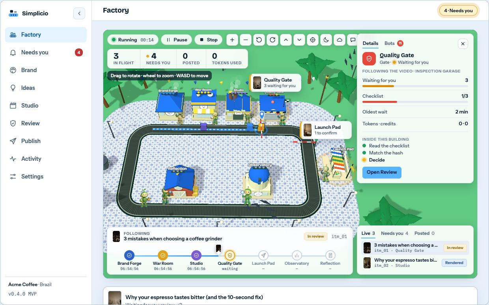

# Panel prototype

A clickable prototype of the MVP panel. It exists so the owner and the people who build the panel can **see the screens, fields, states and themes** before the real code exists. It is a throwaway: sample data, no server, no real agents.



## Open it

`index.html` is one self-contained file (plain HTML, CSS and JS; no build step). It loads Three.js `0.160.0` from cdnjs and two Google Fonts, so it needs internet. Serve the folder and open it:

```bash
python3 -m http.server -d docs/factory/prototype 8765   # then open http://localhost:8765/index.html
```

Use a local server rather than opening the file from disk: some browsers restrict pages loaded from `file://`.

## What to try

- **Factory**: agents walk to their stations, the belt runs, the Quality Gate barrier closes when a video waits for you. Click a building or a step in the stepper to see that station in the side panel. Click a video on the belt, or a row in the queue, to follow it (blue ribbon and pin). Drag, wheel or pinch to move the camera. Use the toolbar to zoom, rotate, reset, switch day and night, or hide the panel.
- **Approve** the amber item at the Quality Gate, then **hold** the button on the Publish step to confirm a post. Posting is a deliberate gesture on purpose.
- **Scenario** (top bar or Settings → Appearance): nine themes. Only Brazil is in the MVP; the others show that the same format carries very different looks.
- **View**: `3D with models` (procedural low-poly agents), `3D with 2D art` (the 2D characters standing in the 3D world) and `2D flat (fallback)` for devices without WebGL.
- **Device** and **language** (English, Portuguese), **RTL preview**, and the collapsible side menu.
- **Demo autopilot** approves and confirms on its own so you can watch the whole loop. That switch exists only in this prototype.

## Screens

| Screen | Shot |
|---|---|
| Factory, day / night / 2D art in 3D | [day](screens/factory-day.jpg) · [night](screens/factory-night.jpg) · [sprites](screens/factory-sprites.jpg) |
| Factory on a phone | [day](screens/factory-phone.jpg) · [night, details open](screens/factory-phone-night.jpg) |
| Factory in Portuguese and right-to-left | [pt-BR](screens/factory-pt-br.jpg) · [RTL](screens/factory-rtl.jpg) |
| Nine themes in 3D | [montage](screens/themes-3d.jpg) |
| Login, Needs you, Brand, Ideas, Studio | [login](screens/login.jpg) · [inbox](screens/inbox.jpg) · [brand](screens/brand.jpg) · [ideas](screens/ideas.jpg) · [studio](screens/studio.jpg) |
| Review, Publish (desktop and phone) | [review](screens/review.jpg) · [publish](screens/publish.jpg) · [review phone](screens/review-phone.jpg) · [publish phone](screens/publish-phone.jpg) |
| Activity, Settings | [activity](screens/activity.jpg) · [scenarios](screens/settings-scenarios.jpg) · [limits](screens/settings-policy.jpg) |

## What it is not

- Not the product. Pages, fields and states follow the spec in [`docs/factory`](../README.md); the numbers are examples.
- Not secure or multi-user. In the product only a human session can approve a video or confirm a post.
- Not final art. The Brazil theme is original procedural geometry; the other eight are concepts.

## Design notes the prototype settles

- **One system color**: light blue. Themes restyle the scene only, never the interface.
- **The factory is a digital twin**: the 3D scene is the hero, and the numbers, the followed video, the station details and the queue float over it. On a phone the scene stays on top and the same pieces stack below it.
- **Zero-token motion**: speech bubbles, labels and states are catalog templates filled with ids and numbers, so the scene is alive in every language at no token cost.
- **Accessibility**: reduced motion stops pulses and camera moves; every control has a text label or `aria-label`; the 2D view is the fallback when WebGL is missing.

## URL parameters

`page` (`login`, `factory`, `inbox`, `brand`, `ideas`, `studio`, `review`, `publish`, `activity`, `settings`), `lang` (`en`, `pt-BR`), `theme` (`br`, `us`, `cn`, `ru`, `jp`, `dragons`, `realms`, `courtyard`, `tiny`), `view` (`3d`, `3d-sprites`, `2d`), `tod` (`day`, `night`), `scheme` (`light`, `dark`), `device` (`desktop`, `phone`), `rail` (`min`), `panel` (`1`, `0`), `auto=1`, `rtl=1`, `upload=1`, `tab` (Settings tab).

Handy for screenshots: `warm=14` runs the simulation for 14 seconds before the first frame, `hud=0` hides every overlay and shows the bare scene, `lowfx=1` lowers shadow quality for software renderers.

## Richer art (next)

The owner asked for more elaborate images generated with GPT Image 2 through Real Oficial's MCP. The prototype already knows how to use them: drop the raw images in `src/art/raw/`, run `python3 src/art/pack.py` and rebuild. Nothing is generated yet (the MCP connection still needs the `media:write` permission); [image-brief.md](image-brief.md) holds the prompts, sizes, budget rules and the status.

## Rebuild

`index.html` is generated from the files in [`src/`](src/) (CSS, markup, art, message catalogs, the 3D scene, the HUD and the app). After editing them run:

```bash
python3 docs/factory/prototype/src/build.py
```

## Licenses

Three.js is MIT. The fonts are open-licensed (OFL). All art in the prototype is original and generated in code.
