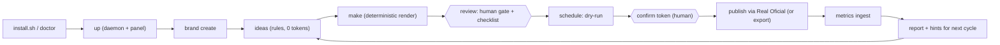

# Roadmap, MVP and release policy

## Principles for what we build now

1. **Token economy first.** The conveyor spends as few tokens as possible. The default path uses **zero LLM tokens**; see [token economy](README.md#token-economy).
2. **Reuse what we already have.** Video generation is solved: deterministic contract → voice → render → edit with HyperFrames, ffmpeg, Kokoro and the motion library. We do not build another way to make videos. Paid video and image generators (Real Oficial AI media, TopView, Higgsfield) are **optional steps of an individual item**, never part of the default route.
3. **Real Oficial for what it already does well:** publishing and scheduling, analytics, captions, translations and dubbing, covers, launcher queues. Using its AI for captions or dubbing also saves our tokens.
4. **Minimum that can go to production, every release.** Each release has every shipped stage working end to end. We drop a stage from a release rather than ship it broken.
5. **Test first.** Contract suites, flow tests and the loop end-to-end test exist before the code they test.

## MVP (v0.4.0): "one theme, videos working, posting through Real Oficial"

Promise: a developer clones the repo, installs, runs one daemon, opens the panel in one theme, creates a brand from a URL, generates a video with the deterministic engine, approves it, and it is scheduled and posted through Real Oficial (or exported when the provider cannot take our file); metrics come back and the loop starts the next cycle. Local, no LLM key needed.

| In the MVP | Out of the MVP (later milestones) |
|---|---|
| Core engine (exists) and plugin host, `doctor`, `install`, `update`, `plugin` | LangGraph, CrewAI, A2A, Langfuse |
| Store, policy (minimal), security (minimal), simple loop runner | Library, cast, plan, compliance plugin, evals |
| Plugins: brand, ideas, studio, review, publish (+ export), realoficial, metrics | Paid media plugins, Postiz, other publishers |
| Panel: Inbox, Brand, Review, Publish, Activity; 2D SVG factory scene; theme engine; theme `br`; `en` + `pt-BR` | Three.js renderer, 14 more themes, 13 more languages |
| Offline demo and the end-to-end flow test | Integrations (Stripe, HubSpot, GA, ...) |

**Hard dependency, decided first:** Real Oficial's MCP has no tool to upload a local MP4 as far as its published tool list shows, and its REST docs (`docs.realoficial.com.br`) are behind a browser check we could not read. Issue #19 starts with that spike. The MVP's "posting" criterion is met in one of two ways: (a) Real Oficial exposes an upload or create-from-file path (MCP tool or REST) that we use; (b) until it does, the export bundle plus the Real Oficial features that do work (captions, scheduling of their clips, analytics) ship, and the gap is stated plainly in the release notes. We will ask Real Oficial for (a) in parallel.

## Milestones and releases

| Milestone | Release | Theme of the release |
|---|---|---|
| M0 Foundation | (no tag) | Gate, plugin host, kernel, skeleton loop on fakes with the end-to-end test green |
| M1 MVP | v0.4.0 | The promise above |
| M2 Agents and learning | v0.5 | LangGraph, CrewAI, A2A, Langfuse, lessons and experiments, evals, MCP over HTTP and notifications. Optional and token-budgeted |
| M3 Content depth | v0.6 | Plan, library, cast, compliance plugin, Real Oficial media (optional paid), Postiz, game rules |
| M4 Plugins and integrations | v0.7 | Social and ads, payments, checkout, CRM, attribution, analytics, VSL, agent runtimes, AI media tools |
| M5 Themes and languages | v0.8 | Three.js renderer, 14 more themes, 13 more languages |
| M6 Site and sponsorship | v0.9 | Public site with sponsor placements, signed sponsor cards, legal terms ([monetization.md](monetization.md)) |

### Release policy (every release)

- `make check-full` green; the loop end-to-end test runs with **every shipped stage real**; `simplicio-video demo` completes offline; `simplicio-video doctor` is green on a fresh clone (macOS and a Linux container).
- A plugin that is not ready ships as `status: experimental` (hidden) or not at all.
- Every issue merges only with the gate green and the end-to-end flow test green; a merge that breaks a stage is reverted first and fixed after.
- The CHANGELOG lists what changed, the known limitations and the cost profile (tokens and credits of the default path: zero tokens).

## Test-first policy

Every issue starts with tests, in this order, as separate commits: (1) contract tests (the plugin kind's contract suite, schema and fixture tests), (2) flow tests (the stage's flow and the loop end-to-end test that includes it), (3) the implementation. A PR shows the first commit red. `scripts/check_tdd.py` enforces the order (the first commit touches only tests and docs unless the PR has the `tdd-exempt` label and a reason). The end-to-end matrix runs the loop with each real stage swapped in while the others stay stubs, so a stage can land the day it is ready without waiting for the rest.
