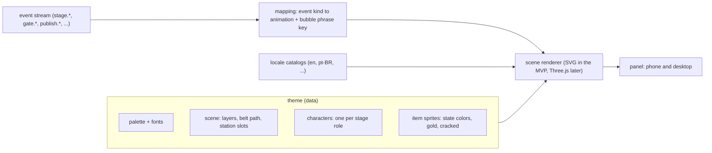

# Themes, characters and languages

A **theme** changes how the factory *looks and speaks* in the panel: the scenery, the belt, the stations and one 2D character per stage. It never changes behavior and never touches the generated videos. A theme is **data only** (no code runs), so anyone can make one.

Status: MVP ships **one** theme (`br`) in **two** languages (`en`, `pt-BR`). The format below is built for 15 themes and 15 languages; the rest arrive as data packs after the MVP (see [roadmap.md](roadmap.md)).

## What a theme contains

```
themes/<id>/
  theme.json          # schema simplicio.theme/v1
  assets/*.svg        # scenery layers, belt, station props, one character sprite per role, item sprites
  locales/<lang>.json # character names, taglines, bubble phrases for this theme (per language)
  LICENSE.md          # who made the art, under which license (required)
```



### `theme.json` (sketch)

```json
{
  "schema": "simplicio.theme/v1",
  "id": "br", "name": "Brazil", "version": "0.1.0",
  "languages": ["pt-BR", "en"], "default_language": "pt-BR",
  "license": {"spdx": "LicenseRef-Proprietary-FreeUse", "art_origin": "original", "attribution": "...", "notes": ""},
  "palette": {"bg": "#0b3d2e", "belt": "#2a2a2a", "accent": "#ffd500", "text": "#ffffff"},
  "fonts": [{"family": "Inter", "src": "assets/fonts/Inter.woff2", "license": "OFL-1.1"}],
  "scene": {
    "landscape": {
      "viewBox": [1280, 720],
      "layers": [{"id": "sky", "asset": "assets/sky.svg", "parallax": 0.1}, {"id": "ground", "asset": "assets/ground.svg"}],
      "belt": {"path": "M80 600 C 400 520, 880 680, 1200 600 S 1200 200, 640 200 S 80 200, 80 600 Z", "speed": 1.0},
      "stations": [{"stage": "brand", "x": 160, "y": 560, "asset": "assets/station-brand.svg", "label_key": "station.brand"}]
    },
    "portrait": {"viewBox": [720, 1280], "layers": [], "belt": {"path": "...", "speed": 1.0}, "stations": []}
  },
  "characters": [{"stage": "brand", "role": "brander", "name_key": "char.brander.name", "asset": "assets/char-brander.svg", "bubble_anchor": [0.5, 0.0]}],
  "items": {"states": {"idea": "#9aa0a6", "rendered": "#4285f4", "approved": "#34a853", "published": "#fbbc04", "failed": "#ea4335"}, "outlier_asset": "assets/item-gold.svg", "failed_asset": "assets/item-cracked.svg"}
}
```

Rules (validated by `simplicio-video theme validate <dir>`, tested by the `ThemeContract` suite):

- Assets are local SVG/WOFF2 only: no scripts, no `<foreignObject>`, no external references, size caps; the validator sanitizes and rejects.
- Every `*_key` resolves in every declared language, or the theme does not validate for that language.
- `license` and `art_origin` (`original`, `licensed`, `ai-generated`) are mandatory; `ai-generated` themes record the tool in `notes`.
- A scene has a `landscape` and a `portrait` variant (desktop and phone); coordinates are in each variant's `viewBox`, so the scene scales without distortion and only the layout around it changes.
- The scene spec is renderer-neutral: the MVP renderer draws it with SVG and CSS animations; a Three.js renderer can load the same sprites later for isometric or 3D scenery without changing any theme.

## Characters: one per stage, localized

Each stage has a character. A theme gives it a name, a sprite and the phrases it says. The **bubble text is not written by an LLM**: it is a template per event kind in the locale catalogs (`events.agent.handoff`, `events.gate.opened`, `events.publish.published`, ...), filled with ids and numbers. That keeps the experience alive in every language at **zero token cost**. Free-text messages that real agents write (post-MVP) are shown as written, next to the template.

| Stage | Role (character) | Typical bubble (en) |
|---|---|---|
| market | Scout | "Found 3 competitors to watch." |
| brand | Brander | "Brand profile ready: 12 facts, all sourced." |
| ideas | Ideator | "5 hooks drafted, ranked by past results." |
| cast | Caster | "Character ready, consent on file." |
| make | Director | "Preview rendered (15 s, 9:16)." |
| review | Critic / Gatekeeper | "Waiting for you: 3 items to review." |
| schedule | Poster | "Scheduled for Tuesday 18:00 on 2 accounts." |
| metrics | Analyst | "Day 3: 4.1k views, +38% vs average." |
| reflect | Reflector | "Pattern found: short hooks win (n=9)." |
| evolve | Evolver | "Next cycle: more short hooks." |

## Choosing and customizing

- Settings → **Scenario** lists installed themes; the choice is stored in the workspace (`settings.theme`) and per browser (`localStorage`) so phones and desktops can differ.
- A custom theme is a folder: `simplicio-video theme new <id>` scaffolds it with the minimal valid files, `theme validate` checks it, drop it in `<workspace>/themes/<id>/` (or `theme install <path|git-url>`). No Python, no build step.
- Themes can be shared as folders or git repositories; the gallery on the site (post-MVP) lists only themes whose license lets us host and show them. **Official themes are project-owned and proprietary (free to use inside the product); third-party themes keep their authors' licenses.**

## Languages

The panel strings, the stage and station names and the bubble templates live in catalogs per language (`locales/<lang>/ui.json`, `events.json`; theme specifics in the theme). English is the source language. The MVP ships `en` and `pt-BR`. The plan is **15 languages, one country theme each**; this list is a proposal for the owner to confirm:

| # | Language | Country theme | Notes |
|---|---|---|---|
| 1 | pt-BR | Brazil (`br`) | MVP |
| 2 | en-US | United States (`us`) | MVP language, theme later |
| 3 | es-MX | Mexico (`mx`) | |
| 4 | zh-CN | China (`cn`) | CJK fonts, line breaking |
| 5 | ru-RU | Russia (`ru`) | Cyrillic fonts; use architecture and folk patterns, no political symbols |
| 6 | fr-FR | France (`fr`) | |
| 7 | de-DE | Germany (`de`) | long words: layout must not clip |
| 8 | it-IT | Italy (`it`) | |
| 9 | ja-JP | Japan (`jp`) | CJK, vertical text not needed |
| 10 | ko-KR | South Korea (`kr`) | |
| 11 | hi-IN | India (`in`) | Devanagari fonts |
| 12 | ar-SA | Saudi Arabia (`sa`) | **RTL**: mirrored layout, tested separately |
| 13 | tr-TR | Turkey (`tr`) | |
| 14 | id-ID | Indonesia (`id`) | |
| 15 | pl-PL | Poland (`pl`) | |

Rules for every locale: the catalog is complete (a gate check compares keys with English), plural and number formatting use the platform `Intl` APIs, no string is concatenated in code, and each pack is reviewed by a native speaker before it is marked `stable` (a machine draft is `experimental`).

## Genre themes (the fun ones)

Besides country themes, the factory can have genre scenarios: dragons and fantasy realms, a neighborhood courtyard sitcom, tiny factory mascots, and so on.

**We ship only original art.** Minions, Chaves, Game of Thrones and similar are protected franchises: names, characters and look-alike trade dress cannot be committed to this repository or its gallery, even as "inspired by". What we ship instead are original genre themes (for example `dragons`, `realms`, `courtyard`, `tiny-workers`). A person can still build a **private** theme with art they have the right to use; the format supports it, but the art and the risk are theirs, the validator requires the `license` block, and the theme must never be added to the repo.

## Cultural quality

Country themes use positive, recognizable motifs (architecture, patterns, landmarks, colors, music-free) and avoid caricature, political symbols and sensitive stereotypes. Each theme is reviewed by someone from that culture before `stable`. Art by AI tools is allowed only with the tool and its terms recorded in `license.notes`.

## MVP theme scope

`themes/br` + `locales/en`, `locales/pt-BR`: one scene (belt loop with 7 stations used by the MVP loop: brand, ideas, make, review, publish, metrics, report/evolve), 8 characters in flat vector SVG, item sprites (states, gold, cracked), bubble templates for every event kind the MVP emits, `theme validate` green, rendered at 375 px and 1440 px.
