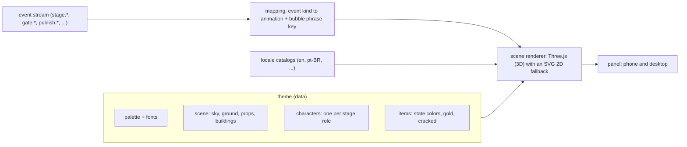

# Themes, characters and languages

A **theme** changes how the factory *looks and speaks* in the panel: the 3D scenery, the belt, the stations and one character per stage. It never changes behavior, never touches the generated videos and never changes the interface color. A theme is **data only** (no code runs), so anyone can make one.

Status: MVP ships **one** theme (`br`) in **two** languages (`en`, `pt-BR`). The format below is built for 15 themes and 15 languages; the rest arrive as data packs after the MVP (see [roadmap.md](roadmap.md)).

## What a theme contains

```
themes/<id>/
  theme.json          # schema simplicio.theme/v1: palette, sky, ground, props, characters, items
  assets/             # plaza pattern, character sprites, 2D fallback art (SVG, PNG or WebP)
  locales/<lang>.json # character names, taglines, bubble phrases for this theme (per language)
  LICENSE.md          # who made the art, under which license (required)
```



### `theme.json` (sketch)

```json
{
  "schema": "simplicio.theme/v1",
  "id": "br", "name": "Brazil", "version": "0.1.0",
  "languages": ["pt-BR", "en"], "default_language": "pt-BR",
  "license": {"spdx": "LicenseRef-Proprietary-FreeUse", "art_origin": "original", "attribution": "...", "notes": ""},
  "palette": {"wall": "#fff3d6", "roof": "#2a62c9", "trim": "#ffd23f", "belt": "#2a2a2a", "line": "#ffd23f", "gate": "#e5483b", "ink": "#10243a"},
  "scene": {
    "sky": {"day": ["#8fd8ff", "#d9f3ff"], "night": ["#050b20", "#1b2a5c"]},
    "ground": {"color": "#58b977"},
    "plaza": {"pattern": "assets/plaza.svg", "tile_size": 2.1},
    "props": [
      {"kind": "palm", "at": [-13, -8], "scale": 1.1},
      {"kind": "bunting", "from": [-11, -8.6], "to": [11, -8.6], "colors": ["#ffd23f", "#25a050", "#2a62c9", "#ffffff"]},
      {"kind": "sun", "at": [-15, 10, -19], "color": "#ffe27a"}
    ],
    "fallback_2d": {
      "landscape": {"viewBox": [1280, 780], "layers": ["assets/2d-landscape.svg"]},
      "portrait": {"viewBox": [720, 1200], "layers": ["assets/2d-portrait.svg"]}
    }
  },
  "characters": [{"stage": "brand", "role": "brander", "name_key": "char.brander.name", "model": {"body": "#25a050", "head": "#ffe9a8", "accent": "#2a62c9"}, "sprite": "assets/char-brander.svg"}],
  "items": {"states": {"idea": "#9aa3a0", "drafted": "#6a5acd", "rendered": "#3b82f6", "in_review": "#f0a81c", "approved": "#22a35a", "published": "#facc15", "failed": "#7a1f1f"}}
}
```

Rules (validated by `simplicio-video theme validate <dir>`, tested by the `ThemeContract` suite):

- Assets are local SVG, PNG, WebP or WOFF2 only: no scripts, no `<foreignObject>`, no external references. SVG is sanitized; raster images are size-capped and re-encoded.
- `props` come from a **built-in catalog** (palm, tree, blossom tree, lamp, lantern, banner, torch, bunting, dome, castle, torii, gear, cloud, mountain, rainbow, sun, moon, snow, petals) parameterized by the theme, or from a `sprite` billboard of your own image. No theme code runs. Custom 3D models (glTF) are post-MVP and will go through the same validator.
- Every `*_key` resolves in every declared language, or the theme does not validate for that language.
- `license` and `art_origin` (`original`, `licensed`, `ai-generated`) are mandatory; `ai-generated` themes record the tool in `notes`.
- Every theme declares a **day** and a **night** sky; the renderer derives lights, fog, window glow and lamps from them.
- The scene is 3D. `fallback_2d` has a `landscape` and a `portrait` variant (coordinates in each `viewBox`) for devices without WebGL and for people who pick the flat view, so they still get the same factory.
- The scene spec is renderer-neutral: the Three.js renderer is the default and the SVG renderer is the fallback. Both read the same theme.

## Buildings, rooms and world

Every stage has its own kind of building, so the scene reads like a small town in a game and not like seven identical boxes: a workshop house (brand), an idea shop (ideas), a video factory (make), an inspection garage (review), a launch market (publish), an observatory (metrics) and a learning barn (report). Each building has **rooms**, the sub-steps of its stage (for example Studio: write script, record voice, compose scenes, render, quality check); a row of lamps on the roof lights up as the followed video moves through them, and the station panel lists them. The belt runs through the whole town.

The world around it is alive and costs no tokens: weather (sun, rain, snow, desert, fog), clouds, birds, a plane with a contrail, a lake with boats and jumping fish, fireflies at night. Weather and time of day are part of the scene, not of the theme's identity, so any theme can be rained on.

The factory is also a chat: each agent can be clicked and asked for its status, what needs the human, to show or follow it, or to change the weather. Replies come from catalog templates (zero tokens); in the product the same panel can talk to real agents.

## Day and night

The scene has two lighting states. At night the sky and fog change, windows and street lamps glow, and 2D sprites are dimmed. The default follows the system color scheme; a button over the scene switches it, and the choice is remembered per browser. Night never changes behavior.

## Interface color

Themes restyle the scene only. The interface keeps one **system color, light blue**, in light and dark mode, so buttons, links, focus rings and the menu look the same under every theme. A theme cannot change it.

## Characters: one per stage, localized

Each stage has a character. A theme gives it a name, a model look (colors) and a 2D sprite, and the phrases it says. The **bubble text is not written by an LLM**: it is a template per event kind in the locale catalogs (`events.agent.handoff`, `events.gate.opened`, `events.publish.published`, ...), filled with ids and numbers. That keeps the experience alive in every language at **zero token cost**. Free-text messages that real agents write (post-MVP) are shown as written, next to the template.

| Stage | Role (character) | Typical bubble (en) |
|---|---|---|
| market | Scout | "Found 3 competitors to watch." |
| brand | Brander | "Brand profile ready: 12 facts, all sourced." |
| ideas | Ideator | "5 hooks drafted, ranked by past results." |
| cast | Caster | "Character ready, consent on file." |
| make | Director | "Preview rendered (15 s, 9:16)." |
| review | Critic / Gatekeeper | "Waiting for you: 3 items to review." |
| schedule | Poster | "Scheduled for Tuesday 18:00 on 2 accounts." |
| metrics | Analyst | "Day 3: 4.1k views, +38% vs average." |
| reflect | Reflector | "Pattern found: short hooks win (n=9)." |
| evolve | Evolver | "Next cycle: more short hooks." |

## Choosing and customizing

- Settings → **Scenario** lists installed themes; the choice is stored in the workspace (`settings.theme`) and per browser (`localStorage`) so phones and desktops can differ.
- A custom theme is a folder: `simplicio-video theme new <id>` scaffolds it with the minimal valid files, `theme validate` checks it, drop it in `<workspace>/themes/<id>/` (or `theme install <path|git-url>`). No Python, no build step.
- Themes can be shared as folders or git repositories; the gallery on the site (post-MVP) lists only themes whose license lets us host and show them. **Official themes are project-owned and proprietary (free to use inside the product); third-party themes keep their authors' licenses.**

## Languages

The panel strings, the stage and station names and the bubble templates live in catalogs per language (`locales/<lang>/ui.json`, `events.json`; theme specifics in the theme). English is the source language. The MVP ships `en` and `pt-BR`. The plan is **15 languages, one country theme each**; this list is a proposal for the owner to confirm:

| # | Language | Country theme | Notes |
|---|---|---|---|
| 1 | pt-BR | Brazil (`br`) | MVP |
| 2 | en-US | United States (`us`) | MVP language, theme later |
| 3 | es-MX | Mexico (`mx`) | |
| 4 | zh-CN | China (`cn`) | CJK fonts, line breaking |
| 5 | ru-RU | Russia (`ru`) | Cyrillic fonts; use architecture and folk patterns, no political symbols |
| 6 | fr-FR | France (`fr`) | |
| 7 | de-DE | Germany (`de`) | long words: layout must not clip |
| 8 | it-IT | Italy (`it`) | |
| 9 | ja-JP | Japan (`jp`) | CJK, vertical text not needed |
| 10 | ko-KR | South Korea (`kr`) | |
| 11 | hi-IN | India (`in`) | Devanagari fonts |
| 12 | ar-SA | Saudi Arabia (`sa`) | **RTL**: mirrored layout, tested separately |
| 13 | tr-TR | Turkey (`tr`) | |
| 14 | id-ID | Indonesia (`id`) | |
| 15 | pl-PL | Poland (`pl`) | |

Rules for every locale: the catalog is complete (a gate check compares keys with English), plural and number formatting use the platform `Intl` APIs, no string is concatenated in code, and each pack is reviewed by a native speaker before it is marked `stable` (a machine draft is `experimental`).

## Genre themes (the fun ones)

Besides country themes, the factory can have genre scenarios: dragons and fantasy realms, a neighborhood courtyard sitcom, tiny factory mascots, and so on.

**We ship only original art.** Minions, Chaves, Game of Thrones and similar are protected franchises: names, characters and look-alike trade dress cannot be committed to this repository or its gallery, even as "inspired by". What we ship instead are original genre themes (for example `dragons`, `realms`, `courtyard`, `tiny-workers`). A person can still build a **private** theme with art they have the right to use; the format supports it, but the art and the risk are theirs, the validator requires the `license` block, and the theme must never be added to the repo.

## Cultural quality

Country themes use positive, recognizable motifs (architecture, patterns, landmarks, colors, music-free) and avoid caricature, political symbols and sensitive stereotypes. Each theme is reviewed by someone from that culture before `stable`. Art by AI tools is allowed only with the tool and its terms recorded in `license.notes`.

## MVP theme scope

`themes/br` + `locales/en`, `locales/pt-BR`: one 3D scene (belt loop with 7 stations used by the MVP loop: brand, ideas, make, review, publish, metrics, report/evolve) with day and night, 8 characters (procedural models, plus 2D sprites for the sprite view), item posters (state colors, gold, cracked), a 2D fallback, bubble templates for every event kind the MVP emits, `theme validate` green, rendered at 375 px and 1440 px. See the [clickable prototype](prototype/README.md).
