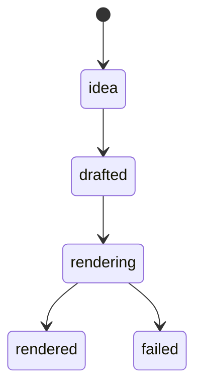
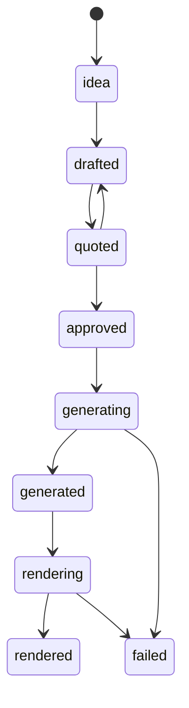

# Duas rotas de produção

Um item segue uma de duas rotas, dada por `production.route` ([ADR-0008](../decisoes/ADR-0008-duas-rotas.md)). A rota `deterministic` é o padrão e não usa modelo. A rota `ai_assisted` gera o vídeo com IA no Real Oficial, e só gasta créditos depois que uma pessoa aprova o orçamento. As duas chegam ao mesmo render final, o do studio ([ADR-0018](../decisoes/ADR-0018-render-final-deterministico.md)).

## Os dois grafos

Rota determinística, o caminho padrão:

Rota ai_assisted, com estimativa e aprovação antes de qualquer gasto:

Os dois grafos estão em `transitions_for(route)` (`src/simplicio_factory/contracts/transitions.py`). `transition()` recusa qualquer par que não esteja no grafo da rota do item.

## Comandos por etapa

| Rota | Etapa | Comando |
|---|---|---|
| deterministic | importa o Draft e roda até `rendered` | `simplicio-video make --from draft.json` |
| deterministic | prévia 540x960 com marca d'água (não muda o estado) | `simplicio-video make preview ITEM` |
| ai_assisted | cota o custo (`drafted` para `quoted`) | `simplicio-video generate quote ITEM --provider real-oficial --estimate-ref REF --credits N` |
| ai_assisted | aprova o gasto (`quoted` para `approved`) | `simplicio-video generate approve ITEM --by NOME` |
| ai_assisted | inicia a geração (`approved` para `generating`) | `simplicio-video generate start ITEM` |
| ai_assisted | mostra o passo, o custo e quem aprovou | `simplicio-video generate show ITEM` |
| ai_assisted | anexa o MP4 com recibo (`generating` para `generated`) | `simplicio-video media attach ITEM ARQUIVO --source real-oficial --media-id ID --prompt-file ARQ` |
| ambas | renderiza o item até `rendered` (no ai_assisted, com a mídia anexada) | `simplicio-video make ITEM` |
| ambas | quadro e revisão | `simplicio-video board list`, `simplicio-video board comment ITEM "texto" --by NOME`, `simplicio-video board review ITEM approve --by NOME`, `simplicio-video board build --out board.html` |

Cada comando tem `--help` com exemplo. O passo a passo com o Real Oficial está no [runbook](../how-to/gerar-video-real-oficial.md).

## O que é reproduzível e o que não é

| Parte | Reproduzível byte a byte? | Por quê |
|---|---|---|
| `contract.yaml` (composição) | sim, nas duas rotas | o composer não tem relógio, aleatoriedade nem rede; a mesma entrada dá os mesmos bytes |
| Render final do studio | sim, para a mesma entrada | o mesmo contrato e as mesmas mídias dão o mesmo `content_hash` e o mesmo MP4 no motor |
| Mídia gerada pela IA | não | outra geração do mesmo prompt dá outro arquivo, e cada geração gasta créditos |

Na rota ai_assisted, a parte que não se repete é a geração. O que fica fixo é a mídia anexada: o recibo guarda o sha256 do arquivo, e o render confere esse hash antes de copiar a mídia. Se o arquivo mudou, o render recusa. Para trocar a mídia, a saída nesta versão é outro item.

## Onde mora cada decisão

- **A rota.** `production.route` do item, escolhida quando o kernel cria o item (ADR-0008). Nenhum comando da CLI faz essa escolha ainda: o `make --from` cria itens na rota `deterministic`.
- **O orçamento.** `budgets.media_credits` no `policy.yaml` do workspace. `generate quote` recusa o custo que passa do orçamento ou do teto diário (padrão 1000 créditos).
- **Quem aprova o gasto.** A pessoa. `generate approve --by NOME` pede confirmação no terminal, ou exige `--yes` quando não há terminal, e grava quem aprovou no passo. `generate start` só roda com essa aprovação registrada. No Real Oficial, a confirmação de gasto é o `ro_confirm_spend`, com o aceite da pessoa; o agente não aceita termos por ela.
- **O recibo.** `studio/<item>/media.json` (schema `simplicio.media-receipt/v1`): sha256 do arquivo e do prompt, id da mídia, referência da estimativa, custo e aprovador. O texto do prompt não entra no recibo.
- **O claim guard.** Preço, número ou promessa que não estão em `brand.json` recusam o `media attach` e o composer, antes de qualquer transição.
- **O render final.** `make ITEM` roda o estágio studio: o contrato vai ao motor, e a mídia anexada entra como asset. O que o render final garante:
  - a marca: paleta, logo e o lockup da última cena, todos vindos de `brand.json`;
  - o formato 9:16 em 1080x1920, com 30 fps;
  - o loudness de −14 LUFS no render local, feito pelo `master.sh`;
  - o `content_hash` em `studio/<item>/studio.json`, que é igual para o mesmo Draft, a mesma marca e a mesma mídia anexada.
- **O que o render final não garante.** Legendas: o template `brand-promo` não tem legenda, então nenhuma das duas rotas as produz.

## Medido na primeira geração real (08/10/2026)

- Uma geração de vídeo levou cerca de 5 minutos.
- O modelo incluído no plano, `minimax-h3-turbo`, não gasta créditos. Outros modelos cobram, e o custo aparece na estimativa antes da aprovação.
- O `media_url` que o Real Oficial devolve é pessoal, expira em até 1 hora e serve só para baixar o arquivo. Não vai para legenda, post, comentário ou commit.

## Ver também

- [Media (orçamento, aprovação, start e attach)](../plugins/media.md)
- [Studio (Draft e marca viram vídeo)](../plugins/studio.md)
- [Board (quadro kanban dos itens)](../plugins/board.md)
- [Gerar vídeo por IA com o Real Oficial (runbook)](../how-to/gerar-video-real-oficial.md)
- [ADR-0008 (duas rotas)](../decisoes/ADR-0008-duas-rotas.md) e [ADR-0018 (render final determinístico)](../decisoes/ADR-0018-render-final-deterministico.md)
