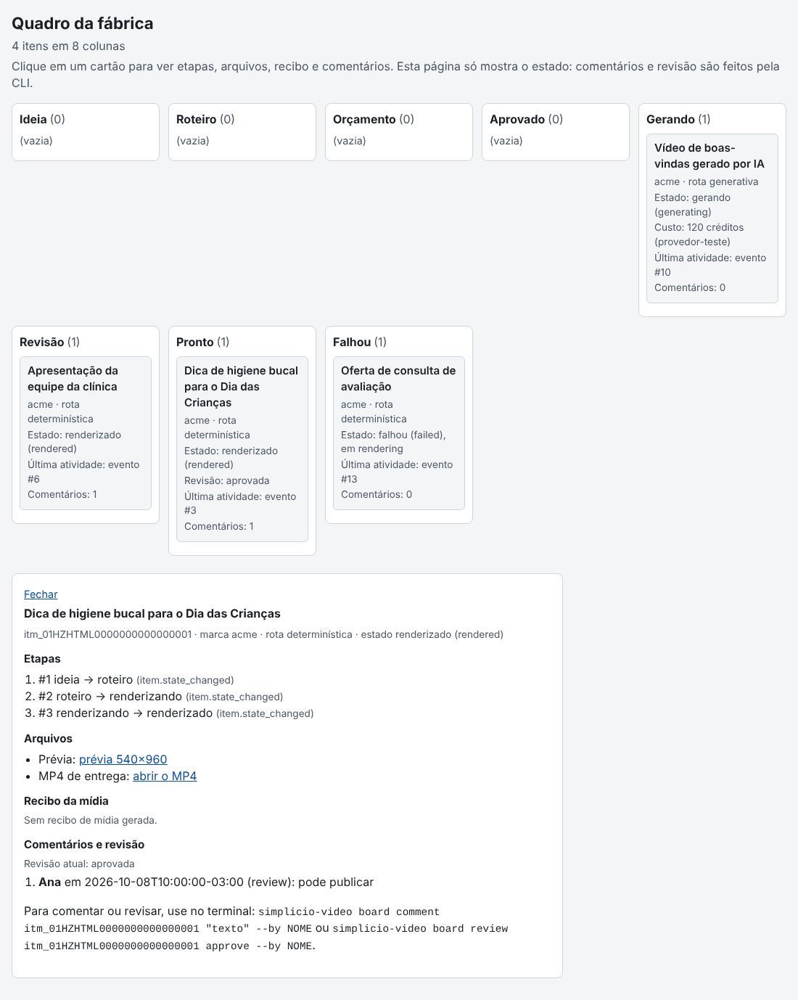

# Board (quadro kanban dos itens)

O board (issue #86, épico #81) mostra os itens da fábrica como um quadro kanban. Cada item vira um cartão, e a coluna do cartão sai do estado do item (`state`) e da revisão humana (`review`). Ele também guarda comentários e a revisão do vídeo renderizado. Não há LLM nem rede no caminho padrão.

Código: `src/simplicio_factory/plugins/board/`. Comandos declarados em [plugin.json](../../src/simplicio_factory/plugins/board/plugin.json) e registrados pelo host ([plugin-host.md](../host/plugin-host.md)). Estado dos itens e o grafo de transições: [kernel.md](../host/kernel.md).

O board não move cartão de etapa. Para mudar a coluna de um item, o estado dele muda pelo estágio que o produz (`transition()`); o board só lê. A única coisa que ele grava no item é `review`.

## Colunas

As colunas são derivadas. Nenhum item guarda a coluna: ela sai de `state`, e só para `rendered` também de `review`.

| Coluna | Chave | Estado (`state`) | Condição extra | Rotas |
|---|---|---|---|---|
| Ideia | `ideia` | `idea` | | deterministic, ai_assisted |
| Roteiro | `roteiro` | `drafted` | | deterministic, ai_assisted |
| Orçamento | `orcamento` | `quoted` | | ai_assisted |
| Aprovado | `aprovado` | `approved` | | ai_assisted |
| Gerando | `gerando` | `generating`, `generated`, `rendering` | | deterministic (só `rendering`), ai_assisted |
| Revisão | `revisao` | `rendered` | `review` não é `approved` | deterministic, ai_assisted |
| Pronto | `pronto` | `rendered` | `review` é `approved` | deterministic, ai_assisted |
| Falhou | `falhou` | `failed` | | deterministic, ai_assisted |

A rota determinística passa só por Ideia, Roteiro, Gerando (`rendering`), Revisão e Pronto. Falhou é o caminho de erro do render. A rota `ai_assisted` também passa por Orçamento e Aprovado, e por `generating` e `generated` em Gerando. A ordem das colunas no quadro é a da tabela.

## Comandos

| Comando | Para quê |
|---|---|
| `simplicio-video board list [--json]` | mostra as oito colunas e os cartões; com `--json`, imprime o quadro em JSON |
| `simplicio-video board comment ITEM "texto" --by NOME` | grava um comentário no item |
| `simplicio-video board review ITEM approve\|changes --by NOME [--note TEXTO]` | aprova ou pede alterações no vídeo renderizado |
| `simplicio-video board build [--out ARQUIVO]` | grava o quadro num HTML estático, de uma página só, para abrir no navegador ([seção abaixo](#dashboard-html-board-build)) |
| `simplicio-video board serve [--port N]` | sobe o quadro num servidor local em `127.0.0.1`, com formulário para comentar e botões para aprovar ou pedir alterações ([seção Servidor](#servidor-board-serve)) |

Cada comando tem `--help` com exemplo. O estado vem de `SIMPLICIO_FACTORY_HOME` (padrão `.simplicio-factory/`, gitignored).

### `board list`

```bash
simplicio-video board list
```

```text
Ideia (0)
  (vazia)
Roteiro (1)
  itm_SMOKE000000000000002  acme  [drafted]  rota=deterministic  comentários=1
Orçamento (0)
  (vazia)
Aprovado (0)
  (vazia)
Gerando (0)
  (vazia)
Revisão (0)
  (vazia)
Pronto (1)
  itm_SMOKE000000000000001  acme  [rendered]  rota=deterministic  comentários=1  review=approved
Falhou (0)
  (vazia)
```

Cada cartão mostra o id, a marca, o estado, a rota, o número de comentários e, se houver, o `review`. A ordem é fixa: colunas na ordem da tabela, cartões por id.

Com `--json`, a saída é determinística (sem horário, mesma entrada, mesmos bytes) e valida contra o schema [board.schema.json](../../schemas/factory/board.schema.json):

```bash
simplicio-video board list --json > quadro.json
```

```json
{
  "schema": "simplicio.board/v1",
  "columns": [
    {"id": "ideia", "title": "Ideia", "cards": []},
    {"id": "roteiro", "title": "Roteiro", "cards": [
      {"id": "itm_SMOKE000000000000002", "brand": "acme", "state": "drafted",
       "route": "deterministic", "review": null, "failed_from": null, "comments": 1}
    ]},
    "..."
  ]
}
```

A lista tem sempre as oito colunas, mesmo vazias. O cartão tem os sete campos do schema: `id`, `brand`, `state`, `route`, `review`, `failed_from` e `comments`.

### `board comment`

```bash
simplicio-video board comment itm_01HZEXEMPLO0000000000001 "Trocar a cor do logo" --by Bruno
```

```text
itm_01HZEXEMPLO0000000000001: comentário 1 registrado
```

`--by` é obrigatório: sem ele, o comando sai com código 2 e não grava nada. O texto e o autor não podem ser vazios. O item precisa existir.

### `board review`

```bash
simplicio-video board review itm_01HZEXEMPLO0000000000001 approve --by Ana --note "pode publicar"
simplicio-video board review itm_01HZEXEMPLO0000000000001 changes --by Ana --note "refazer o final"
```

- `approve` define `review: approved`. O cartão vai de Revisão para Pronto.
- `changes` define `review: changes_requested`. O cartão fica em Revisão.
- A revisão só vale para item em estado `rendered`. Em outro estado, o comando falha e não muda nada.
- Revisar de novo substitui o `review` anterior. Por exemplo, `changes` seguido de `approve` leva o cartão a Pronto.
- Sem `--note`, a linha de revisão leva um texto padrão (`aprovado` ou `alterações solicitadas`).

## Dashboard HTML (`board build`)

Issue #88, épico #81. `simplicio-video board build [--out board.html]` grava um único arquivo HTML com o quadro. Ele não precisa de servidor nem de rede: CSS e JS vêm inline, e o arquivo não tem nenhuma URL `http://` ou `https://`. Código: [html.py](../../src/simplicio_factory/plugins/board/html.py) e o template [board.html.tpl](../../src/simplicio_factory/plugins/board/templates/board.html.tpl).

```bash
simplicio-video board build --out quadro.html
```

```text
quadro.html: quadro gravado
```



**O que a página mostra.** Uma coluna por etapa, na ordem das oito colunas da tabela, com o total de cada uma. Um cartão por item, com:

- título (a ideia do Draft, se houver), marca e rota (determinística ou generativa);
- estado, e a revisão quando o item está `rendered`;
- custo em créditos, do último passo `ai_media` com `credits` (se houver);
- última atividade e número de comentários.

Clicar no cartão abre o detalhe do item:

- linha do tempo das etapas, com os eventos do item em ordem;
- links para a prévia 540x960 (`studio/renders/<id>-previa.mp4`) e para o MP4 de entrega (o `stages.studio.mp4` do `studio.json`), quando existirem;
- recibo da mídia gerada (`studio/<id>/media.json`, gravado por `media attach`), em JSON, quando o arquivo existir;
- comentários e revisão atual, com o comando da CLI para comentar ou revisar.

**Regras.**

- **Última atividade sai do último evento** do item (`evento #N`, o `seq` do `events.jsonl`). O HTML não guarda horário de geração, então a mesma entrada dá sempre os mesmos bytes.
- **Limite de 50 cartões por coluna**, os mais recentes pelo último evento. O resto aparece como `+N mais antigos fora do quadro`.
- **Escape.** Todo texto de cartão, de detalhe e de comentário é escapado. Um comentário com `<script>` aparece como texto.
- **Leitura apenas.** A página não tem formulário nem botão: não grava comentário e não move cartão. Comentar e revisar continuam na CLI.
- **Layout.** Uma coluna em 375 px, várias em 1440 px, sem rolagem horizontal. Tema claro e escuro pelo `prefers-color-scheme`. Foco visível, e cada cartão é um link, então dá para navegar pelo teclado. O texto tem contraste de pelo menos 4,5:1 nos dois temas (AA).
- **Links relativos.** A prévia e o MP4 são caminhos relativos à pasta onde o HTML foi gravado. Se o arquivo for movido, leve junto a pasta `studio/` ou gere de novo.
- **Recibo.** O quadro lê `studio/<id>/media.json`, o recibo que `media attach` grava (#87). Sem recibo, o detalhe diz que não há mídia gerada.

**Testes.** O golden do HTML com quatro itens (pronto, em revisão, gerando e falhou) fica em `tests/factory/plugins/board/golden/board.html`. O teste `ui` (marcador `ui`, Chromium) mede a rolagem horizontal da página em 375 e 1440 px, e pula quando o navegador não existe.

## Servidor (`board serve`)

Issue #89, épico #81 (post-mvp, opcional). `simplicio-video board serve [--port N]` sobe a mesma página do `board build` num servidor local, com um formulário para comentar e dois botões para aprovar ou pedir alterações. Código: [serve.py](../../src/simplicio_factory/plugins/board/serve.py). Usa só a biblioteca padrão (`http.server`): sem rede externa e sem LLM.

```bash
simplicio-video board serve --port 8765
```

```text
Quadro em http://127.0.0.1:8765/ (Ctrl+C para parar)
Token desta sessão: kDuu21F6srJ8qe3wX2J6g03FaZIb1ykH
Abra no navegador: http://127.0.0.1:8765/?token=kDuu21F6srJ8qe3wX2J6g03FaZIb1ykH
```

Abra o endereço da última linha. O token é novo a cada execução e vale enquanto o servidor estiver no ar. Com `--port 0`, o sistema escolhe uma porta livre.

**Escuta.** Só em `127.0.0.1`. `--host` aceita `127.0.0.1` ou `localhost`; qualquer outro valor, como `0.0.0.0`, sai com código 2 e não sobe nada. O servidor não atende pela rede.

**Rotas.** Só estas. Qualquer outro caminho é 404.

| Rota | Para quê | Resposta |
|---|---|---|
| `GET /?token=TOKEN` | a página do quadro, com o formulário | 200 |
| `POST /comment` (`token`, `item`, `by`, `texto`) | grava um comentário em `comments.jsonl` | 303, de volta ao quadro, com aviso |
| `POST /review` (`token`, `item`, `by`, `decisao`, `note` opcional) | define a revisão de um item `rendered`; `decisao` é `approve` ou `changes` | 303, de volta ao quadro |

Respostas de erro: 400 quando o pedido é inválido (item inexistente, texto vazio, revisão fora de `rendered`), com a mensagem na página; 403 sem token, com token errado, ou com `Host` ou `Origin` que não seja `localhost` ou `127.0.0.1`; 404 para qualquer caminho que não exista; 405 para método errado numa rota que existe.

**Nenhuma rota muda estado.** Não existe rota para mover cartão, mudar `state` de item, mexer no orçamento ou aprovar gasto. Aprovar gasto continua no terminal, com `generate approve`. Um pedido a uma dessas rotas recebe 404 e não grava nada.

**Escritas.** Comentário e revisão passam pelo mesmo serviço da CLI (`service.comentar` e `service.revisar`) e são serializados por uma trava no servidor: dois pedidos ao mesmo tempo gravam um depois do outro, sem repetir o id da linha. Depois de comentar ou revisar, `board build` e `board list` já mostram a mudança.

**Token e origem.** O token é aleatório (`secrets.token_urlsafe`), vale só nesta sessão e vai no formulário e na URL de abertura. Toda rota confere `Host` e, quando o navegador envia, `Origin`: os dois precisam ser `localhost` ou `127.0.0.1` na porta do servidor. As respostas saem com `Content-Security-Policy` restritiva, `Cache-Control: no-store` e `Referrer-Policy: no-referrer`.

**O que o token não é.** Ele protege contra páginas de terceiros abertas no mesmo navegador, que não conseguem ler a página nem enviar o formulário sem o token. Não é autenticação de usuário. Quem lê a saída do terminal, ou o histórico do navegador onde a URL foi aberta, tem o token e acesso ao quadro.

**Limites.**

- A página é a do `board build`. Os links de prévia e MP4 são caminhos relativos ao arquivo gravado pelo build, e o servidor só responde ao quadro e às duas rotas de escrita. Por isso esses links não abrem pelo servidor: use `board build` ou o terminal para abrir os arquivos.
- O servidor não move cartão e não muda o `state` de item. Para mudar a coluna, muda-se o estado pelo estágio que o produz.

## Comentários (`comments.jsonl`)

Os comentários ficam em `<SIMPLICIO_FACTORY_HOME>/items/<id>/comments.jsonl`, um objeto JSON por linha. O arquivo é append-only: cada comando só acrescenta uma linha, e as linhas antigas não são reescritas.

```json
{"id": 1, "at": "2026-10-08T10:00:00-03:00", "by": "Bruno", "kind": "comment", "text": "Trocar a cor do logo"}
{"id": 2, "at": "2026-10-08T10:05:00-03:00", "by": "Ana", "kind": "review", "text": "pode publicar"}
```

| Campo | Valor |
|---|---|
| `id` | posição da linha, a partir de 1 |
| `at` | horário de Brasília, ISO 8601 (`-03:00`) |
| `by` | quem escreveu (de `--by`) |
| `kind` | `comment` (de `board comment`) ou `review` (de `board review`) |
| `text` | o texto do comentário ou a nota da revisão |

Os comentários não mudam estado nem coluna. O board conta os comentários de cada item para mostrar o número no cartão.

## Schema do quadro

`schemas/factory/board.schema.json` é gerado por `make factory-schema`, que também grava `item.schema.json`. O gerador é [simplicio_factory/plugins/board/schema.py](../../src/simplicio_factory/plugins/board/schema.py), chamado por [contracts/schema.py](../../src/simplicio_factory/contracts/schema.py). Não edite o JSON à mão. O schema fixa as oito colunas na ordem (`prefixItems`) e os valores de `state`, `route` e `review`.

## Ressalvas

- **Escritores concorrentes.** Duas escritas no mesmo item ao mesmo tempo (dois `comment`, ou um `comment` e um `review`) podem se atropelar: o id da linha é calculado pelo número de linhas do arquivo, e o `review` é gravado com regravação do JSON do item. A CLI não tem trava de arquivo. O servidor (`board serve`, seção Servidor) serializa as escritas dos próprios pedidos com uma trava. A CLI não tem trava de arquivo: não rode `board comment` ou `board review` no mesmo item enquanto o servidor estiver gravando nele.
- **Dashboard somente leitura.** O HTML do `board build` só mostra o quadro. Para comentar e revisar pelo navegador, use `board serve` (seção Servidor), que escuta só em `127.0.0.1` e exige o token da sessão.
- **Coluna não se edita.** Não há comando para mover cartão. Para mudar a coluna, muda-se o estado do item pelo estágio que o produz.
