# motion/ — biblioteca de padrões de motion (HyperFrames)

Peças reutilizáveis de animação da esteira. Cada padrão é uma pasta `patterns/<id>/` com:

| Arquivo | O quê |
|---|---|
| `pattern.json` | Nome, descrição, status, categoria, **parâmetros** (id/tipo/default), quando usar, sincronia com a voz, **fonte/inspiração** (link). Formato: [`pattern.schema.json`](pattern.schema.json) |
| `block.html` | **Bloco HyperFrames** (sub-composição 1080×1920) — só nos padrões `pronto` |
| `preview.png` | Frame de preview (360×640) gerado pelo próprio bloco — só nos `pronto` |

Status: **pronto** (bloco + preview renderizados e com lint limpo) · **lib** (helper JS) · **inline** (validado dentro de um vídeo de cliente, ainda não extraído) · **proposto** (pesquisado e descrito, ainda sem bloco).

## Como usar um bloco num vídeo

1. Copie o bloco para o projeto: `cp motion/patterns/<id>/block.html clients/<c>/video-NN/compositions/<id>.html` (as fontes vêm de `assets/fonts/` do projeto — copie `motion/assets/fonts/` se faltar).
2. Monte no `index.html` (mesmo contrato dos componentes do registry do HyperFrames: o runtime clona só o `<template>`, a timeline registra na chave literal `<id>`):

```html
<div id="hook" class="clip" data-composition-id="kinetic-letters-punch"
     data-composition-src="compositions/kinetic-letters-punch.html"
     data-start="0" data-duration="2" data-track-index="1"
     data-variable-values='{"line1":"Seu","line2":"console","line3":"parou?","t3":0.68,"primary":"#e50914"}'></div>
```

3. Os valores de `data-variable-values` saem do **spec** (`spec.json`/`video.json`), nunca escritos à mão na composição: copy da `coleta/`, cores da marca, tempos das palavras (timestamps do faster-whisper sobre a narração — parâmetros `t*`/`times`/`words`).
4. `npm run check` no projeto. Testado: duas instâncias do mesmo bloco com valores diferentes na mesma composição funcionam.

Regras dos blocos: 100% determinísticos (rng com semente, nada de `Math.random`/`Date.now`/`fetch`/repeat infinito), estilos escopados em `[data-composition-id="<id>"]`, texto pt-BR com espaço para acentos (Ã, Ó) nas máscaras.

## Comandos

```bash
export PATH=~/.local/node22/bin:$PATH
bash motion/scripts/preview.sh            # lint + preview.png de todos os blocos (monta cada um via data-composition-src)
bash motion/scripts/preview.sh <id>       # só um
node motion/scripts/catalog.mjs           # regenera catalog.json + a tabela abaixo a partir dos pattern.json
node motion/scripts/catalog.mjs --check   # falha se o catálogo estiver desatualizado
```

`lib/retime.js` — helper RETIME (coreografia na grade base → cortes reais da narração; `"@t"` = tempo absoluto de palavra).

## Adicionar um padrão (quem faz: Opus 5.5 / autor humano — o render nunca chama LLM)

1. `patterns/<id>/pattern.json` com `status: "proposto"` e a fonte (link). Inspiração externa: **descreva e reimplemente** — não copie código/arte de terceiros (o video-shotcraft é Apache-2.0, mas as próprias cartas registram que as técnicas vêm de peças de terceiros sem licença de cópia; o acervo awesome-opus5-5-videos é de prompts/vídeos de criadores no X).
2. Escreva `block.html` seguindo um bloco existente (ex.: `kinetic-letters-punch`), parâmetros em `data-composition-variables`.
3. `bash motion/scripts/preview.sh <id>` (lint + preview) → confira o PNG → `status: "pronto"` → `node motion/scripts/catalog.mjs`.

## Fontes de inspiração

- Interno: `clients/wjr-informatica-games/video-01` (12 padrões extraídos daqui).
- [video-shotcraft](https://github.com/Vincentwei1021/video-shotcraft) (Apache-2.0) — 152 cartas de receitas de plano/motion; usamos a *técnica* descrita, reimplementada em GSAP.
- [awesome-opus5-5-videos](https://github.com/yihui-dev/awesome-opus5-5-videos) (MIT, 475 prompts em `data/videos.json`) e [Revid — 63 exemplos de motion do Opus 5.5](https://www.revid.ai/claude-motion-graphics); técnicas destiladas dos prompts citados em cada `pattern.json`.
- [Fluxo Opus 5.5 + HyperFrames em 5 passos](https://openclawdatabase.com/news/videos/2026-09-25-opus-55-hyperframes-video-editing-workflow/) (transcrever → planejar beats → skills → verificação).
- [motion-video-kit](https://github.com/echris6/motion-video-kit) (MIT, commit `255562b`, 29/09/2026) — `business-motion-film/references/motion-grammar.md`: 6 regras (o primeiro plano vira a transição, um ator persistente, densidade por hierarquia, variar velocidade, corte seco quando a linguagem casa, causa → efeito) e catálogo de mecanismos; 5 viraram padrões `proposto` aqui (reescritos, só a ideia). A barra de qualidade dele (tempo congelado ≤ ~1 s/30 s, nenhuma pausa > 0,6 s fora o CTA; frame 0 já composto) vale como checklist de review dos blocos.
- Bookmarks do X (@simpliciomcp) — ver `docs/recursos.md`.
- [Registry do HyperFrames](https://github.com/heygen-com/hyperframes/tree/main/registry) (blocos/componentes oficiais; contrato de montagem igual ao nosso).

## Catálogo

<!-- catalog:start (gerado por motion/scripts/catalog.mjs — não edite à mão) -->
52 padrões: 30 pronto, 1 lib, 2 inline, 19 proposto.

| Preview | Padrão | Status | Categoria | Parâmetros | Quando usar | Fonte |
|---|---|---|---|---|---|---|
| 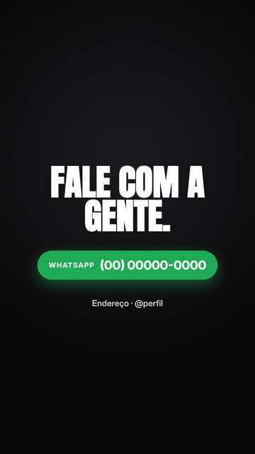 | **[cta-button-spring](patterns/cta-button-spring/)**<br>CTA: título por letra + botão com mola e respiração | pronto | cta | `cta` `button_label` `button_value` `meta` `t_pulse` `primary` `secondary` | Fechamento com um único canal de contato confirmado. | clients/wjr-informatica-games/video-01/index.html |
| 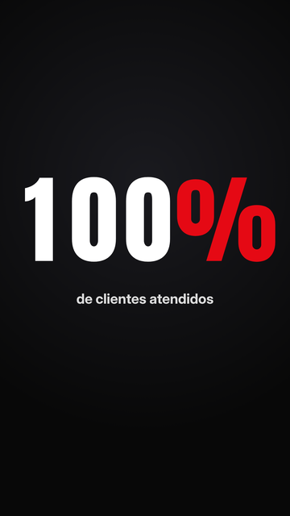 | **[odometer-digit-roll](patterns/odometer-digit-roll/)**<br>Número em odômetro (dígitos rolando) | pronto | dados | `value` `label` `primary` `secondary` | Uma métrica real e confirmada do cliente (anos de mercado, nº de atendimentos). Nunca inventar número. | [video-shotcraft](https://github.com/Vincentwei1021/video-shotcraft/blob/main/references/shots/data/odometer-digit-roll.md) |
| 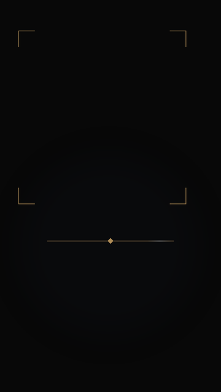 | **[line-accent](patterns/line-accent/)**<br>Ornamento de linhas finas (sóbrio) | pronto | decoração | `color` `ink` `y` `width` `corners` `top` `bottom` `glow` `t_in` `dur` `bpm` `seed` | Cena institucional que precisa de movimento discreto sob/ao redor do texto palavra a palavra (tom sóbrio: advocacia; elegante: estética). Troca o mascote/confete dos templates festivos. | [interno](https://github.com/echris6/motion-video-kit/blob/main/business-motion-film/references/motion-grammar.md) |
| 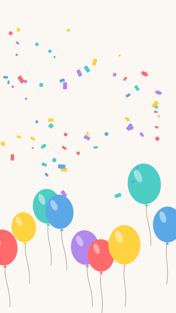 | **[balloons-confetti](patterns/balloons-confetti/)**<br>Balões subindo + explosão de confete | pronto | fundo | `colors` `count` `rise_s` `t_burst` `burst_x` `burst_y` `confetti` `ink` `bg` `seed` | Abertura/fechamento festivo; datas comemorativas. Camada transparente (bg: transparent) sobre qualquer cena. | [interno](https://github.com/echris6/motion-video-kit/blob/main/business-motion-film/references/motion-grammar.md) |
| 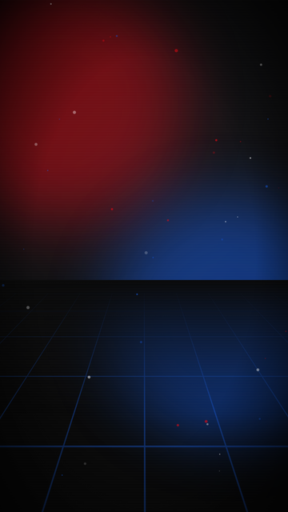 | **[bg-grid-glow-particles](patterns/bg-grid-glow-particles/)**<br>Fundo: grade em perspectiva + glows + partículas | pronto | fundo | `seed` `particles` `primary` `secondary` | Fundo de vídeo inteiro para marcas tech/games; troque as cores para outros setores. | clients/wjr-informatica-games/video-01/index.html |
| 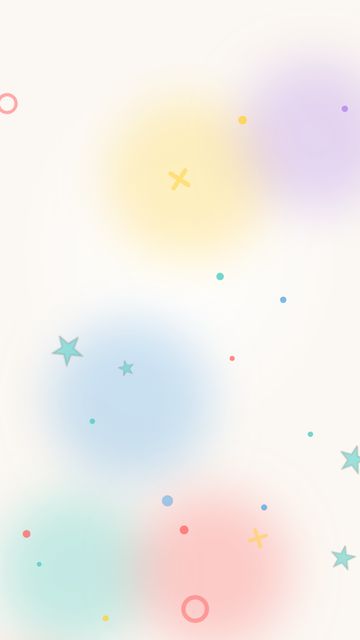 | **[bg-parallax](patterns/bg-parallax/)**<br>Fundo em movimento (parallax de formas + zoom contínuo) | pronto | fundo | `colors` `base` `ink` `dur` `speed` `zoom` `bpm` `shapes` `dots` `seed` | Fundo de vídeo inteiro que nunca pode ficar parado (Reels rápidos, festivos, infantis). Host na trilha 0 com a duração total. | [interno](https://github.com/echris6/motion-video-kit/blob/main/business-motion-film/references/motion-grammar.md) |
| 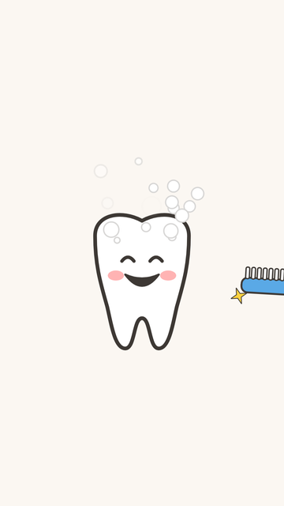 | **[toothbrush-sparkle](patterns/toothbrush-sparkle/)**<br>Escovinha + espuma + brilho | pronto | ilustração | `x` `y` `scale` `t0` `strokes` `handle` `ink` `sparkle` `cheek` `dur` `bpm` `bg` `seed` | Dica leve de higiene/escovação (sem promessa clínica), odontopediatria, campanhas infantis. | [interno](https://github.com/echris6/motion-video-kit/blob/main/business-motion-film/references/motion-grammar.md) |
| 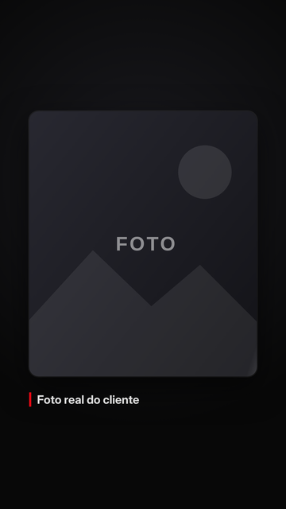 | **[card-3d-pushin-sweep](patterns/card-3d-pushin-sweep/)**<br>Card 3D com push-in + light sweep | pronto | imagem | `image` `caption` `primary` `secondary` | Mostrar foto real do cliente (loja, produto, antes/depois) com cara de produto premium. | clients/wjr-informatica-games/video-01/index.html |
| 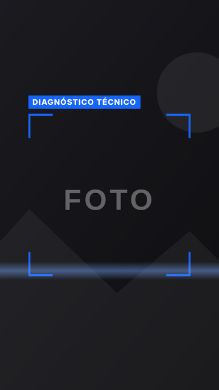 | **[hud-scan-photo](patterns/hud-scan-photo/)**<br>HUD de mira + barra de scan + parallax de foto | pronto | imagem | `image` `label` `primary` `secondary` | Serviços técnicos (assistência, clínica, oficina, TI): 'a gente analisa'. | clients/wjr-informatica-games/video-01/index.html |
|  | **[caption-word-highlight](patterns/caption-word-highlight/)**<br>Legenda palavra a palavra sincronizada com a voz | pronto | legenda | `words` `chunk` `primary` `secondary` | Reels com narração: legenda queimada sincronizada com os timestamps da voz (Gemini/ElevenLabs/local). | [artigo](https://openclawdatabase.com/news/videos/2026-09-25-opus-55-hyperframes-video-editing-workflow/) |
| 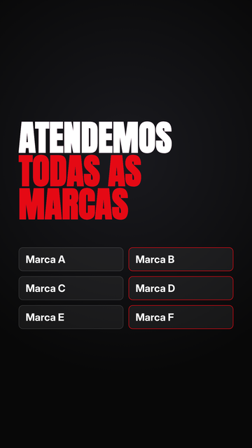 | **[cliptitle-chip-cascade](patterns/cliptitle-chip-cascade/)**<br>Título por clip-path + cascata de chips | pronto | lista | `title1` `title2` `chips` `primary` `secondary` | Mostrar variedade (marcas, modelos, categorias, bairros atendidos). | clients/wjr-informatica-games/video-01/index.html |
| 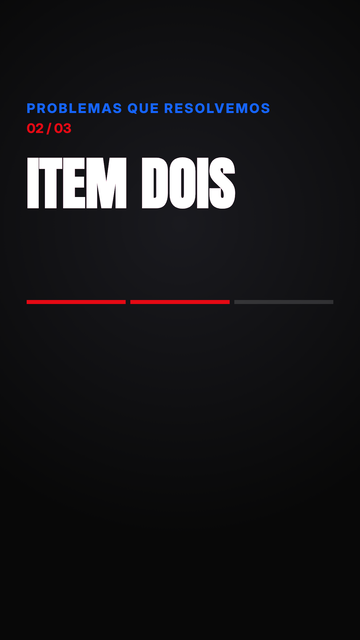 | **[item-relay-counter](patterns/item-relay-counter/)**<br>Revezamento de itens com contador + barra segmentada | pronto | lista | `kicker` `items` `times` `primary` `secondary` | Lista de 2–5 dores/serviços, cada um entrando na palavra falada. | clients/wjr-informatica-games/video-01/index.html |
| 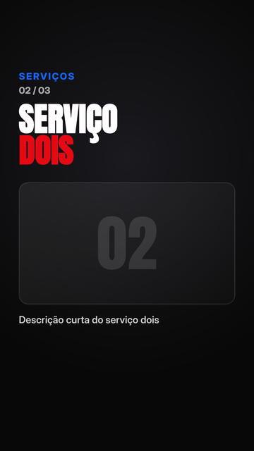 | **[service-panels-slide](patterns/service-panels-slide/)**<br>Painéis de serviço deslizando no beat + contador | pronto | lista | `kicker` `titles` `captions` `times` `primary` `secondary` | 2–4 serviços principais, um por beat, com legenda curta. | clients/wjr-informatica-games/video-01/index.html |
|  | **[brand-lockup-soft](patterns/brand-lockup-soft/)**<br>Assinatura suave da marca (anel + nome + @) | pronto | logo | `name` `sub` `tagline` `handle` `city` `logo` `logo_round` `logo_size` `logo_bg` `ink` `accent` `colors` `dur` `bpm` `bg` `tag_font` `dots` `tag_y` `chip_y` `seed` | Encerramento de marcas acolhedoras/saúde (tom calmo). Use o logo real quando houver arquivo em boa resolução; senão, só texto. | [interno](https://github.com/echris6/motion-video-kit/blob/main/business-motion-film/references/motion-grammar.md) |
| 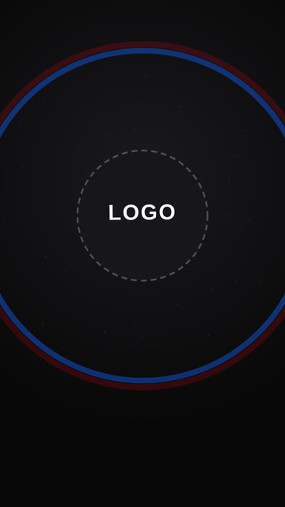 | **[logo-drop-shockwave](patterns/logo-drop-shockwave/)**<br>Drop de logo: elastic + ondas de choque + partículas | pronto | marca | `logo` `particles` `seed` `primary` `secondary` | Entrada do logo no drop da música, antes do CTA. | clients/wjr-informatica-games/video-01/index.html |
| 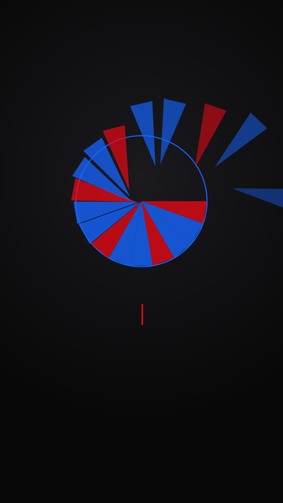 | **[logo-wireframe-shards](patterns/logo-wireframe-shards/)**<br>Logo: wireframe → estilhaços que montam → nome digitado | pronto | marca | `logo` `name` `seed` `primary` `secondary` | Abertura ou assinatura de marca para qualquer setor (sem energia de 'glitch'). | [awesome-opus5-5-videos](https://x.com/Mounnna/status/2103802871934497266) |
| 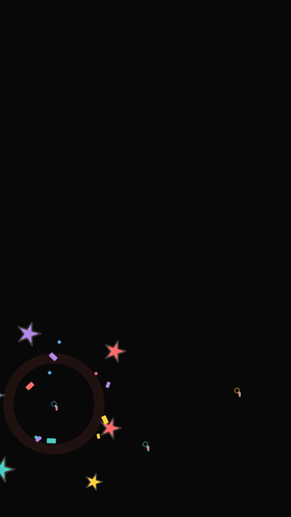 | **[beat-burst](patterns/beat-burst/)**<br>Estrelas + confete explodindo nas batidas | pronto | partículas | `bpm` `beat0` `every` `count` `points` `colors` `ink` `stars` `confetti` `size` `dur` `seed` | Impactos visuais sincronizados com a trilha (a cada 1-2 batidas) longe do texto: cantos e parte de baixo no 9:16. | [interno](https://github.com/echris6/motion-video-kit/blob/main/business-motion-film/references/motion-grammar.md) |
| 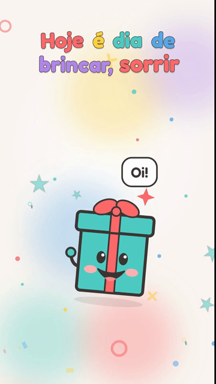 | **[icon-mascot](patterns/icon-mascot/)**<br>Mascote-ícone sorridente (SVG), qualquer setor | pronto | personagem | `icon` `x` `y` `scale` `body` `ink` `cheek` `accent` `enter` `t_in` `wave_t` `label` `dur` `bpm` `beat0` `bg` `seed` | Campanhas sazonais infantis (Dia das Crianças) em qualquer setor: o ícone representa o setor (brinquedos=gift, games=controller, escola=book, buffet=cake, moda infantil=shirt, saúde=heart). Não é o logo do cliente. | Generalização de tooth-character |
|  | **[tooth-character](patterns/tooth-character/)**<br>Personagem dente sorridente (SVG) | pronto | personagem | `x` `y` `scale` `body` `ink` `cheek` `accent` `t_in` `wave_t` `label` `dur` `bpm` `beat0` `bg` `seed` | Odontologia/saúde com público infantil: saudação, dica de escovação, datas comemorativas. Não é o logo do cliente. | [interno](https://github.com/echris6/motion-video-kit/blob/main/business-motion-film/references/motion-grammar.md) |
| 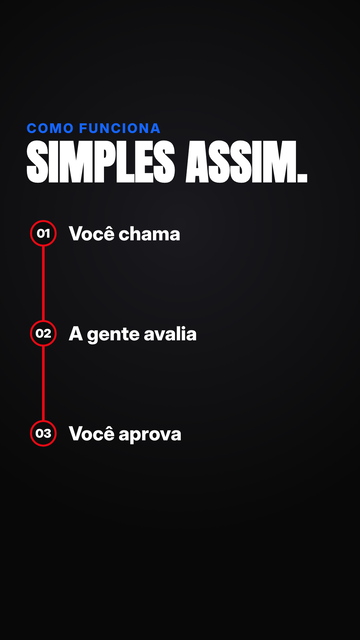 | **[process-timeline](patterns/process-timeline/)**<br>Linha do tempo de processo (trilho + passos) | pronto | processo | `kicker` `title` `steps` `primary` `secondary` | Explicar o atendimento em 3–4 passos (reduz objeção antes do CTA). | clients/wjr-informatica-games/video-01/index.html |
| 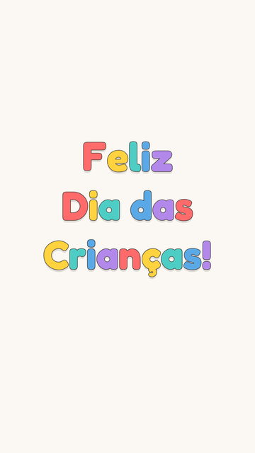 | **[kinetic-bounce-title](patterns/kinetic-bounce-title/)**<br>Título com letras quicando (infantil) | pronto | tipografia | `line1` `line2` `line3` `colors` `ink` `size` `y` `t0` `stagger` `exit` `dur` `bg` `seed` | Saudação festiva/infantil (Dia das Crianças, aniversário, datas comemorativas) em marcas acolhedoras. | [interno](https://github.com/echris6/motion-video-kit/blob/main/business-motion-film/references/motion-grammar.md) |
| 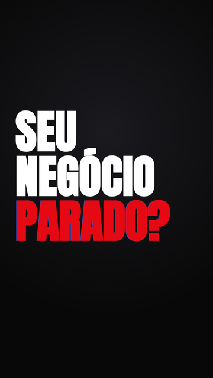 | **[kinetic-letters-punch](patterns/kinetic-letters-punch/)**<br>Tipografia cinética por letra + punch RGB | pronto | tipografia | `line1` `line2` `line3` `t3` `primary` `secondary` | Gancho dos primeiros 1–2 s; pergunta curta de dor do cliente. | clients/wjr-informatica-games/video-01/index.html |
|  | **[kinetic-words](patterns/kinetic-words/)**<br>Tipografia cinética palavra a palavra (sincronizada com a fala) | pronto | tipografia | `lines` `times` `colors` `ink` `size` `y` `maxw` `exit` `dur` `mode` `font` `seed` | Frase da locução na tela, palavra por palavra (Reels/Shorts). Use times: '{{words:<fala>}}' (tempos reais do WAV no timing.lock.json). | [interno](https://github.com/echris6/motion-video-kit/blob/main/business-motion-film/references/motion-grammar.md) |
| 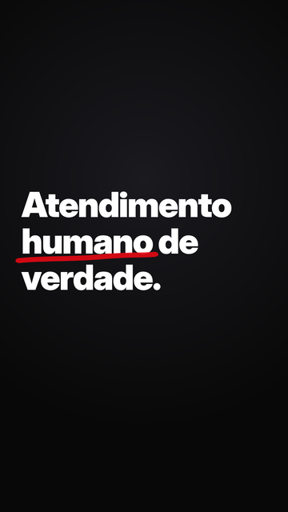 | **[marker-underline-title](patterns/marker-underline-title/)**<br>Título com sublinhado de marca-texto | pronto | tipografia | `before` `keyword` `after` `primary` `secondary` | Tom humano/acolhedor (saúde, beleza, alimentação) — alternativa suave ao split RGB. | [video-shotcraft](https://github.com/Vincentwei1021/video-shotcraft/blob/main/references/shots/typography/marker-underline-title.md) |
| 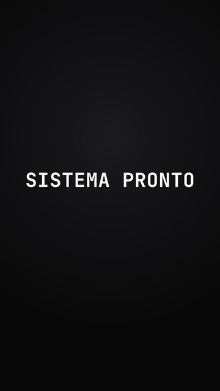 | **[scramble-text](patterns/scramble-text/)**<br>Texto que decodifica (scramble com semente) | pronto | tipografia | `text` `seed` `primary` `secondary` | SaaS/TI/tech: revelar nome de produto, versão ou 'pronto'. | [video-shotcraft](https://github.com/Vincentwei1021/video-shotcraft/blob/main/references/shots/typography/scramble.md) |
| 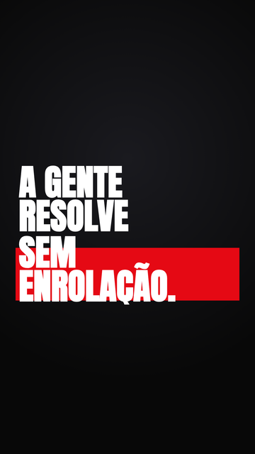 | **[word-mask-highlight](patterns/word-mask-highlight/)**<br>Revelação por máscara de palavras + faixa destacada | pronto | tipografia | `text` `highlight` `t_hl` `primary` `secondary` | Promessa/benefício em uma frase, com o trecho-chave destacado quando é falado. | clients/wjr-informatica-games/video-01/index.html |
| 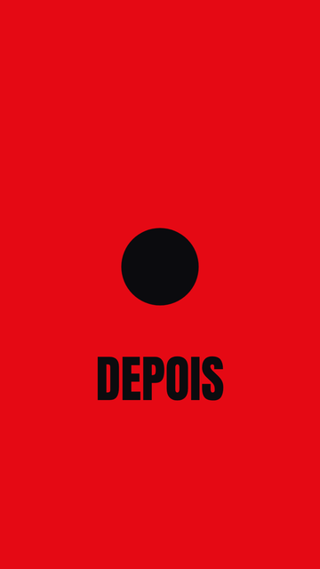 | **[circle-iris-transition](patterns/circle-iris-transition/)**<br>Transição íris circular (match cut) | pronto | transição | `label_a` `label_b` `cx` `cy` `primary` `secondary` | Antes/depois ou troca de tema com elemento redondo (logo, foto de perfil, prato, relógio). | [video-shotcraft](https://github.com/Vincentwei1021/video-shotcraft/blob/main/references/shots/transition/circle-match-iris.md) |
|  | **[fx-transition](patterns/fx-transition/)**<br>Transição rápida 6-10 frames (whip, zoom punch, flash, formas, glitch) | pronto | transição | `kind` `at` `frames` `fps` `dir` `colors` `flash` `flash_max` `seed` | Cortes rápidos e dopaminérgicos (Reels/Shorts); host curto centrado no corte, com SFX whoosh/pop/sparkle no mesmo instante. | [interno](https://github.com/echris6/motion-video-kit/blob/main/business-motion-film/references/motion-grammar.md) |
| 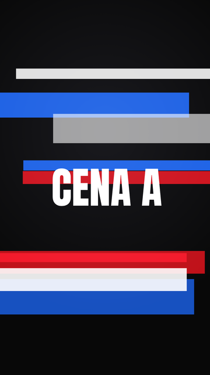 | **[transition-glitch-rgb](patterns/transition-glitch-rgb/)**<br>Transição glitch (fatias RGB + flash + tranco) | pronto | transição | `label_a` `label_b` `seed` `strong` `primary` `secondary` | Troca de cena energética (games, tech, varejo jovem). Evite em saúde/imobiliário. | clients/wjr-informatica-games/video-01/index.html |
| 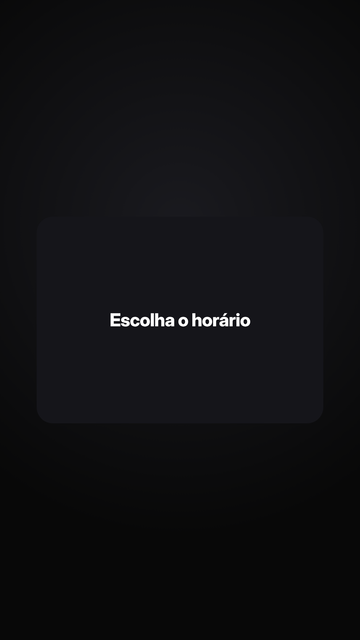 | **[one-shape-morph](patterns/one-shape-morph/)**<br>Uma forma, sem corte (morph de estados de UI) | pronto | ui | `states` `times` `primary` `secondary` | Mostrar um fluxo de app/agendamento/compra em 3 estados sem cortes. | [awesome-opus5-5-videos](https://x.com/twoclipping/status/2103273003555402193) |
|  | **[retime-piecewise](patterns/retime-piecewise/)**<br>RETIME: coreografia em grade base remapeada para os cortes reais | lib | tempo | — | Sempre que a duração real das falas (TTS) mudar os cortes. | clients/wjr-informatica-games/video-01/index.html |
|  | **[reactive-icon-controller](patterns/reactive-icon-controller/)**<br>Ícone que reage à fala (controle SVG) | inline | ilustração | — | Dar vida ao objeto central do negócio enquanto a lista de problemas passa. | clients/wjr-informatica-games/video-01/index.html |
|  | **[service-illustrations-wjr](patterns/service-illustrations-wjr/)**<br>Ilustrações de serviço animadas (pincel+poeira, metal líquido, Hall Effect) | inline | ilustração | — | Explicar um serviço técnico específico com um desenho, sem foto. | clients/wjr-informatica-games/video-01/index.html |
|  | **[crash-zoom-punch](patterns/crash-zoom-punch/)**<br>Crash zoom (empurrão seco até o detalhe) | proposto | câmera | — | Chamar atenção para um detalhe (preço confirmado, selo, botão). | [video-shotcraft](https://github.com/Vincentwei1021/video-shotcraft/blob/main/references/shots/camera/crash-zoom-punch.md) |
|  | **[infinite-zoom-collage](patterns/infinite-zoom-collage/)**<br>Zoom infinito por colagem | proposto | câmera | — | Abertura criativa/institucional (turismo, história da marca). | [awesome-opus5-5-videos](https://x.com/koldo2k/status/2103129343253778767) |
|  | **[before-after-slider](patterns/before-after-slider/)**<br>Antes/depois com barra deslizante | proposto | dados | — | Beleza, estética, reforma, limpeza, reparo — só com fotos reais autorizadas. | [video-shotcraft](https://github.com/Vincentwei1021/video-shotcraft/blob/main/references/shots/data/before-after-slider-scrub.md) |
|  | **[counter-confetti](patterns/counter-confetti/)**<br>Contador com confete | proposto | dados | — | Marco real (aniversário da loja, nº de clientes) confirmado. | [video-shotcraft](https://github.com/Vincentwei1021/video-shotcraft/blob/main/references/shots/data/counter-confetti.md) |
|  | **[spotlight-sweep](patterns/spotlight-sweep/)**<br>Holofote revelando painéis no escuro | proposto | efeito | — | Marcas premium (imobiliário, estética) apresentando ambientes/produtos. | [video-shotcraft](https://github.com/Vincentwei1021/video-shotcraft/blob/main/references/shots/effects/spotlight-sweep-moves.md) |
|  | **[hook-3s-retention](patterns/hook-3s-retention/)**<br>Estrutura de gancho 3 s + retenção | proposto | estrutura | — | Todo reels curto; aplicar no roteiro antes da animação. | [x-bookmark](https://x.com/Sayajiiinz/status/2100336121137754476) |
|  | **[showreel-15s-techniques](patterns/showreel-15s-techniques/)**<br>Showreel 15 s (catálogo de técnicas) | proposto | estrutura | — | Vídeo-portfólio da própria Simplicio ou de agência. | [awesome-opus5-5-videos](https://x.com/reflex_cloud/status/2103552840027304046) |
|  | **[ugc-replicate-structure](patterns/ugc-replicate-structure/)**<br>Replicar estrutura de vídeo viral (UGC) | proposto | estrutura | — | Quando o cliente manda um vídeo de referência. | [x-bookmark](https://x.com/shengkunye/status/2100672978749096186) |
|  | **[recipe-ingredients-explainer](patterns/recipe-ingredients-explainer/)**<br>Receita/ingredientes entrando no recipiente | proposto | explicador | — | Alimentação/bebidas: mostrar como o produto é feito (só ingredientes confirmados). | [awesome-opus5-5-videos](https://x.com/Ror_Fly/status/2102853258582880547) |
|  | **[spending-simulation-9x16](patterns/spending-simulation-9x16/)**<br>Simulação de uso no dia a dia (9:16) | proposto | explicador | — | Varejo/serviços financeiros: produto em situações do dia a dia. | [awesome-opus5-5-videos](https://x.com/felipemoller/status/2103846311149936736) |
|  | **[carousel-emphasis](patterns/carousel-emphasis/)**<br>Carrossel com destaque | proposto | lista | — | Enumerar marcas, modelos, especialidades ou produtos sincronizado com a narração. | [motion-video-kit](https://github.com/echris6/motion-video-kit/blob/main/business-motion-film/references/motion-grammar.md) |
|  | **[logo-shrink-lockup](patterns/logo-shrink-lockup/)**<br>Logo encolhe e trava com o nome (lockup) | proposto | marca | — | Assinatura final de marca. | [video-shotcraft](https://github.com/Vincentwei1021/video-shotcraft/blob/main/references/shots/outro/logo-shrink-wordmark-lockup.md) |
|  | **[beat-cut-accelerate](patterns/beat-cut-accelerate/)**<br>Cortes secos no beat, acelerando | proposto | ritmo | — | Montagem de fotos/clipes reais antes do CTA. | [video-shotcraft](https://github.com/Vincentwei1021/video-shotcraft/blob/main/references/shots/rhythm/beat-cut-moves.md) |
|  | **[split-flap-title](patterns/split-flap-title/)**<br>Título em letreiro de aeroporto (split-flap) | proposto | tipografia | — | Datas de evento, inaugurações, contagem regressiva. | [video-shotcraft](https://github.com/Vincentwei1021/video-shotcraft/blob/main/references/shots/typography/split-flap-title.md) |
|  | **[card-flip-reveal](patterns/card-flip-reveal/)**<br>Card 3D que vira e revela resultado | proposto | transição | — | SaaS/serviços: 'o que fazemos → o que você ganha'. | [video-shotcraft](https://github.com/Vincentwei1021/video-shotcraft/blob/main/references/shots/transition/card-flip-reveal.md) |
|  | **[foreground-fly-through](patterns/foreground-fly-through/)**<br>Fly-through do primeiro plano (o título vira a transição) | proposto | transição | — | Troca de cena depois de uma frase forte (gancho → promessa, promessa → serviços). | [motion-video-kit](https://github.com/echris6/motion-video-kit/blob/main/business-motion-film/references/motion-grammar.md) |
|  | **[logo-portal](patterns/logo-portal/)**<br>Logo-portal (o furo da marca vira o próximo quadro) | proposto | transição | — | Abertura ou virada para o CTA quando o logo tem uma forma vazada utilizável. | [motion-video-kit](https://github.com/echris6/motion-video-kit/blob/main/business-motion-film/references/motion-grammar.md) |
|  | **[selection-expansion](patterns/selection-expansion/)**<br>Seleção → expansão | proposto | transição | — | Lista de serviços → detalhe de um serviço; catálogo → produto. | [motion-video-kit](https://github.com/echris6/motion-video-kit/blob/main/business-motion-film/references/motion-grammar.md) |
|  | **[materializing-result](patterns/materializing-result/)**<br>Resultado que se materializa | proposto | ui | — | Diagnóstico → laudo, pedido → orçamento aprovado, formulário → confirmação. | [motion-video-kit](https://github.com/echris6/motion-video-kit/blob/main/business-motion-film/references/motion-grammar.md) |
<!-- catalog:end -->
